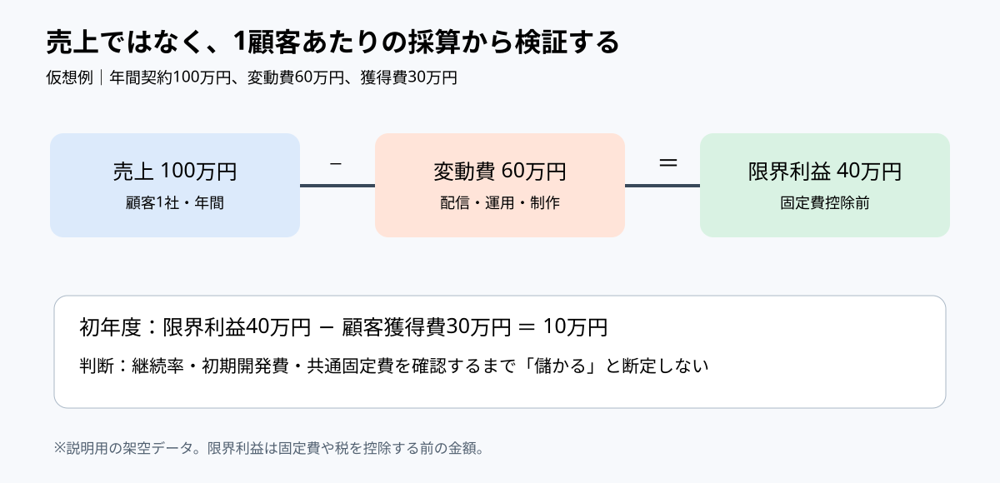

# 市場規模より先に採算の分岐を描く｜スポーツ映像サービスの単位経済

**2026-11-03 21:00 JST｜学習ID 2026-11-03/2100｜コンサル実務応用｜3〜5分**

## 今日の結論

**今日の技：TAM（獲得可能な市場全体の規模）を描く前に、1顧客を獲得・提供する際の採算を図にする。** 市場が大きいことと、1社増えるほど利益が積み上がることは別問題。経営層には「何を検証すれば拡大投資を判断できるか」を示す。

## 守｜市場規模と単位経済を混同しない

**単位経済（ユニットエコノミクス）**とは、顧客1社や1契約といった単位で売上と費用を確かめる考え方。**限界利益**は売上から、その契約に応じて増える変動費を引いた額。固定費や税金を引いた最終利益とは異なる。動画分析サービスでは、カメラ設置・映像処理・人的サポートのどれが契約ごとに増えるかを分ける必要がある。

**図の読み方：**売上100万円から変動費60万円を引き、限界利益40万円を求める。さらに初年度獲得費30万円を別段で引く。固定費は未控除。

## 破｜4手順で採算の判断図を作る

1. **単位を決める。**「クラブ1社・年間1契約」と定義し、月額契約と混ぜない。
2. **売上と変動費を並べる。** 仮想例：年間売上100万円、配信・制作・運用の変動費60万円。限界利益は40万円。
3. **獲得費を別段に置く。** 初年度の顧客獲得費30万円なら、初年度の限界利益から獲得費を差し引いた額は10万円。ただし固定費控除前。
4. **意思決定の条件を添える。** 継続率、追加開発費、共通固定費、設備更新費を検証してから拡大を判断する。費用が契約数と比例しない場合は段階別シナリオに切り替える。

## Before→After｜スポーツ映像サービスの事業機会

**Before：**「国内スポーツ市場は大きく、映像分析の成長余地がある」。市場規模だけでは事業採算を説明できない。**After：**「仮想の1社契約では売上100万円−変動費60万円＝限界利益40万円。初年度獲得費30万円を差し引くと10万円。継続率と共通固定費の検証が次の判断条件」。タイトルは**「拡販前に顧客単位の採算と継続率を検証する」**。PPTでは上部20％に結論、中央55％に売上→変動費→限界利益の横3箱、下部25％に獲得費と検証条件を置く。

## 離｜売り方が変わると費用の形も変わる

クラブ向け年額契約と、イベント単位の映像制作では費用構造が違う。前者は継続率と導入負荷、後者は案件ごとの制作人日と稼働率が重要。映像認識AIが進化して処理単価が下がっても、顧客ごとの運用調整が増えれば採算は改善しない。**技術の自動化率ではなく、追加契約時の総変動費を測る**という視点が必要。

## 失敗例｜粗利と利益を混同する

**失敗：**限界利益40万円を「利益40万円」と書く。開発費や共通人件費が抜け、黒字を誤認させる。**回避：**「固定費控除前」「架空データ」の注記を図中に置き、必要なら固定費回収に必要な契約数を別紙で示す。

## 60秒課題｜初年度の貢献額を計算する

**課題：**売上120万円、変動費75万円、初年度獲得費35万円の契約を想定。初年度の限界利益から獲得費を引いた額は？ **答え：10万円。** 判断基準は、120−75−35を正しく計算し、最終利益と呼ばないこと。

## 参考資料・Simple English

参考：[SlideLand｜図解の分類](https://www.slideland.tech/)／[Microsoft公式｜PowerPointのグラフ作成](https://support.microsoft.com/en-us/powerpoint/training/use-charts-and-graphs-in-your-presentation)。PowerPointでは［挿入］→［グラフ］から編集でき、頻繁に変わるデータはExcelとのリンクを検討する。図の数値はすべて架空であり、実在企業の売上・収益性を示さない。

**Simple English：A big market does not guarantee good unit economics.** ／ **日本語：市場が大きくても、顧客単位の採算が良いとは限らない。**