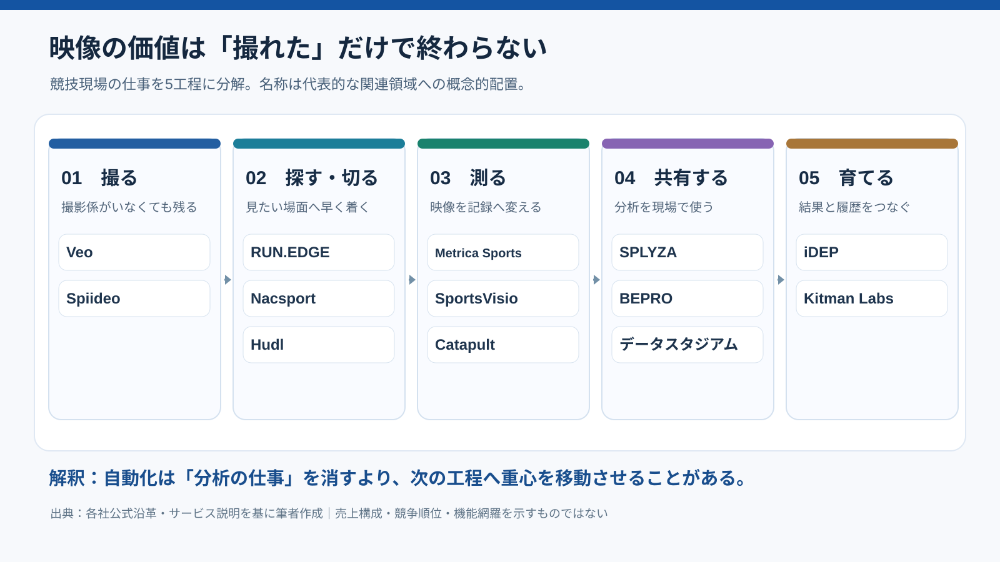
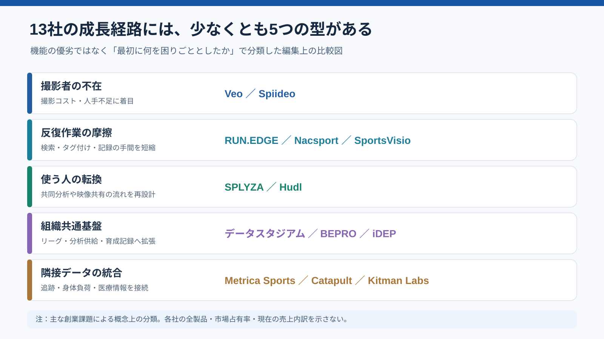

# 息子のゴールからリーグ共通基盤へ――スポーツ映像分析13社は何を売り始めたのか

*調査・執筆：2026年11月3日。一次資料と創業者証言を照合。事実・解釈・予測・提案を区別する。*

## 「息子のゴールを見逃した」が、なぜスポーツ産業の話になるのか

少年サッカーの試合に遅れて到着した父親が、息子のゴールを見逃す。「なぜ、どの試合も録画されていないのか」。2015年の秋、デンマークのVeo共同創業者ケルド・ライニッケが抱いた疑問として、同社はこの話を公式に紹介している。映像分析の起業秘話としては、驚くほど分析していない。出発点は、データでも戦術でもなく、親が見たかった一場面だった。[Veo公式沿革](https://www.veo.com/about-us)

ところが、この小さな欠落の反対側には大きな市場があった。プロなら撮影できる、アマチュアでは撮影者も費用も足りない。別の企業は「膨大な試合映像から目的の一球を探せない」、また別の企業は「記録した選手情報が医療担当と監督の間でつながらない」と感じていた。同じ『スポーツ映像分析』の棚に並ぶ13サービスを調べると、そもそも困っていた瞬間がまるで違う。

本稿が検証する問いは、**技術は何ができるか**ではなく、**誰の仕事から何を取り除き、誰の判断を変え、どの顧客へ広がったか**である。事実は企業・団体の一次資料を優先し、創業者の回想は本人の説明として扱う。そこからの因果の整理は「解釈」、今後の展開は「仮説」、実務での使い方は「提案」と明示する。2026年11月3日現在の調査であり、当時の数字を現在の実績と混ぜない。

## 守｜13社を一つの市場と見る前に、何を売っているかを分ける

カメラで試合を記録するVeoやSpiideo、映像の検索・分割・共有を支えるRUN.EDGEやHudl、映像から座標やスタッツを抽出するMetrica SportsやSportsVisio、記録を指導に変えるSPLYZAやNacsport。データスタジアムとBEPROは分析情報や運用を含み、Catapultは身体負荷計測から映像へ統合した。iDEPとKitman Labsは育成・コンディションの継続記録が軸である。これらを『どのAIが賢いか』だけで比較すると、商売の土台を見失う。

図にすると、現場の仕事は「撮る→探す・切る→測る→意味を解釈する→共有する→次の練習や選考を決める」と続く。製品はこの鎖の一部分を短くすることも、隣り合う工程をまとめることもできる。ただし各社が全工程を一貫して提供するとまでは言えない。**市場の区分は機能一覧より、どの工程で顧客が対価を払うかによって決めるべきだ**というのが本稿の最初の解釈である。

## 図解｜スポーツ映像の価値は、撮影から意思決定へ少しずつ移る



*筆者作成の概念図。配置は分析上の分類であり、各企業の機能を網羅した製品比較表や公式な市場分類ではない。*

## 1｜SPLYZA：売れなかったアプリは、選手に仕事を返してから変わった

**事実。**静岡県浜松市のSPLYZAは2011年創業。創業者の土井寛之はウインドサーフィンに夢中になり、アマチュア選手にもITを使って上達する手段が必要だと考えた。2014年1月に個人向けの「Spoch」を出したが、大学などに大量に売り込んでも登録はわずか2ユーザー。創業メンバーが自分たちの欲しい機能を追加し続けたことも、開発を長引かせた要因として本人たちが振り返っている。[SPLYZA創業ストーリー](https://www.splyza.com/founding/)

**転機。**残像動画アプリ「Clipstro」などを経て、Spochをチーム向けに改造した「SPLYZA Teams」を2016年10月に公開。約150チームが試用したのに、2017年の正式リリース時に有料化したのは5チームだった。同社は最初の顧客の多かった高校サッカーに絞り、指導者から「自分の仕事が増える」と指摘される。そこで選手が映像のタグ付けや分析を分担できる共同作業へ設計を変えた。[同社公式沿革](https://www.splyza.com/founding/)

**解釈。**最初は『高度な映像分析』を売ろうとし、実際に強くなったのは『分析の担当者を監督一人から選手たちへ変える』機能だった。顧客に機能を追加することと、顧客の仕事を減らすことは別である。現行の公式案内も、選手が課題発見と解決を行うことを訴求する。技術的にはタグ・共有・描画だが、経営上の価値は**分析する人の配置転換**にある。[現行製品説明](https://products.splyza.com/teams/)

## 写真｜試合映像は、観察を共有する道具にもなる


*製品写真：SPLYZA公式[動画共有機能の紹介](https://products.splyza.com/teams/function/share.html)。製品の操作例を示す写真であり、導入効果を実証する画像ではない。*

## 2｜RUN.EDGE：一球を探す時間が、富士通からの独立までつながった

**事実。**小口淳は2014年、富士通社内でスポーツ事業の検討を始めた。狙ったのは、プロ野球で映像を探して再生するたびに生じる待ち時間。2015年夏に球団スタッフへ試作版を見せた際、機能は未完成ながら高速再生の体験に驚かれたと本人は語る。2016年に「PITCHBASE」を国内プロ野球に導入し、2018年6月にRUN.EDGEとして独立した。[JSPIN・小口氏インタビュー](https://jspin.mext.go.jp/column/runedge-1/)／[会社沿革](https://speakerdeck.com/runedge/20221014-run-dot-edge-hui-she-shao-jie-zi-liao-4426feb2-3a7f-4674-af69-afe7e11199ff)

**転機。**シーンへ素早く飛べる技術を、野球の投球からサッカーのプレーへ転用した。FL-UX Footballは2020年にプロ向け提供を始め、その年に一般クラブ向け販売も開始。FL-UX Basketballは2021年12月に販売開始された。「2014年にFL-UXが生まれた」と書くと、社内検討と製品発売が混ざるので注意したい。[FL-UX Football](https://prtimes.jp/main/html/rd/p/000000005.000053881.html)／[FL-UX Basketball](https://prtimes.jp/main/html/rd/p/000000011.000053881.html)

**解釈。**この会社が扱う資源は動画そのものより、**見たい瞬間へ到達するまでの人間の時間**である。映像が増えるほど探す時間が増えるなら、データ量の増加は顧客の利益と一致しない。高速シーン再生という一点を先に解くことで、競技を横断できる基礎技術になった。撮影の民主化とは別の、『検索の摩擦を減らす』事業だ。

## 3｜Veo：父親の取り逃しから、選手単位のデータへ

**事実。**Veoは2015年、共同創業者ケルドが息子のゴールを見逃した経験を起点に構想された。2018年にカメラシステムを発売し、人手をかけにくい育成年代や地域クラブにも自動撮影を届けた。プロクラブでも使われるが、2021年の報道では顧客の大半が草の根・学生などだった。会社が物語る発端は一人の親の残念さであり、商品の設計課題は撮影係の不足だった。[Veo公式](https://www.veo.com/about-us)／[Sports Business Journal](https://www.sportsbusinessjournal.com/Daily/Issues/2021/01/07/Technology/automated-sports-camera-startup-veo-raises-24-million/)

**転機。**録画後の映像からプレーを探す、試合全体を確認する、選手の動きを把握する方向へ拡張した。公式ヘルプによると、Analytics 1は2021年以降、試合のイベントや統計を段階的に追加。2026年8月以降のAnalytics 2では、それまでのチーム単位に加えて個々の選手に関するデータを提供する。ただし古い映像に後から新指標を付け直す仕様ではない。[Veo公式・Analyticsの版別機能](https://support.veo.com/hc/en-us/articles/49953564466321-What-you-get-with-each-version-of-Veo-Analytics)

**解釈。**『撮れなかった試合を残す』段階から、『残した映像の中に何が起きたかを見つける』段階へ。安価な撮影の普及は、新たに膨大な映像を生む。すると次の顧客課題は撮影ではなく、見返す時間に移る。録画サービスが自ら次の不便を生み出すのは、少し皮肉である。映像は増えるが、人間の休日は増えない。

## 写真｜カメラが現場の人手を減らすという発想


*製品写真：サッカーショップKAMOの[Veo製品紹介](https://img.sskamo.co.jp/veo/)。商品の外観を示す資料。初期型の形状・当時の導入台数を示すものではない。*

## 4｜Metrica Sports：マウスの動きと選手の動きは、座標なら同じ構造になる

**事実。**Metrica Sportsの構想は2012年ごろ、試合中の走行距離やヒートマップが放送に出始めたころに形になった。2014年創業。共同創業者のルベン・サアベドラは博士課程でマウスなどの動きを、別の創業者は眼球などの動きを扱っていた。何が動くかより、時間と座標をどう記録するかが共通する。スポーツ企業らしからぬ出身分野だが、位置追跡の数理には筋が通る。[バルサ・イノベーションハブの創業者インタビュー](https://barcainnovationhub.fcbarcelona.com/blog/ruben-saavedra-at-metrica-sports-we-want-any-club-even-without-a-data-scientist-to-be-able-to-use-elite-tools/)

**転機。**最初はクラブ向けのデータ分析コンサルティングを構想したが、当時はデータの利用環境が整っていなかった。そこで現場が長時間を費やす映像編集の自動化に絞る。後に、特定の高価な撮影設備に依存しない追跡技術と、指導者向けのPlayBase、Nexusなどへ広げた。2025年にはFCバルセロナのイノベーション事業が出資を発表した。[創業者インタビュー](https://barcainnovationhub.fcbarcelona.com/blog/ruben-saavedra-at-metrica-sports-we-want-any-club-even-without-a-data-scientist-to-be-able-to-use-elite-tools/)／[FCバルセロナ発表](https://www.fcbarcelona.com/en/news/4234548/bihub-invests-in-metrica-sports-to-democratise-tactical-analysis-in-football)

**解釈。**技術の種は『スポーツに詳しいこと』ではなく、異分野で学んだ**時系列座標の扱い方**だった。しかし商売になるきっかけは技術の美しさではなく、コーチの映像編集が遅いという不便の発見である。研究の移植と顧客課題の発見が重なったとき、応用技術が製品になる。

## 5｜データスタジアム：電子スコアブックからリーグ共通インフラへ

**事実。**データスタジアム設立は2001年。その前段には、1990年代のプロ野球で過去の投球や打撃を調べるため、紙のスコアブックから探す手間を減らしたいという需要があった。前身のアソボウズが電子スコアブック型の分析を手がけ、事業譲渡を経てデータスタジアムが設立されたと、創業期の関係者は説明している。企業の設立年と技術の出発年は一致しない。[吉田秀雄記念事業財団・インタビュー](https://www.yhmf.jp/as/postnumber/vol_79_04.html)／[東洋経済・関係者証言](https://toyokeizai.net/articles/-/424390?display=b)

**転機。**野球の記録・映像連携を基盤として、サッカーでは「Football Analyzer」などデータとシーンを結ぶ製品を提供。2025年4月16日には、Football BOXをJ1・J2・J3全60クラブへ2025シーズンから導入すると発表した。これは**Jリーグが一括導入を決めた**事例で、60クラブがそれぞれ独立して購買判断したという意味ではない。[Football Analyzer公式](https://datastadium.co.jp/service-detail/D-Xo9wsU)／[60クラブ導入の公式発表](https://datastadium.co.jp/news/F8T3mndd)

**解釈。**一クラブの記録作業を減らす道具が、リーグ全体で利用条件を揃える共通基盤へ変わると、販売先は『監督』だけではなく『競技団体・リーグ』になる。個別の導入数と中央調達による配布数を同じ営業KPIに混ぜるべきではない。顧客の組織階層が上がることで、調達・データ仕様・人材育成も製品価値の一部になる。

## 6｜BEPRO：AIだけでなく、人間の分析班を会社に取り込んだ

**事実。**BEPROは2015年、選手の映像とデータを結び、選手のプロフィールを共有できる世界を構想してスタートした。2016年には韓国Kリーグの育成年代に関する契約を獲得。2017年に初期メンバーがドイツのハンブルクへ移ったと採用ページで説明している。『韓国で育った分析手法を欧州へ持ち込む』という国際展開の経路が確認できる。[BEPRO採用資料](https://bepro.notion.site/Bepro-Open-Positions-Job-Description-ad3e178e823e4f4a81d792bb0a755ea2)

**転機。**BEPRO自身の2020年の説明によれば、創業時からデータ会社H-Sportsと協力し、2019年に同社を買収。買収時の8人に5人を加え、常勤13人の分析チームを構成した。その後はフリーランス分析者や研修拠点を増やしている。映像AIの企業は『人を減らして全部自動化する』と想像しがちだが、現実には人の分析作業を組織化・品質管理する投資もしていた。[BEPRO公式解説](https://bepro11.medium.com/behind-the-scenes-of-bepros-analysis-process-16eb669f924)

**解釈。**機械が映像から何かを推定できることと、クラブが同じ品質の分析を安定して受け取れることは異なる。人手を含む業務設計、データの揃え方、納品の品質保証を組み合わせた可能性がある。ただし現在の自動化率や収益構成は確認できない。**AI企業だから必ず人員が少ない**という短絡は、この事例の前では弱い。

## 7｜Spiideo：走高跳選手が自撮りできない問題は、スタジアムの無人撮影につながった

**事実。**2012年、Spiideo共同創業者の息子である走高跳選手が、練習を一人で撮りにくいと語ったことが開発のきっかけだったと、CEOのパトリック・オルソンは説明している。スマートフォンを置けば撮れるが、画角は動かない。誰かに撮ってもらえば解決するが、その誰かはいつもいるわけではない。装置を固定し、対象を自動で追って撮る着想が生まれた。[創業者インタビュー](https://techround.co.uk/interviews/interview-with-patrik-olsson-ceo-at-sports-video-recording-solution-spiideo/)

**転機。**マルメFFのコーチとの対話で、個人競技の自動追跡をサッカーなどの団体競技へ広げられると気づいたとする。走高跳の練習記録からチームの練習・試合記録、さらに複数競技の制作・配信・分析の基盤へと展開した。ここでも新規市場への転換を生んだのは、研究室での機能追加だけでなく、現場のコーチとの会話だった。[インタビュー](https://techround.co.uk/interviews/interview-with-patrik-olsson-ceo-at-sports-video-recording-solution-spiideo/)／[会社事業紹介](https://www.spiideo.com/)

**解釈。**Veoと同じ自動撮影でも、創業エピソードの初期使用場面が違う。Veoは『見逃した試合を残したい』、Spiideoは『一人では自分の動きを撮れない』。技術カテゴリが同じでも、**録画したい理由の違いが、個人練習・チーム・施設といった顧客展開の順番を変えうる**。これは創業史からの分析であって、現在の販売比率を示すものではない。

## 8｜Nacsport：豪華な分析席がなくても、映像を切って見返したかった

**事実。**Nacsportは、2000年代初頭にフィールドホッケーの試合分析向けに開発されたと公式ブログが説明する。競技映像の場面に印を付けて分析するソフトがまだ少ない時代だった。2008年から低価格でスポーツ映像分析ソフトの販売を始めたという日本公式窓口の説明も確認できる。『2008年に初めてホッケー向け開発を開始』ではなく、**早期の開発と商用販売を区別**するのが正確だ。[Nacsport公式・ホッケーの原点](https://www.nacsport.com/blog/en-gb/Users/case-study-spanish-hockey-federation)／[日本公式窓口](https://www.nacsport.jp/post/welcometo-nacsport)

**転機。**現行の製品ラインは、Basic、Scout、Pro、Elite、Hubなど、利用者の分析の深さに応じて幅を設ける。フィールドホッケー起点の道具が、より一般的な競技で利用されるようになった。これは自動撮影カメラの普及とは別の流れで、撮影された素材に意味を付ける『分析デスク』の価格と機能の選択肢を増やした。[Nacsport製品サイト](https://www.nacsport.com/)

**解釈。**機能を高機能化し続ける一方で、予算や作業習熟度の違う人がどこから使い始めるかも設計しなければならない。競技の裾野を広げるとは『最高機能を全員に配る』だけではない。買い始めるハードルと、使い続けるハードルを別々に下げるという価格・UXの問題でもある。

## 9｜Hudl：アメフト部の配布作業から、世界の映像基盤を買い集めた

**事実。**Hudlは2006年、米ネブラスカ大学の学生デイビッド・グラフ、ブライアン・カイザー、ジョン・ワーツが創業した。グラフは大学アメフト部の補助スタッフとして、紙のプレーブックや試合映像を配る作業の重さを目にしていた。最初に解こうとしたのは『相手チームの戦術をAIが全部読み解く』ではなく、コーチと選手が必要な資料を受け取れるようにすることだった。[Hudl公式・リーダー紹介](https://identify.hudl.com/about/leadership)

**転機。**高校・大学の映像共有から多競技へ広げた後、2015年にオーストラリアのSportstec買収を発表し、同年7月に完了を公表した。Sportstecの持つ高度な試合映像分析の顧客・技術が加わり、後のSportscodeなどの専門領域につながる。共有の広い基盤を先につくり、必要な高度機能は買収でも補った経路である。[Hudlの買収発表](https://www.hudl.com/blog/hudl-continues-global-growth-with-bid-to-acquire-sportstec)／[買収完了報告](https://www.prnewswire.com/news-releases/hudls-acquisition-of-sportstec-approved-300111984.html)

**解釈。**『誰が、誰に、どの映像を渡すか』という運用の入口を持つと、精密な分析機能はその上へ載せられる。ひとつのAIモデルの精度で勝つのではなく、日々の練習会議に入り込むことで次の機能や買収をつなぐ戦略が見える。これは成長経路の整理であって、買収による利益率改善の実証ではない。

## 10｜Catapult：動画会社ではなく、身体の負荷を測る会社だった

**事実。**Catapultは、オーストラリア国立スポーツ研究所（AIS）と研究開発組織（CRC）の連携で、アテネ五輪に向けた選手のパフォーマンス向上を目指した技術を背景に、2006年にメルボルンで創業した。出発点は選手がどれだけ動き、どれだけ負荷を受けたかを計測するウェアラブル機器で、映像撮影事業ではない。元の一覧にある『シドニー五輪に向けた開発』という説明は、公式沿革と合わない。[Catapult公式沿革](https://www.catapult.com/company/about-catapult)

**転機。**身体負荷・運動データの製品を世界へ広げ、映像ソフトの買収を重ねる。2021年にはSBG Sports Softwareを買収し、試合・戦術・映像分析を技術体系へ統合した。映像だけを見ても負荷は分からず、走行量だけでも戦術上の位置取りは説明しにくい。別々のデータを接続する必要が増えた。[Sports Business Journal・2021年買収](https://www.sportsbusinessjournal.com/Daily/Issues/2021/06/24/Technology/catapult-boosts-video-analysis-with-sbg-sports-software-acquisition/)

**解釈。**技術の水平展開だけでなく、**別々の計測対象を結び付ける垂直統合**である。守備の位置とスプリント回数を別の画面で見るより、同じ場面に紐づけられれば、監督とコンディショニング担当は対話しやすくなる可能性がある。ただし統合が実際の怪我を減らしたと結論づけるには、別の検証が必要だ。

## 11｜SportsVisio：バスケのスコア係をAIで置き換える発想

**事実。**SportsVisioは2021年創業。創業者ジェイソン・サイバーセンらは、子どもの大会やボランティア指導の経験から、バスケットボールのスタッツを手で取る難しさに着目した。画像認識を用い、一つの映像からスコア表を作るモバイルサービスで始まった。『2022年創業』という元の一覧の表記は、会社発表と2025年・2026年の報道に照らし2021年へ改める。[SportsVisio公式・創業背景](https://www.sportsvisio.com/company)／[2023年会社発表](https://www.prnewswire.com/news-releases/sportsvisio-raises-3m-seed-round-to-bring-mobile-first-generative-ai-to-the-sports-analytics-space-301903341.html)

**転機。**スタッツ生成から、ハイライトの自動編集、試合の文章生成へ広げた。2025年6月時点の取材では、150のリーグ・クラブ・チーム顧客と約1万6,000ユーザーが報告されている。この数字は当時の会社側説明であり、2026年現在の利用者数として流用しない。2026年4月の取材でもバスケからバレーボールなどへの拡張が報じられた。[2025年取材](https://www.sportsbusinessjournal.com/Articles/2025/06/20/sportsvisio-raises-32m-eyes-growth-of-ai-stats-video-services/)／[2026年取材](https://www.sportsbusinessjournal.com/Articles/2026/04/21/warriors-moses-moody-joins-sportsvisio-as-investor-product-advisor/)

**解釈。**高性能な戦術AIを先に欲しがったのではない。記録係という、試合のたびに必ず誰かが担当する仕事の削減から出発した。統計が自動化されれば次は選手の振り返りや配信にも材料を使える。『AIが賢い』より『毎週、何人分の記録作業を消せるか』のほうが、導入の意思決定には分かりやすい可能性がある。

## 12｜iDEP：映像をうまく切る前に、紙の個別育成計画をつなぐ

**事実。**株式会社ICが開発したiDEPは、横浜F・マリノスの育成組織が個別育成情報を紙などで管理していた課題から生まれた。スポンサー関係を通じた対話が開発の入口になったと、開発担当者のインタビューで説明されている。2023年11月にユース・ジュニア年代向けサービスを発表し、横浜F・マリノスアカデミーに初導入した。[事業構想・担当者インタビュー](https://www.projectdesign.jp/articles/4a9a862c-bf42-4d77-a971-f7e198d4617f)／[2023年製品発表](https://prtimes.jp/main/html/rd/p/000000112.000033532.html)

**転機。**IDP（Individual Development Plan＝選手個人の成長目標と取り組みを整理する計画）を軸に、身体・練習・試合などの記録を集める。2025年6月、JFAは株式会社ICとパートナー契約を結び、JFAアカデミー福島や熊本宇城などの育成事業でiDEPを導入すると発表した。これは映像解析専業企業の起業とは異なり、組織の育成情報を継続的に扱う事業である。[JFA公式](https://www.jfa.jp/about_jfa/news/00035198/)

**解釈。**一度の試合をどう分析するかではなく、選手を何年にもわたって誰がどう育てたかを引き継ぐ仕組みが売り物になる。選手が学年を上がり、コーチが交代するとき、頭の中や紙にあった評価が失われる問題を扱う。『スポーツ映像分析13社』という括りにiDEPを含めるなら、**映像解析と育成記録は隣接市場であり同一機能ではない**と明記すべきだ。

## 13｜Kitman Labs：怪我を予言したいのではなく、現場の情報を使えるようにしたかった

**事実。**Kitman Labsは2012年、ラグビーのコンディショニングとリハビリテーションに携わったスティーブン・スミスらが創業した。スミスはレンスター・ラグビーの現場で、多くの選手データを集めても十分に活用できない問題に向き合った。2013年にレンスターを初期顧客としてInjury Profilerを提供した。創業者の語りによれば、現場で試作品を使い、スタッフと選手の反応を聞いて改善を繰り返した。[公式年表](https://www.kitmanlabs.com/why-us/)／[創業者インタビュー](https://www.rugbypass.com/news/stephen-smith-four-of-the-top-nations-are-leveraging-our-platform-kitman-labs/)

**転機。**負傷・コンディション関連の分析から、医療・パフォーマンス・育成情報を統合する仕組みへ進む。2020年にThe Sports Office、2021年にPresagiaを取得し、2022年に「Intelligence Platform」を公開。2023年にはNFL全32クラブへの医療系ソリューション提供などを公式年表に記載する。ただし『予測モデルが導入された』と『怪我の件数が減った』は同義ではない。[Kitman Labs公式](https://www.kitmanlabs.com/why-us/)

**解釈。**ここでの製品価値は、映像の中の特定プレーだけではない。練習負荷、検査、復帰計画などが部門をまたいで断片化する問題を扱う。重要な問いは『AIは怪我を当てられるか』だけでなく、**コーチ・医療担当・選手が、同じ情報の異なる意味を話し合えるか**である。高リスクな健康・医療判断では、機械の推定を人間の専門判断に置き換えたと表現しない。

## 比較｜13の創業史は、少なくとも五つの成長経路へ分かれる

**分類①：不在の人を補う。**VeoとSpiideoは撮影担当の不足に向き合った。**分類②：反復作業の摩擦を減らす。**RUN.EDGEは検索、SportsVisioは記録、Nacsportは分析操作に注力した。**分類③：使う人を変える。**SPLYZAは分析の担当を選手へ広げ、Hudlは資料の共有を日常業務へ組み込んだ。

**分類④：データの共通基盤になる。**データスタジアムはリーグ単位の導入、BEPROは人手も含む分析供給、iDEPは育成記録の継続性を扱う。**分類⑤：隣接する情報を統合する。**Metricaは位置追跡と映像、Catapultは運動負荷と映像、Kitman Labsは医療・育成・競技情報を接続した。企業ごとに複数の分類へ重なるため、これは市場シェア図ではなく**初期の問題と拡張方法を区別する分析地図**である。

調べる前は『AIカメラが普及すれば分析ソフトは不要になるのでは』と考えがちだった。しかし今回の13社を並べると、撮影が簡単になったことは、分析の需要を消すのではなく、分析すべき映像の量を増やしうる。逆に分析が簡単になっても、誰が選手へ説明し、次の練習を決めるかという仕事は残る。自動化は鎖を切るのではなく、**負荷のかかる場所を移動させる**ことがある。

## 図解｜価値の中心は、ソフトウェアの精度だけでは決まらない



*筆者作成。各社の起点を主な課題で配置した概念マップ。売上高・市場規模・製品競争力・技術水準の序列を示すものではない。*

## 再リサーチ｜最初の一覧を、一次資料と照らしてどう修正したか

調査の第一段階では各社を『創業年→最初の顧客→主力技術→拡大先』に並べた。次に、**創業年と製品発売年、最初の発想と公式販売開始、企業単位の契約とリーグ単位の配布、映像解析と育成・医療情報の管理**が混ざっていないかを再確認した。年表は一見きれいでも、違う出来事を同じ一列へ入れると因果を捏造してしまう。

主な修正は以下である。SportsVisioの創業は2022年ではなく**2021年**。Catapultの公式な技術開発背景は**アテネ五輪**。RUN.EDGEは2014年の富士通内プロジェクト、2016年のPITCHBASE導入、2018年の独立、2020年のFL-UX Football、2021年のBasketballを区別する。Nacsportは2000年代初頭のホッケー向け開発と2008年の商用販売を区別する。Football BOXの2025年全60クラブ導入は**リーグの一括決定**として扱う。iDEPとKitman Labsは映像専業と記述しない。

なお、企業の事業拡大が創業時の小さな困りごと**だけ**によって起きたと証明できたわけではない。資金調達、競争、組織、技術進歩、買収、販売チャネルも影響する。創業者の語りには後から整理された成功物語が含まれる可能性がある。ここではそれを否定も美化もせず、確認できた事実と経営上の解釈を分けた。

## 破｜次の競争は、映像を理解するAIより「最後の判断」への接続で起きるかもしれない

**仮説1：自動撮影は普及し、映像を見返すコストが競争軸になる。**カメラが安くなるほど大量の試合が保存される。そこで『全部録画できます』より、『守備が崩れた10場面を練習メニューに結びつけます』の価値が高まる可能性がある。ただし競技、年齢、撮影環境によって自動認識の精度や許容コストは違う。撮影会社が分析で必ず勝つという予測ではない。

**仮説2：チーム単位の購買を超えて、リーグ・学校・育成組織が買い手になる。**Football BOXの一括導入、JFAのiDEP導入、BEPROの育成年代との契約は、同じ評価軸・データ形式・運用ルールを揃えたい買い手の存在を示す。個々のクラブを営業で回るより販売効率が高い可能性はあるが、調達が長期化し、制度変更に左右される集中リスクもある。

**仮説3：差別化は認識モデルだけでなく『訂正できること』になる。**AIが記録したシュート数や選手の移動を現場が修正できるか、なぜそのシーンを抽出したか説明できるか、選手ごとの情報へ適切にアクセス制御できるか。映像とデータが組織の公式記録になるほど、誤検出や個人情報の扱いが問題となる。これは各社の現在の品質評価ではなく、今後の製品要件を推測したものである。

## 離｜空港の監視カメラと、学校の成績表は意外なほど近い

映像分析の話を、スポーツの外へ持ち出してみる。空港や工場にカメラを増やせば、映像は残る。しかし事故の予兆を発見した後、誰に知らせ、誰が安全確認をして、誰が工程を止めるのかを決めていなければ、監視機器は単なる高価な記録装置になる。スポーツでも、映像の中のプレーを発見する能力と、その発見をコーチングに変える能力は別だ。これは技術の転用を保証する話ではなく、業務の構造的な類似である。

さらにiDEPの個別育成記録を考えると、学校の成績表にも似ている。試験結果を一回表示するだけではなく、何を学び、どこでつまずき、次に何を試すかを継続して追う。ただし選手や児童生徒の情報はセンシティブになりうる。便利だから統合すればよいとは限らない。アクセス権、本人・保護者の扱い、保存期間など、競技の映像とは別の安全性が必要になる。

二つの連想が示すのは、**見えること、分かること、行動を変えられることは三つの別の能力**だということ。スポーツテックを選ぶときにも、撮影解像度やAI精度だけではなく、誰が訂正し、誰が説明し、誰が意思決定するのかまで問うべきだ。結局、スポーツの映像をデジタル化するのは、画面を増やすためではない。人の判断を、どの時点でどう支えるかを変えるためである。

## 実務への提案｜商談の前に、五つの時間を測る

**提案。**新しい映像分析事業を検討するなら、最初の顧客ヒアリングでは『AIに何をしてほしいですか』と聞かず、直近一試合の運用を時系列で再現する。撮影準備、アップロード、シーン抽出、確認・修正、チームへの説明。それぞれの作業者、所要時間、現行ツール、失敗例、月額費用を聞き、観察できる範囲では実際の画面を見せてもらう。顧客の『便利そう』より、既に支払っている時間とお金を優先する。

たとえばコーチが試合映像を編集するのに毎回2時間、週2試合、年間40週なら年160時間である。これは試算条件の例であって、いずれかの企業の導入効果を示す数字ではない。自動化で削減できるのが編集時間の半分でも、別途30分の確認作業が増えれば、正味効果は異なる。**省力化＝元の作業時間－新しい確認・訂正時間**として測定する。

次に売り先を三つに分ける。個人コーチへ売るのか、学校・クラブへ売るのか、リーグ・連盟へ売るのか。使う人、費用を払う人、契約を決める人がずれるほど、製品の評価軸は変わる。MVP（Minimum Viable Product＝最小限の価値を検証できる製品）なら、まず『週末の試合の重要な3場面へ迷わず戻れる』だけでもよい。カメラ、分析、育成管理、配信まで一度に作る必要はない。

## 確認すべきデータと、まだ分からないこと

次の調査では、各社の課金単位（台数・チーム・試合・利用者）、同一クラブの継続率、映像1試合あたりの人手と計算費用、解析結果の訂正率、リーグ調達による顧客獲得費用、録画素材の権利・利用同意を比較する必要がある。今回の公開資料だけでは、13社の現在の売上高、利益率、解約率、AI自動化比率を同一基準で並べられない。架空の数値で市場シェア表を作るより、欠測を明示したほうが事業判断には役立つ。

また、育成年代の映像と選手の身体・医療情報を同じ『データ』と一括りにすると、利用目的と保護の必要性を見落とす。認識技術の評価には精度だけでなく、誤検出した場合の業務影響と人間の確認体制が必要である。本稿は市場の投資判断、医療判断、製品導入の適法性を保証しない。

## 終章｜見逃したゴールの本当の行き先

最初の父親の話に戻ろう。息子のゴールが録画されていたら、見逃した人は見返せる。それで小さな残念は解決する。しかしゴール映像が毎試合保存されるようになれば、次は見たい場面が見つからない。探せるようになれば、何が良かったかを伝える相手が必要になる。伝えられるようになれば、次の練習と育成の記録を残したくなる。

13社が示したのは、『一つの巨大AIが全工程を奪う』という一直線の未来ではなかった。映像を撮る人、探す人、数える人、教える人、選手の変化を見守る人。その間にある不便を、一社ずつ違う角度から見つけてきた歴史だった。父親が見逃したのは、たった一つのゴール。しかし企業が競っているのは、**その一場面を誰の次の行動へつなぐか**なのだ。

## 再利用プロンプト｜別の技術市場で13社を比較する

```text
同一市場に見える企業群を比較する。まず企業名・製品名・創業年・製品発売年・買収・顧客拡大を一次資料で確認する。
各社について「原点の具体的な困りごと／最初の顧客／初期の失敗や制約／転機／技術的な核／現在の購買主体／未確認事項」を調べる。
1回目の調査で仮説を置き、2回目には年代の混同、契約と利用の違い、創業者の回想と検証可能な事実の違いを点検する。
その後、企業を機能ではなく顧客の仕事・対価・意思決定で分類し、守＝前提と実証、破＝条件付き予測、離＝異分野の類推を行う。
文章は具体と抽象を往復し、見出しを結論型にする。事実・解釈・予測・提案を明記し、引用元のURLを残す。
図は概念図と実測データを区別し、公開可能な写真のみ出典を添える。日本語版を正本とし、英語交じり版は段落単位で対応させる。
```

## 主な出典｜創業者証言と公式発表を分けて追う

**日本企業と国内団体**：[SPLYZA公式創業史](https://www.splyza.com/founding/)／[RUN.EDGE創業者インタビュー](https://jspin.mext.go.jp/column/runedge-1/)／[データスタジアム関係者インタビュー](https://www.yhmf.jp/as/postnumber/vol_79_04.html)／[Jリーグ全60クラブ導入発表](https://datastadium.co.jp/news/F8T3mndd)／[iDEP初導入発表](https://prtimes.jp/main/html/rd/p/000000112.000033532.html)／[JFA公式導入発表](https://www.jfa.jp/about_jfa/news/00035198/)。

**海外企業の沿革・証言**：[Veo公式](https://www.veo.com/about-us)／[Metrica共同創業者インタビュー](https://barcainnovationhub.fcbarcelona.com/blog/ruben-saavedra-at-metrica-sports-we-want-any-club-even-without-a-data-scientist-to-be-able-to-use-elite-tools/)／[BEPRO公式分析過程](https://bepro11.medium.com/behind-the-scenes-of-bepros-analysis-process-16eb669f924)／[Spiideo創業者インタビュー](https://techround.co.uk/interviews/interview-with-patrik-olsson-ceo-at-sports-video-recording-solution-spiideo/)／[Nacsport公式](https://www.nacsport.com/blog/en-gb/Users/case-study-spanish-hockey-federation)／[Hudl公式](https://identify.hudl.com/about/leadership)／[Catapult公式](https://www.catapult.com/company/about-catapult)／[SportsVisio公式](https://www.sportsvisio.com/company)／[Kitman Labs公式年表](https://www.kitmanlabs.com/why-us/)。

**事実の再確認に用いた報道**：[SportsVisio創業年・事業規模（2025年）](https://www.sportsbusinessjournal.com/Articles/2025/06/20/sportsvisio-raises-32m-eyes-growth-of-ai-stats-video-services/)／[Hudl・Sportstec買収完了（2015年）](https://www.prnewswire.com/news-releases/hudls-acquisition-of-sportstec-approved-300111984.html)／[Kitman Labs創業者取材](https://www.rugbypass.com/news/stephen-smith-four-of-the-top-nations-are-leveraging-our-platform-kitman-labs/)。**調査基準日：2026年11月3日。**
