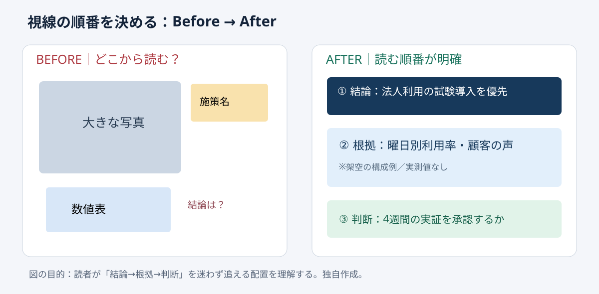

# 視線の順番を先に決める｜3点読み順テスト

**2026-11-04 06:00 JST｜学習ID 2026-11-04/0600｜基礎技・今日の小さな改善｜3〜5分**
## 今日の結論

**最初に装飾せず、読む順番を「結論→根拠→判断」の3点に固定する。** 同じ情報量でも、最初にどこを見ればよいかが明確なら、説明や修正の手戻りを減らしやすい。

## 守｜読み順はレイアウトの前提

**視覚的階層**とは、文字の大きさ・位置・余白・コントラストで「何から読むか」を伝える設計のこと。情報の重要度と視覚上の目立ち方が逆転すると、読者は資料を探索する必要がある。今回の3点は①結論（何を言いたいか）、②根拠（なぜか）、③判断（何を決めるか）。これは絶対的な視線法則ではなく、意思決定用の1枚を点検する実務上のルールである。

## Before→After｜スポーツ施設の改善提案

架空のスポーツ施設で「平日集客を増やす施策」を説明する場面。**Before**は中央の大きな写真、左下の売上表、右上の施策名が同じ強さで競合し、結論の位置が不明。**After**は上部に「平日は法人利用の試験導入を優先」、中央に曜日別利用率と企業ヒアリングの要点、下部に「4週間の小規模実証を承認するか」を置く。利用率などの実測値は示していないため、実在の効果を主張するものではない。

## 破｜4ステップで制作する

1. **紙に3語だけ書く。**「結論／根拠／判断」の3枠を先に描く。図形の装飾は後回しにする。
2. **最初の視点を決める。**結論を上部の短い一文にする。「平日施策」ではなく「法人利用の試験導入を優先」と書く。
3. **根拠を一群にまとめる。**数値・比較・観察を中央に置き、タイトルと競合する大きな飾りを減らす。
4. **最後に判断を置く。**下部に「何を承認するか」「次に何を検証するか」を短く明記する。PowerPointでは［表示］→［ガイド］で配置軸を確認できる。

## 例外と別解｜読む順番は固定の型ではない

時系列を説明するなら左から右のフロー、2案の選択なら左右比較が自然なこともある。その場合も「まず何を見せ、次に何を理解させるか」を先に決める。写真自体が証拠となる事故現場や製品の紹介では、写真を主役にしてもよい。重要なのは、写真の大きさを習慣で決めないこと。

## 離｜会議の時間も設計する

読み順の設計は、単なるデザイン改善ではない。議論の入口を揃える行為でもある。根拠より先に施策案が目立つと、会議は賛否から始まりやすい。先に判断の問いを定め、その判断に必要な根拠だけを置けば、資料は情報の保管庫から意思決定の道具に変わる。営業提案、採用計画、自治体の施策説明にも転用できる。

## 失敗例｜矢印を増やして読み順を説明する

**失敗：**読みにくさを補おうとして矢印を大量に追加する。**回避：**矢印の前に位置・文字サイズ・余白を直す。矢印が必要なのは、因果や手順など、関係そのものを示す場合だ。

## 60秒課題｜今ある1枚を診断

手元のスライドを開き、①最初に見る要素、②次に読む根拠、③最後に残る判断を声に出す。**合格基準：**各要素を指すのに迷わず、主張と無関係な大きな要素がない。迷ったら装飾を足さず、見出し・配置・余白を一つだけ変える。

## 参考資料・Simple English

参考：[SlideLand｜公開スライドの構成事例](https://www.slideland.tech/)／[Microsoft公式｜ガイドとスマートガイド](https://support.microsoft.com/en-us/powerpoint/training/guides-for-arranging-things-on-a-slide)／[Microsoft公式｜整列と均等配置](https://support.microsoft.com/en-us/office/graphics-visuals/align-or-arrange-objects)。SlideLandは作例の構成比較、MicrosoftはWindows版を含むガイドと整列操作の確認に使用した。

**Simple English: Design the reading path before the slide.** ／ **日本語：スライドを飾る前に、読む順番を設計しよう。**
