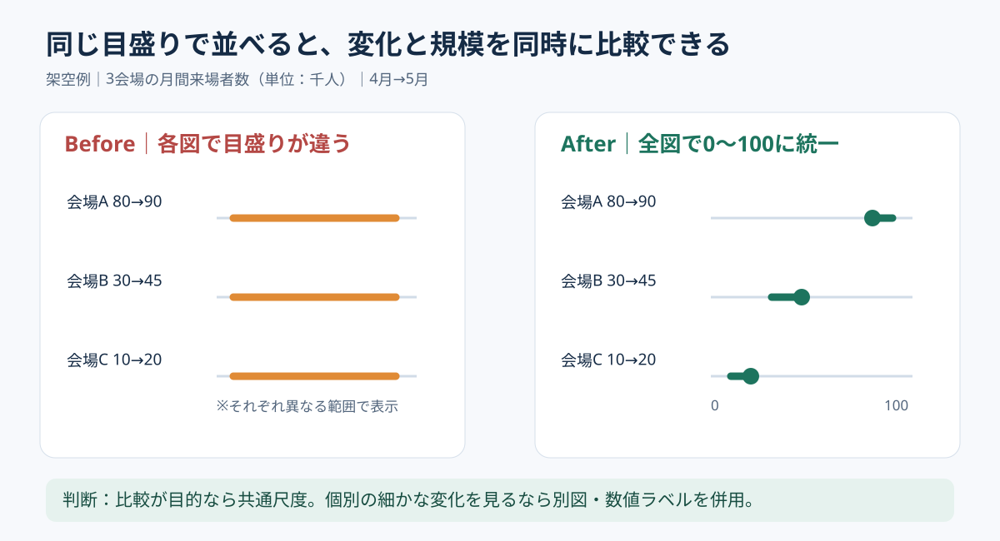

# 複数市場の変化は同じ目盛りで並べる｜スモールマルチプル

**2026-11-04 12:00 JST｜学習ID 2026-11-04/1200｜レイアウト・図解｜3〜5分**

## 今日の結論

**複数の小さなグラフは、比較するなら目盛りをそろえる。** スモールマルチプル（同じ形式の小さな図を並べる手法）は、違いを一目で捉えるためのもの。軸が違うと見た目の傾きや長さを比較できない。

## 守｜比較できる条件を先にそろえる

会場A・B・Cの月間来場者数を並べるとき、各図の縦軸が異なると、実際の規模差が隠れる。共通尺度とは、すべての図で最小値・最大値・単位を統一すること。特に棒の長さで量を示す場合は、原則としてゼロを起点にする。折れ線は小さな変化を示すために範囲を狭める場合もあるが、比較上の意図を明示する。

## Before→After｜3会場を同じ物差しで見る

説明用の架空データはAが80→90千人、Bが30→45千人、Cが10→20千人。Beforeは会場ごとに目盛りが違い、すべて同じ程度に伸びたように見える。Afterは0〜100千人の共通尺度で並べ、規模差を保ったまま変化を示す。増加率も必要ならAは12.5%、Bは50%、Cは100%と別ラベルにする。**絶対数の大きさと増加率は別の問い**である。

*図：左は尺度が異なるため比較に不向き。右は共通尺度で規模差を可視化。数値はすべて架空。*

## 破｜4ステップでレイアウトを作る

1. **問いを決める。**「最大の会場はどこか」なら絶対数、「伸びが速いのはどこか」なら増加率を優先する。
2. **単位と期間を統一する。** 来場者数は千人、対象期間は4月と5月、対象範囲は同一条件にする。
3. **同じ形式の小図を複製する。** Windows版PowerPointでは［挿入］→［グラフ］で作成し、データを編集する。軸の最大・最小値を各グラフで統一し、同じサイズで整列する。
4. **直接ラベルを付ける。** 各図に会場名・値・単位を置き、必要なら増加率を併記する。最後に縮小表示で読めるか確認する。

## 離｜向かない情報と別案

**向く：** 同じ指標を多数の地域・顧客群・時点で比較する場合。**向かない：** 2系列だけで細かな数値を正確に読む場合は表、構成比なら積み上げ棒、項目間の相関なら散布図が適切。会場間の規模差が大きすぎて小さい会場の変化が消えるなら、絶対数の図と増加率の図を分ける。共通尺度を守ること自体が目的ではなく、判断の問いに合うことが目的だ。

## 失敗例｜見た目をそろえて軸だけ違う

**失敗：** 小図を複製してから自動軸設定のまま値だけ変える。**回避：** 軸の範囲、ゼロ起点、単位、期間を図の下に明記する。視覚的な整列と比較条件の統一を別々に確認する。

## 60秒課題｜同じ物差しに直す

「店舗A：売上100→110万円」「店舗B：20→30万円」を2つの棒グラフで描くなら、軸をどうするか。**解答：** 絶対額を比較するなら両方0〜120万円など共通範囲にする。成長率の比較が目的ならAは10%、Bは50%と率を別に示す。

## 参考資料・Simple English

参考：[Microsoft公式｜PowerPointでグラフを作る](https://support.microsoft.com/en-us/accessibility/powerpoint/use-a-screen-reader-to-create-charts-in-powerpoint)／[Microsoft公式｜アクセシビリティと表・図](https://support.microsoft.com/en-us/accessibility/powerpoint/make-your-powerpoint-presentations-accessible-to-people-with-disabilities)／[SlideLand｜公開図解の研究](https://www.slideland.tech/)。図は独自制作であり公開作例の転載ではない。

**Simple English: Use the same scale for a fair comparison.** ／ **日本語：公平に比較するなら、同じ目盛りを使おう。**