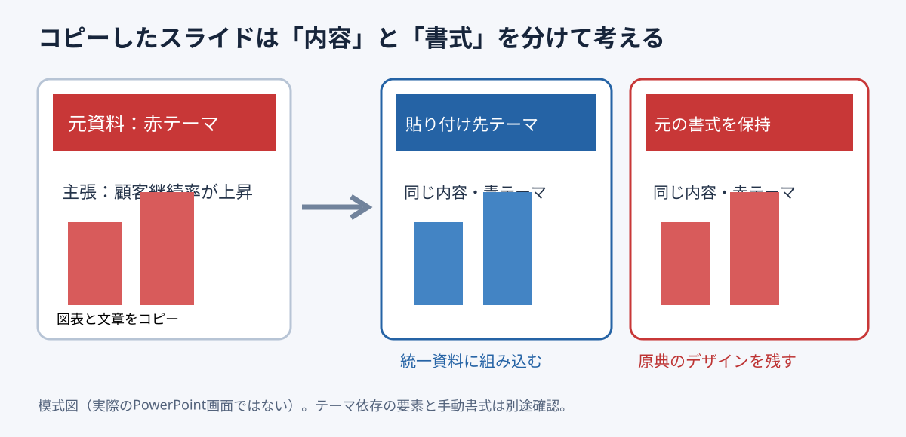

# スライド流用は貼り付け時のテーマ選択で手戻りを防ぐ

**2026-11-04 15:00 JST｜学習ID 2026-11-04/1500｜PowerPoint実装・時短｜3〜5分**

## 今日の結論

**別資料からのスライド流用では、貼り付け直後に「貼り付け先のテーマを使用」か「元の書式を保持」かを選ぶ。** 先に判断すると、後から色・フォントを直す時間を減らせる。これは文章の構造を決めてから装飾する、という制作順序にもつながる。

## 守｜テーマと書式は別物

PowerPointのテーマは色・フォントなどのデザイン体系。別の資料からスライドをコピーすると、貼り付け先のテーマに合わせる方法と、元のテーマを保持する方法を選べる。ただし図形ごとに手動設定した色やフォントまで必ず自動変換されるとは限らない。貼り付け後の確認が必要だ。

## Before→After｜流用後の見た目を設計する

Before：赤を基調とする営業資料の1枚を、青い経営会議資料へそのまま貼り付ける。結果、ページだけ色と文字が浮く。After：貼り付け先テーマを選び、強調色・見出し・グラフ凡例を確認する。元のブランド表現を保持すべき外部引用資料なら、逆に元の書式を保持する。

## 図解｜選択の分岐

*図：内容を同じまま、テーマの適用先で見た目が変わる。PowerPointの実画面ではなく独自模式図。*

## 破｜Windows版PowerPointで4ステップ

1. **目的を決める。** 自社資料の一部にするなら貼り付け先テーマ、他社の原典として示すなら元書式保持を候補にする。
2. **コピーする。** 元資料の左側サムネイルでスライドを選択し、Ctrl+C。貼り付け先の挿入位置を選びCtrl+V。
3. **貼り付けオプションを選ぶ。** 「貼り付け先のテーマを使用」または「元の書式を保持」を選択。Microsoft公式は両方を案内している。
4. **手動書式を点検する。** 見出し、色、フォント、グラフ、ロゴ、配置を確認。崩れた場合は元書式保持で再挿入し、必要な部分だけ調整する。

## 離｜流用はデザイン移植ではなく意味の移植

他社資料を流用する際、まず「このページの論理構造は新しい資料の問いに答えるか」を検証する。見た目がそろっても、元資料の結論がそのまま使えるとは限らない。社外の公開スライドを引用する場合は出典と利用条件も確認する。

## 失敗例｜貼り付け後に一括で色を変える

**失敗：** 何枚も貼り付けた後で、資料全体のテーマ不一致に気づく。**回避：** 最初の1枚で両方式を試し、見出し・図表・ロゴを確認してから残りを流用する。

## 60秒課題｜どちらを選ぶ？

ケースA：過去の社内資料から分析図を自社の新テンプレートへ移す。ケースB：提携企業の公式スライドを参考資料として原形のまま示す。**判断例：** Aは貼り付け先テーマ、Bは元書式保持。ただしどちらも手動書式・著作権・説明文の適合性を確認する。

## 参考資料・Simple English

Microsoft公式：[スライドのコピーと貼り付け](https://support.microsoft.com/en-us/powerpoint/copy-and-paste-your-slides)／[スライドの再利用](https://support.microsoft.com/en-us/powerpoint/reuse-import-slides-from-another-presentation)。図解研究の入口：[SlideLand](https://www.slideland.tech/)。本稿はMicrosoftの操作説明を根拠とし、SlideLandの特定作例を再現したものではない。

**Simple English: Reuse the content, then choose the right theme.** ／ **日本語：内容を再利用し、目的に合うテーマを選ぼう。**

