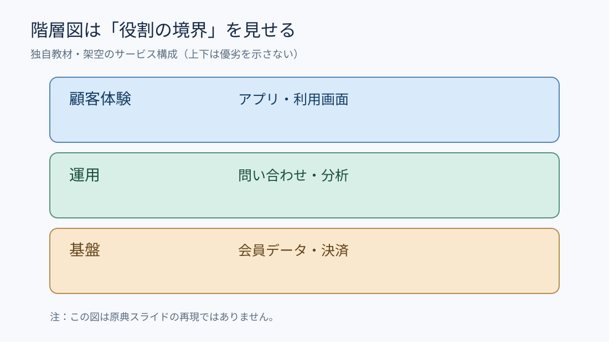

# キカガク掲載事例から学ぶ｜階層図は境界と包含関係を伝える

**2026-11-04 18:00 JST｜学習ID 2026-11-04/1800｜名作スライド解剖｜3〜5分**

## 今日の結論

**階層図は、要素の上下関係より「どこまでが同じ範囲か」を伝えるために使う。** 関係を先に定義すれば、箱の装飾を試行錯誤する時間を減らせる。

## 守｜実在する掲載事例と読み方

SlideLandの「階層・レイヤー」分類には、株式会社キカガクの「Company Deck」が掲載されている。これは**実在する掲載事例**だが、今回の図は当該スライドの模写ではない。分類ページから個別スライドの細部やページ番号までは検証できないため、原典の具体的配置を断定しない。

階層（レイヤー）図が得意なのは、包含・依存・責任範囲など、**層の意味が異なる**関係だ。単に三つの項目があるだけなら、横並びの比較表の方が正確な場合もある。

## 図解｜箱の内側が何を意味するか

*図：顧客体験・運用・基盤の三層を示す架空の教材例。上下は優劣や時系列を意味しない。原典画像の転載ではない。*

## 破｜再現する4ステップ

1. **問いを確定する。** 「サービスは何で支えられるか」など、層を示す理由を一文で書く。
2. **関係の種類を選ぶ。** 包含なら入れ子、依存なら積層、順番ならフローにする。混ぜない。
3. **各層に役割名を付ける。** 例：「顧客体験」「運用」「基盤」。同じ粒度の言葉でそろえる。
4. **例外を脚注で扱う。** すべてが上下に収まらない横断機能は、層の外側に別帯として示す。

## Before→After｜説明の重複を減らす

**Before：**「顧客向けアプリ、問い合わせ対応、会員データベース、分析、決済」を同列の箇条書きで説明する。**After：**「顧客体験＝アプリ／運用＝問い合わせ・分析／基盤＝会員データ・決済」と三層に整理。**重要：**これは理解用の仮想例であり、実際のキカガクの事業構造を表していない。

## 離｜スポーツ興行へ転用

スポーツ興行なら「観客が見る体験／現場の運営／計測・配信基盤」という層に整理できる。ただしチケット販売は体験・運用・基盤を横断し得る。横断項目を無理に一層へ押し込まず、横に一本の帯として配置すると責任の抜けが見える。

## 失敗例と限界

**失敗：**上段ほど重要だと受け取られる図なのに、重要度ではなく業務順序を置いてしまう。**回避：**タイトルと注釈に「上から顧客接点・運用・技術基盤。優劣ではない」と明記する。因果を主張したいなら根拠を別に添える。

## 60秒課題

「来場者アプリ・入場ゲート・会員ID・問い合わせ窓口」を、顧客接点／現場運用／共通基盤に分けよう。**判断例：**アプリ＝顧客接点、ゲートと窓口＝現場運用、会員ID＝共通基盤。ただしゲートはシステム機能と現場設備の両面があるため、説明目的に応じて再配置する。

## 参考資料・Simple English

[SlideLand｜階層・レイヤー](https://www.slideland.tech/docs/schematic/layer)／[SlideLand｜図解カテゴリ一覧](https://www.slideland.tech/docs/category-list)／[Microsoft PowerPoint公式](https://support.microsoft.com/ja-jp/powerpoint)。

**Simple English: Show the boundary, not just the boxes.** ／ **日本語：箱を並べるだけでなく、範囲の境界を示そう。**
