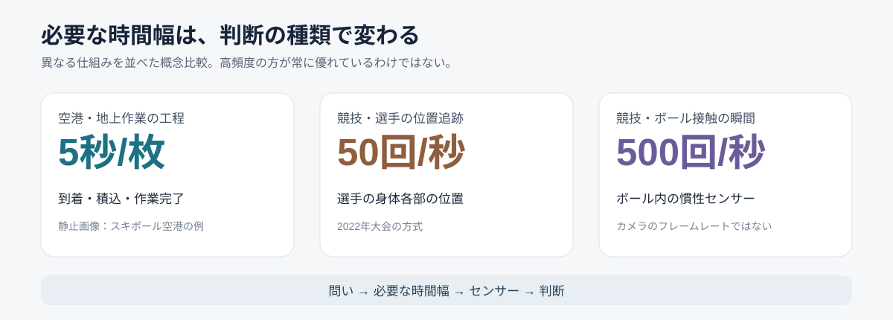
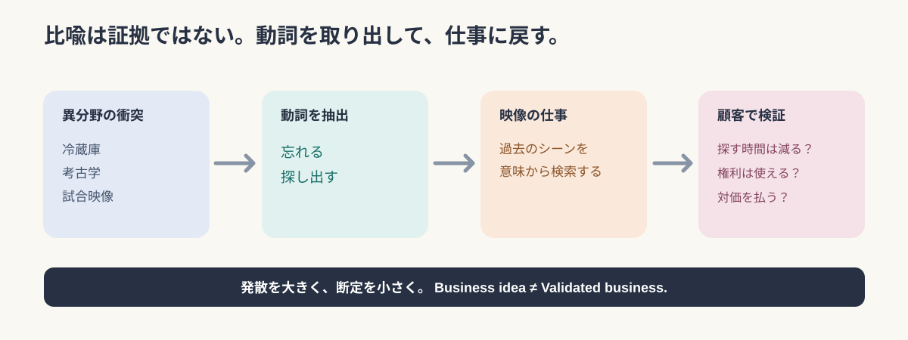

# 飛行機の地上作業を5秒に1枚で追う――嫉妬と冷蔵庫から映像事業を発掘する30の衝突実験

*2026年11月4日｜守破離リサーチ／リサーチ→構造化→再リサーチ→プロンプト化*

飛行機が地上で整備される様子を、**5秒に1枚の写真**で管理する仕組みがある。飛行機の周りでは、荷物や燃料や人が忙しく動く。にもかかわらず、オランダのスキポール空港が提供する「Deep Turnaround」は、駐機場に設置したカメラから5秒間隔の画像を集め、作業工程を把握する。公式説明では、1つの駐機スポットに2台のカメラを用いる。[スキポール空港公式：Deep Turnaround](https://www.schiphol.nl/en/aviation-solutions/deep-turnaround-how-does-it-work/)

スポーツ中継を見慣れると、撮影速度は速ければ速いほどありがたく感じる。ところが飛行機は「5秒でいい」と言う。仕事の現場で5秒は意外と長い。ラーメンなら麺が伸びる前兆を感じるし、サッカーなら数回のパスで局面が変わる。観測の世界では、どうも「高性能」の意味が一つではないらしい。


*画像：スキポール空港の[Turnaround Insights公式紹介](https://www.schiphol.nl/nl/innovatie/blog/een-voorspelbaar-omdraaiproces-met-turnaround-insights/)より。空港の工程可視化を説明する資料画像であり、後述のスポーツ施策の実績写真ではない。*

**最初の問いは「映像で何ができるか」ではなく、「誰が、いつ、何を判断するために映像が必要なのか」である。** この問いを確かめるため、嫉妬、菌根菌、冷蔵庫、裁判、夢日記といった、およそスポーツ映像の会議で出すと一度静かになりそうな言葉をぶつけてみた。30案はすべて筆者の未検証の事業仮説であって、実在する製品や導入実績を示すものではない。

## 守｜撮影間隔の違いは、映像技術より「問い」の違いを教える

映像解析を、画質・フレームレート・AI精度の性能競争として考え始めると、観測対象の時間幅を見落とす。空港の地上作業では、機材の到着、荷役の開始、作業の完了が重要だ。一方、サッカーのオフサイドでは、パスが出た瞬間と選手の位置関係が問われる。撮影したい現象が違うので、必要な観測も違う。

FIFAが2022年大会で説明した半自動オフサイド技術は、12台の専用カメラで選手の身体各部を**毎秒50回**追跡し、センサー内蔵ボールからは**毎秒500回**のデータを取得する。後者はカメラのフレームレートではなく、ボール内部の慣性センサーの測定頻度だ。現在の技術説明は構成が更新されているため、この数値は**2022年方式の説明**として扱う。[FIFA公式：2022年の半自動オフサイド技術](https://inside.fifa.com/innovation/world-cup-2022/semi-automated-offside-technology)／[FIFA公式：現在の技術概要](https://inside.fifa.com/innovation/innovating-the-game/semi-automated-offside-technology)



*筆者作成。5秒間隔の静止画像、毎秒50回の身体追跡、毎秒500回のボール内センサー測定は異なる観測方法であり、単純な性能序列ではない。*

次に、撮る対象ではなく**関係を読む**研究へ目を移す。Google DeepMindとリバプールFCの研究「TacticAI」は、コーナーキックの選手配置を関係グラフとして表し、誰がボールを受けるか、シュートにつながるかを予測し、配置の変更案を生成する。論文で報告された「専門家が提案を90%の場面で好んだ」は**提案への評価**であり、採用した戦術が実際に90%勝ったという意味ではない。[Nature Communications論文](https://www.nature.com/articles/s41467-024-45965-x)／[DeepMind研究紹介](https://deepmind.google/blog/tacticai-ai-assistant-for-football-tactics/)

この3つを並べると、映像の仕事は異なる。空港は工程の変化を捉える。オフサイド判定は瞬間を確かめる。戦術AIは選手間の関係を表す。映像データを増やすこと自体は、どの事業でも目的ではない。**測るべきものを先に決めなければ、撮影機材は豪華になっても判断は変わらない。**

## 破｜無関係な言葉の衝突は、隠れた「動詞」を探すために行う

「菌根菌×インターネット」と聞いて、すぐ映像事業を思い浮かべる人は多くない。菌根菌は植物と関係を持ち、資源のやり取りを助ける。そこから**つなぐ・交換する・依存する**という動詞を抜き出す。映像事業へ戻せば、別々の会社が持つ動画・位置情報・解析結果を、同じ時刻で結ぶ仕組みになる。

「冷蔵庫×考古学」なら、忘れられたものを発掘する。「カラオケ×羞恥心」なら、人前では失敗したくないことを何度も練習する。「保険×ブラックボックス」なら、事故や判定の後で根拠をたどれるようにする。変な単語同士のあいだにある**日常の動作**が、技術の機能一覧より先に事業の入口を教える場合がある。

ただし、類推は証拠ではない。植物の共生があるからデータ交換市場が成立するわけでも、冷蔵庫に期限があるから映像に同じ期限があるわけでもない。言葉の組み合わせは、**新しい問いを発見する装置**であって、需要の実証ではない。



*筆者作成。異分野の似姿を、そのまま市場の成立根拠として扱わないための探索手順。*

## 30案を六つの衝突実験として並べる

以下は元の発散30案を削除せず、各案について「何を変えるか」「映像で何をするか」「どこで推論が飛躍するか」を圧縮した台帳。いずれも**提案・仮説**であり、顧客導入、精度、収益性は未検証である。

### 実験A｜感情や記憶の扱いを、映像の機能に変える

- **01｜選手の相性オークション**〈嫉妬×菌根菌×オークション〉：同じ選手でも周囲によって働きが変わる。選手間の距離、空間創出、連携を映像から測り、特定の組み合わせに限った追加的な貢献を評価する。 **盲点：**観測した相性を、移籍後の因果効果と取り違えやすい。
- **02｜忘れられた名場面の発掘機**〈忘却×考古学×冷蔵庫〉：古い試合を現在の話題や戦術と意味検索で結び、眠った映像を再発見する。 **盲点：**再利用できる権利と映像品質が揃っているとは限らない。
- **03｜失敗を安全に練習できる映像空間**〈羞恥心×カラオケ×鏡〉：自分のプレーと目標動作を重ね、公開せず繰り返し振り返れる練習室を設計する。 **盲点：**映像比較だけでは動作改善や安全性を保証できない。
- **04｜記憶を呼び起こす観戦体験**〈郷愁×香水×タイムカプセル〉：座席位置、歓声、当日の場面を合わせ、個人の観戦履歴を再編集する。 **盲点：**映像だけでは本人の感情を確定できない。
- **05｜退屈な試合の隠れた見どころ**〈退屈×宝探し×監視カメラ〉：ボール外の駆け引きや珍しい動きを抽出し、観戦時の探索課題に変える。 **盲点：**奇妙な動きと競技的に重要な動きを混同しやすい。

### 実験B｜自然現象を借りて、集団の動きを読み直す

- **06｜スタジアム混雑の気象予報**〈台風×株式市場×蟻の行列〉：ゲートや売店の集団的な流れを可視化し、短時間先の混雑リスクを推定する。 **盲点：**個人の経路選択理由までは分からない。
- **07｜技術成長の地層**〈地層×複利×スローモーション〉：同じ動作を年単位で重ね、姿勢やタイミングの微細な変化を追う。 **盲点：**撮影条件の違いが成長に見えてしまう。
- **08｜スポーツデータ共生ネットワーク**〈菌根菌×インターネット×寄生虫〉：リーグ、クラブ、技術事業者のデータを共通時刻と権限管理で接続する。 **盲点：**接続するほど権利や目的外利用の問題が増える。
- **09｜事故の連鎖を予測する映像AI**〈雪崩×ドミノ×保険〉：小さな滞留、逆流、密度変化を連鎖として検知し、事故の前兆候補を示す。 **盲点：**前兆の検知と事故削減の実証は別である。
- **10｜スタジアム商圏の生態系分析**〈サンゴ礁×不動産×生態系〉：試合前後の匿名化された人流と周辺の商業データを合わせ、地域への波及を調べる。 **盲点：**地域売上の増分を映像だけでは識別できない。

### 実験C｜歴史と仮想世界から、過去の再利用を考える

- **11｜引退選手の動作を次世代へ継承**〈輪廻転生×著作権×ロボット〉：身体動作の特徴を3次元で記録し、許諾された教育・研究用途に再利用する。 **盲点：**人格や能力の『再現』と動作特徴の記録は違う。
- **12｜歴史的判定の再審シミュレーター**〈裁判×タイムマシン×神話〉：古い映像から判定条件を可能な範囲で復元し、現在の判定技術と比べる。 **盲点：**当時の情報欠落と規則の違いは消せない。
- **13｜スポーツの聖地発見ゲーム**〈巡礼×ポケモン×地図〉：名場面の位置を空間に紐付け、現地で映像や仮想演出を重ねる。 **盲点：**撮影・演出・現地利用には複数の許諾が要る。
- **14｜もしもの試合を無数に試す**〈反実仮想×将棋×映画〉：特定場面で別の配置や判断を与え、モデル上の展開を可視化する。 **盲点：**生成した未来は起きた事実ではない。
- **15｜戦術の進化系統博物館**〈遺跡×DNA×博物館〉：時代を超えて類似する配置を検索し、戦術変化の系譜を探る。 **盲点：**似た配置を『影響を受けた証拠』として扱えない。

### 実験D｜日用品の不便から、具体的な操作を見つける

- **16｜映像の賞味期限管理**〈冷蔵庫×賞味期限×データベース〉：映像の話題性、権利期限、再利用候補をまとめて検索する。 **盲点：**話題性の期限と利用許諾の期限は別である。
- **17｜スポーツ動作のレシピ化**〈料理レシピ×工場×スポーツ科学〉：フォームを開始条件、順序、接触、力の変化に分解し、映像教材へ落とす。 **盲点：**熟練動作は言語化した順序だけで再現できない。
- **18｜未来の自分を試着する**〈試着室×ゲームキャラ×鏡〉：自分のフォーム映像に改善候補を重ね、動作変更を仮想的に試す。 **盲点：**見た目が整っても身体への負荷が安全とは限らない。
- **19｜売店配置の戦術AI**〈スーパーの棚割り×サッカー戦術×迷路〉：売店や案内板を選手の配置のように捉え、会場内の動線変更を試算する。 **盲点：**映像だけでは購買・満足度の原因を特定できない。
- **20｜時間が経つほど価値が増す映像**〈発酵×ブランド×映像アーカイブ〉：周年、記録更新、選手復帰など現在の出来事と過去映像を自動接続する。 **盲点：**古さそのものが視聴需要を保証するわけではない。

### 実験E｜金融と法律から、見えない価値と責任を考える

- **21｜見えない選手価値の変動指数**〈株式市場×オフザボール×気象予報〉：直接ボールに触れない行動が味方の選択肢に与える変化を推定する。 **盲点：**評価指標を選手の本当の市場価値とは呼べない。
- **22｜スポーツ判定の監査証跡**〈保険×ブラックボックス×審判〉：判定に使った映像、計測条件、モデル版、修正履歴を保存する。 **盲点：**記録が完全でも判断基準の妥当性は別途必要。
- **23｜動作データのライセンス市場**〈フリーマーケット×身体動作×特許〉：動画から得た動作特徴を、利用範囲を限定して研究や制作へ提供する。 **盲点：**動作データの法的権利は単純な所有物と同じではない。
- **24｜スポーツAIの健康診断**〈信用スコア×AI×体温計〉：姿勢推定や追跡AIを、雨・遮蔽・照明など条件別に定期評価する。 **盲点：**基準データも誤差を含み、評価手法の合意が必要。
- **25｜スポーツ映像AIの共同利用組合**〈共同購入×放映権×クラウド〉：複数のクラブが映像解析機能を共通基盤で利用し費用と運用を分担する。 **盲点：**中央契約と個別契約では調達・権利処理の構造が違う。

### 実験F｜SFから、映像を未来に渡す形式を考える

- **26｜消えないアスリート**〈デジタル不死×動作解析×図書館〉：長期の競技映像を、後世へ残せる動作・状況データとして整理する。 **盲点：**身体の記録は本人そのものの再生ではない。
- **27｜夢の中の試合を再現**〈夢日記×VR×並行世界〉：実際のプレーを起点に異なる展開を生成し、視聴者が任意視点で体験する。 **盲点：**架空映像だと明示しないと記録と誤認される。
- **28｜現実世界の検索エンジン**〈検索エンジン×物理世界×未来の考古学〉：映像内の動作、接触、相互作用を自然文で検索できるようにする。 **盲点：**検索の一致と、その場面が示す意味は別である。
- **29｜身体動作のバージョン管理**〈GitHub×進化論×身体能力〉：同一条件の映像を比較し、選手や製品の動作変化を差分として追う。 **盲点：**撮影・装備・計測条件が異なると差分は信用できない。
- **30｜スポーツから育てる世界モデル**〈人工生命×宇宙探査×サッカー〉：多人数の相互作用を学ぶため、競技映像と位置・イベント情報を整備する。 **盲点：**スポーツで学んだ予測が他の現実環境へ転移する保証はない。

## 再リサーチ1｜面白い映像ほど、推定と原因を混同しやすい

30案で最も危ないのは、08のデータ共生でも、27の架空の試合でもない。**「観察した行動から、その人の意図まで分かった気になる」**ことだ。

例えば、売店の前で立ち止まって引き返した来場者がいたとする。混雑が嫌だったのかもしれない。食べたいものがなかったのかもしれない。友人と待ち合わせただけかもしれない。カメラが捉えたのは停止と方向転換であり、「買い物を諦めた」という心理ではない。したがって19「売店配置の戦術AI」を事業化するなら、匿名化された人流だけでなく、POS、待ち時間、アンケートを組み合わせ、**映像で分かることと別データが必要なこと**を区別する必要がある。

別の例は14「もしもの試合」。TacticAIが提案した選手配置はモデル上の評価対象であり、現実の対戦相手が同じ反応をする保証はない。映像をCGで滑らかにつなぐほど、人はそれが本当に起きた歴史のように感じてしまう。ここではリアルな見た目そのものが、検証を難しくする。**生成映像は、過去の証拠と未来の仮説を表示上も分けるべきだ。**

## 再リサーチ2｜「AIの健康診断」は、技術を作る側より測る側の事業かもしれない

24「スポーツAIの健康診断」は、信用スコアと体温計の衝突から出た案だ。身体の健康診断では、単に「健康です」と表示するより、どの指標をどの条件で測ったかが必要になる。映像AIにも、同じ構造がある。

米国国立標準技術研究所（NIST）のAIリスク管理の手引きは、AIの評価を実際の利用環境に近い条件で行い、正解データに対する誤検出率や見逃し率、遅延、適用可能な条件を記録するよう勧める。これは「スポーツAIの健康診断」という製品が既に存在する証拠ではないが、**測定・評価・検証という独立した仕事の必要性**を支える資料になる。[NIST：AI RMF Measure](https://airc.nist.gov/airmf-resources/playbook/measure/)

ここでの小さな机上実験。サッカーの選手追跡AIを「平均精度95%」で売るとしよう。この数値は説明用の**架空の設定**であり、実在製品の数値ではない。雨の日に選手が重なった場面で精度が落ちるなら、平均値だけでは現場の安心材料にならない。必要なのは「何に、いつ、どの程度強いか」の条件付きの説明である。

逆に、その条件を測るための基準データ自体にも誤差がある。すべてを正しく測る万能のものさしはない。**信頼を販売する事業では、ものさしの限界まで商品説明に含める**必要がある。

## 再リサーチ3｜映像を使わない方がよい場合まで調べる

06「スタジアム混雑の気象予報」を考えると、まずカメラを増設したくなる。しかし、入場ゲートの通過人数が既存システムで取れるなら、新たに観客を撮影せずとも答えられる問いがある。これは性能ではなく必要性の問題だ。

英国の個人情報保護監督機関ICOは、映像監視について、目的をよりプライバシー侵害の少ない方法で達成できないか検討すべきだと案内している。これは英国の規制実務に関する資料であり、日本での法的適用をそのまま示すものではない。だが、**撮影しない選択肢を設計段階に置く**という技術倫理の論点は、スタジアムでも無視できない。[ICO：映像監視とデータ保護原則](https://ico.org.uk/for-organisations/uk-gdpr-guidance-and-resources/cctv-and-video-surveillance/guidance-on-video-surveillance-including-cctv/how-can-we-comply-with-the-data-protection-principles-when-using-surveillance-systems/)

映像の仕事を増やしたい記事が、映像を減らす提案へ戻ってきた。ずいぶん変な結末だが、顧客が欲しいのが「混雑を減らすこと」なら、カメラ台数は目的ではない。**撮らずに解ける問題を除いた残りにこそ、映像固有の価値が現れる。**

## 離｜映像は見る商品ではなく、現実の「編集可能性」を提供するかもしれない

30案を横断すると、商品は九つの動詞に分かれる。**関係を測る、記憶を掘る、身体を継承する、体験を作る、見落としを探す、運営を変える、データを流通させる、推定を検証する、別の未来を試す。**

この分類にはあえて「動画を撮る」という項目がない。撮影は手段であり、顧客が対価を払う対象とは限らないからだ。たとえば16の「映像の賞味期限」は、動画を見せるサービスではなく**探せる状態、使える状態、使ってよい状態を維持する管理**が商品になる。22の「判定の監査証跡」も、派手な映像演出より、何を根拠に判断したかを後で確かめられることに価値がある。

さらに触覚で観戦を支援するOneCourtは、スポーツの情報を振動に変えて、視覚障害のある人にも競技の動きを伝えるサービスを公式に紹介している。**スポーツの情報を映像以外へ翻訳する**ことまで、映像データの利用価値には含まれる。[OneCourt公式](https://www.onecourt.io/)

発散したはずの30案が、最後に「映像を見せる」という常識そのものを揺らしてくる。**映像をどう撮るかより、現実のどの関係を保存し、比較し、検証し、他者の行動につなげるか。** それが次の研究課題になる。

## 図解｜30案は何を売るのか

| 売るもの | 対象アイデア | 最初に確かめること |
| --- | --- | --- |
| 見落としの発見 | 05・28 | 検索結果が作業を減らすか |
| 長期の記憶 | 02・15・16・20・26 | 権利と再利用の頻度 |
| 身体の知識 | 03・07・11・17・18・29 | 撮影条件の再現性 |
| 関係の推定 | 01・21 | 比較対象と妥当性 |
| 現場の改善 | 06・09・10・19 | 指標が実際に変わるか |
| 観戦体験 | 04・13・27 | 視聴者が使い続けるか |
| 信頼と責任 | 12・22・24 | 誤差と監査要件 |
| データ流通 | 08・23・25 | 権利・契約・共通仕様 |
| 別の未来の検討 | 14・30 | 仮説と現実を混同しないか |

※上の分類は事業上の主たる価値で分けた便宜的な整理であり、各案の提供機能を排他的に定めるものではない。

## 実務へ戻す｜30案を「思いつき」で終わらせない3つの小実験

**実験A｜映像検索の不便は、何分の仕事なのか。** 実在する試合映像を10本程度選び、コーチや広報担当に「似た守備場面を探す」「過去の同種シーンを探す」などの課題を依頼する。従来の検索方法と試作検索機能を比較し、所要時間、発見率、誤検索、再利用の許諾条件を記録する。結果はまだない。まず測る項目を決める。

**実験B｜混雑の原因を、カメラだけで言い切らない。** 会場内の一つの売店列で、目視による列長・待ち時間、匿名集計、POS、簡単な聞き取りを照合する。画像解析モデルを作る前に、何が既存データで分かり、何が映像なしでは分からないかを調べる。個人を識別しない設計と権利・個人情報の確認を前提にする。

**実験C｜AIの平均精度より失敗条件を探す。** 追跡AIのテスト映像を晴天・雨天・逆光・遮蔽・異なる画角で層別し、条件別の誤差と失敗例を記録する。基準データの作成手法や測定誤差も併記する。顧客候補に「この結果が導入判断に必要か」と尋ね、評価サービスへの支払意思を確かめる。

この順であれば「AIの巨大プラットフォームを作る」より前に、**現場で誰が何に困り、どの結果を見て意思決定するのか**に到達できる。

## 編集ノート｜事実・解釈・提案を混ぜない

- **確認済みの事実：** スキポール空港の5秒間隔画像、FIFAが示した2022年方式の測定頻度、TacticAIの研究対象と専門家評価、NISTの評価指針、OneCourtの触覚中継。
- **筆者の解釈：** 映像技術は時間幅と意思決定によって選ぶべきであり、異分野連想から抽出するべきは名称より「動詞」である。
- **未検証の仮説：** 30の事業アイデア、顧客候補、対価、実装上の価値。
- **提案：** 利用現場での検索テスト、混雑計測、AIの条件別検証。実験は提案であり、実施済みとは主張しない。
- **確認が必要：** 映像・選手データの権利、プライバシー、個別の契約範囲、技術精度、導入費用、顧客の支払意思。

## 再利用プロンプト｜変な言葉から事業の原理までたどる

```text
対象領域を一度忘れ、自然・金融・心理・日用品・芸術・歴史から無関係な言葉を3〜4語選ぶ。
1. 各言葉について「何をする／何が変わる」という動詞を抽出する。
2. 動詞を接続し、ばかばかしい組み合わせを最低30案作る。
3. 各案を映像の観測・理解・予測・再現・検証・流通のいずれかへ戻す。
4. 実在する技術・導入例を一次資料で調べ、事実と仮説を切り分ける。
5. もっともらしい因果、測れない心理、権利処理、精度、支払意思を反証する。
6. 代表案は顧客の実務・使う場面・代替手段・必要データ・小実験に落とす。
7. 調査前には考えなかった問いを最後に一つ残す。
文体は、日常の妙な観察から始め、正確な研究と軽いユーモアを往復する。
見出しは結論型にし、本文は具体から抽象へ進める。断定の確度を勝手に上げない。
```

## 参考資料

1. [スキポール空港：Deep Turnaroundの仕組み](https://www.schiphol.nl/en/aviation-solutions/deep-turnaround-how-does-it-work/)
2. [FIFA：2022年の半自動オフサイド技術](https://inside.fifa.com/innovation/world-cup-2022/semi-automated-offside-technology)
3. [FIFA：半自動オフサイド技術の現在の解説](https://inside.fifa.com/innovation/innovating-the-game/semi-automated-offside-technology)
4. [Wangほか：TacticAI（Nature Communications, 2024）](https://www.nature.com/articles/s41467-024-45965-x)
5. [Google DeepMind：TacticAI研究紹介](https://deepmind.google/blog/tacticai-ai-assistant-for-football-tactics/)
6. [NIST：AI Risk Management Framework — Measure](https://airc.nist.gov/airmf-resources/playbook/measure/)
7. [ICO：映像監視と個人情報保護に関する指針（英国）](https://ico.org.uk/for-organisations/uk-gdpr-guidance-and-resources/cctv-and-video-surveillance/guidance-on-video-surveillance-including-cctv/how-can-we-comply-with-the-data-protection-principles-when-using-surveillance-systems/)
8. [OneCourt：触覚によるスポーツ観戦](https://www.onecourt.io/)

***

冷蔵庫に残った食材を見て「もったいない」と思う人は多い。試合映像の倉庫を見ても、同じことを思う人はまだ少ないかもしれない。もっとも、倉庫の中身を全部使えばよいわけでもない。**保存された出来事が、誰かの次の判断につながるときに初めて、映像は記録から道具へ変わる。**