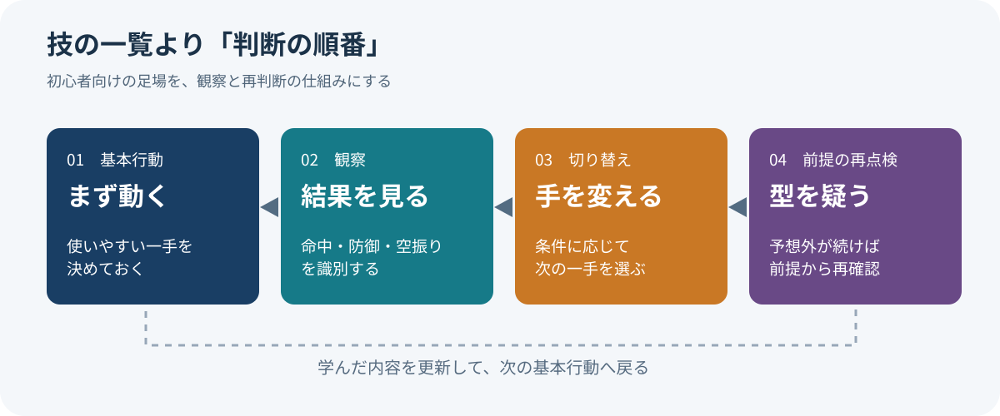
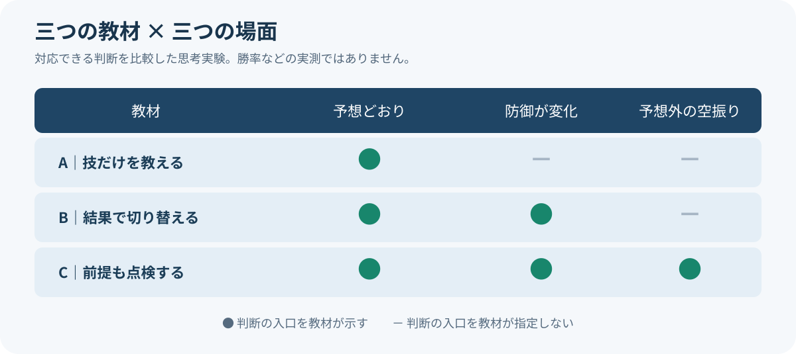

# 12分教えた攻略法を、講師は最後に使わないと言った

*2026年11月5日｜調査→再調査→構造化／事実・解釈・提案を分けた論考*

12分ほどの初心者講座の最後に、講師が自分の教えていた操作方法を「もう触らない」と言い出す。授業の締めくくりとしては、かなり自由だ。だが、この一言を調べていくと、初心者にとって本当に必要な教育とは何かという問題が見えてくる。

題材は『ストリートファイター6』のエレナ。プロゲーマーのアクア（ACQUA）は[2025年6月6日の講座](https://www.youtube.com/watch?v=jqFhyP1FBzc)で、操作が簡略化された「モダン」方式の基本的な攻め方を教える。しかし[11分53秒ごろ](https://www.youtube.com/watch?v=jqFhyP1FBzc&t=713s)、「僕は今モダンエレナをもう触んないです」と発言し、自分はクラシック方式を選ぶという。教える相手に適した入口と、講師本人の現在の最適解は違う。

これは矛盾ではなく、教育の誠実さかもしれない。入門者のために選択肢を減らしながら、その選択が永久に最善だとは言わない。ここから考えたいのは、「何をすればよいか」を教えるだけでなく、「いつそのやり方をやめるべきか」を教えられるかという問いである。

*画像：カプコンが[公式発表（Steam）](https://steamcommunity.com/games/1364780/announcements/detail/534348484694770027)に掲載したエレナの設定画。©CAPCOM。ゲーム内の現行性能を示す図ではない。*

## 1｜リサーチ：技のリストではなく、観察の順番を教えていた

動画の文字起こしを、技名の羅列ではなく条件分岐として読み直した。最初に主力の中攻撃を教え、命中すれば追撃し、ガードされたら別の技を使う。しゃがむ相手への弱点、飛び込む相手への対空、飛び道具への対応も紹介する。[講師の時刻別ノート](https://acqua-souken.com/v/jqFhyP1FBzc/)を確認すると、各項目は「相手が何をしたか」によって行動を変える構成になっている。

技を100個知っていても、試合中にどれを使うか判断できなければ役に立たない。少数の技でも、結果を見て選び直せれば攻防が成立する。教えているのは操作だけではない。相手が発した情報のうち、どれを次の判断に使えばよいかという「観測の順番」である。

心理学には「実行意図（implementation intention）」という概念がある。あらかじめ「状況Xになったら行動Yをする」と決めておく方法で、ゴルヴィッツァー（Peter M. Gollwitzer）とシーラン（Paschal Sheeran）の2006年の統合分析は94件の独立検証で目標達成に対する効果量d＝0.65を報告した。[原論文](https://doi.org/10.1016/S0065-2601(06)38002-1)。これはゲーム講座の効果を直接測った数字ではないが、初心者に条件と行動を組で渡すことの意味を考える手掛かりになる。

ただし、条件付きの行動が便利なのは、条件を正しく見分けられる場合に限られる。相手の動きを誤読したり、以前は有効だった連係が通用しなくなったりしたら、整理された手順ほど自信を持って失敗を繰り返す可能性がある。次に必要なのは、手順の効能だけでなく「手順が崩れた兆候」を調べることだった。

*図1：筆者作成。講座から抽出した判断設計の概念図であり、技の性能や勝率の実測結果ではない。*

## 2｜次のリサーチ計画：『疑え』を本当に使える言葉へ変える

最初の仮説は「基本行動と切り替え条件を一組で教えるべきだ」だった。しかし「失敗したらやり方を変えよう」は、もっともらしいだけの助言にもなる。何回失敗したら判断するのか。単なる操作ミスと手順の不適合をどう分けるのか。分からなければ、初心者に新しい悩みを追加するだけだ。

- 条件付きの行動計画は、どの範囲で実証されているかを調べる。
- 成功した型が、新しい状況への適応を妨げる研究を探す。
- 『別の可能性を疑う』という一般的な助言に効果はあるか調べる。
- 会議・研修に移す場合、何を観察・測定できるかを整理する。

ここでは、格闘ゲームと医療や職場を同じものとして扱わない。ある研究が別の領域でも同じ効果を出すと主張するのではなく、研究から取り出した問いを、別の場面で検証可能な形に変える。横断的な連想を、無制限な一般化と取り違えないための条件である。

## 3｜再リサーチ：反省のための確認表は、万能薬ではなかった

学習科学の研究は、成功した手順にもう一つの顔があることを示していた。シュワルツ（Daniel L. Schwartz）らは2012年、以前うまくいった解き方を新しい問題へ過剰に当てはめると、新しい特徴を学ぶ機会を逃す場合があると論じ、これを「過剰な転用（overzealous transfer）」と名付けた。[論文要旨](https://eric.ed.gov/?id=EJ974017)。2025年掲載のシュワルツの論考も、決まった課題をこなす能力と、新しい情報から学び直す能力を区別する。[論考](https://doi.org/10.1080/00461520.2024.2397389)。

それなら「もっと疑え」と教えればよいのか。米国医療研究品質庁（Agency for Healthcare Research and Quality：AHRQ）の診断研究整理は、そう単純ではないと告げる。ある比較研究では、難しい症例で具体的な診断候補を示す確認表に効果が見られた一方、一般的な思考の偏りを問い直す確認表では有意な改善が見られなかった。[研究整理](https://www.ahrq.gov/diagnostic-safety/resources/issue-briefs/dxchecklists-3.html)。同庁は、診断推論の確認表を通常の臨床にそのまま導入するには証拠が混在し、不十分だと結論づけている。[結論](https://www.ahrq.gov/diagnostic-safety/resources/issue-briefs/dxchecklists-6.html)。

医療の研究からゲーム攻略の効果を推定することはできない。むしろ得られた教訓は、空疎な反省を増やすなという慎重さだった。「ほかの可能性も考えよう」だけでなく、「この兆候が出たら、いま使っている手順の何を点検するか」まで決める。教育に必要なのは反省という態度より、再判断の入口を具体化する設計かもしれない。

## 4｜意外な接続：会議の進行表にも『技が当たらない条件』がある

職場で「売上が落ちたら広告を増やす」と教えられた担当者を考える。実行しやすい。だが売上の減少が新規顧客数の低下によるのか、既存顧客の購入頻度の低下によるのか、決済画面での離脱によるのかによって、打ち手は異なる。会議で広告施策の説明だけが洗練されると、問題の見立てがずれていても、議論が進んだように見える。

ここに「広告費を増やす前に、新規顧客数と購入頻度の変化を確認する」「原因が特定できなければ施策決定をいったん保留する」という条件を付けると、手順の役割が変わる。何かを実行するための指示から、実行してはいけない状況を見抜く道具になる。手順書の価値は、書いてある通りに動けることだけではなく、書いてある通りに動くのが不適切な瞬間を見つけられることにもある。

ここで動画の結末が違って聞こえる。講師は初心者のための最初の足場を作った後、競技で上を目指す自分にとっては別の足場が必要だと告げた。もちろん、その好みは本人の評価であり万人共通の正解ではない。それでも、教えた方法の適用範囲を隠さないという姿勢は、職場の研修でも珍しいほど大切なものだ。

## 5｜やりすぎの思考実験：三つの教材を同じ場面で比べる

机上の思考実験をしてみる。教材Aは「主力技を使う」だけ。教材Bは「当たれば続け、守られたら切り替える」。教材Cはそこに「予想外の結果が続いたら、相手の状態や手順の前提を点検する」を加える。この三つを、相手が予想どおり動く場面、守り方を変える場面、技が想定外に空振りする場面へ当てはめる。

Aは最初の場面にしか判断が書かれていない。Bは防御の変化に対応する入口がある。Cには前提を点検する入口がある。ただし、この図が示すのは教材に書かれた判断の範囲だけで、Cの勝率が高いという証拠ではない。条件を増やしすぎれば初心者の反応が遅くなる可能性もある。良さそうな構造を描くことと、その効果を測ることは別だ。

*図2：筆者作成。記号は教材に判断の入口があるかを示す。勝率・反応時間などの測定結果ではない。*

実証するとしたら、初心者を無作為に三群へ分け、既知の場面と条件が変わった未知の場面で、それぞれの正答率、判断時間、誤った手順を続けた回数を測りたい。操作の再現と、操作を続けるべきか判断する能力を分けて評価する。それで初めて、初心者にはどこまで例外を教えるべきかという設計問題に答えられる。

## 6｜構造化：空・雨・傘で『手順を卒業する条件』を設計する

調査前は、この動画の価値を「覚える技を減らしてくれる親切さ」に置いていた。今は違う。重要なのは少ない技そのものではなく、その技が成立する状況と成立しない状況を識別する練習を、実戦の中に埋め込んでいる点だ。標準化は判断を省くためだけにあるのではない。判断するべき箇所を際立たせることもできる。

- 【空・事実】講座は基本行動に加えて命中・防御・相手の変化による分岐を示す。実行意図の効果には研究蓄積がある一方、抽象的な思考の見直しだけの効果には限界がある。
- 【雨・解釈】熟達とは、手順を多く持つことだけでなく、どの条件で手順が通用しなくなるかを識別することでもある。ただし領域横断の一般命題は本稿の仮説である。
- 【傘・行動】手順書を「基本動作」「見るべき兆候」「切り替える動作」「前提を再点検する条件」の4点セットにし、未知の場面で効果を検証する。

例えば会議資料の最終ページに、「施策が前提とする顧客変化は何か」「その前提を否定するデータは何か」「判断を保留するのはどんなときか」を一行ずつ追加する。議論を遅くするためではない。間違った問題への回答を、手際よく完成させないためだ。

## 7｜限界と結末：『もう使わない』と言える教材

本稿は動画の提供文字起こし、講師の時刻別ノート、公開された研究資料を照合した文献調査である。講師本人への追加取材や、初心者を対象とした実験は行っていない。2025年6月時点の動画におけるクラシック方式への評価を、2026年11月の全プレイヤーに当てはまる結論として扱わない。また、医療の診断研究を企業やゲームの実効性の証明に置き換えていない。

最後に元の動画へ戻る。講師は、入りやすい道を教えながら、自分は別の道を選んだと告げる。学びの入口に、出口の表示まで付いている。説明書が使い方だけでなく、使い続けない理由まで教えてくれるとき、人はようやく説明書から少し自由になれる。

## 参考文献と検証範囲

- [原動画：アクア「初心者向けモダンエレナ使い方講座」](https://www.youtube.com/watch?v=jqFhyP1FBzc)／[講師の時刻別ノート](https://acqua-souken.com/v/jqFhyP1FBzc/)
- [カプコン公式：エレナ紹介](https://steamcommunity.com/games/1364780/announcements/detail/534348484694770027)
- [Gollwitzer & Sheeran（2006）：実行意図の統合分析](https://doi.org/10.1016/S0065-2601(06)38002-1)／[2025年の計画心理学総説](https://doi.org/10.1146/annurev-psych-021524-110536)
- [Schwartzら（2012）：過剰な転用](https://eric.ed.gov/?id=EJ974017)／[Schwartz（2025）：適応的な学習](https://doi.org/10.1080/00461520.2024.2397389)
- [AHRQ：確認表の比較](https://www.ahrq.gov/diagnostic-safety/resources/issue-briefs/dxchecklists-3.html)／[AHRQ：研究の限界と結論](https://www.ahrq.gov/diagnostic-safety/resources/issue-briefs/dxchecklists-6.html)
- [エリック・ハイヨ（Eric Hayot）『The Elements of Academic Style』](https://cup.columbia.edu/book/the-elements-of-academic-style/9780231168014/)：非対称のU字（Uneven U）を段落と記事全体の展開に参照。
