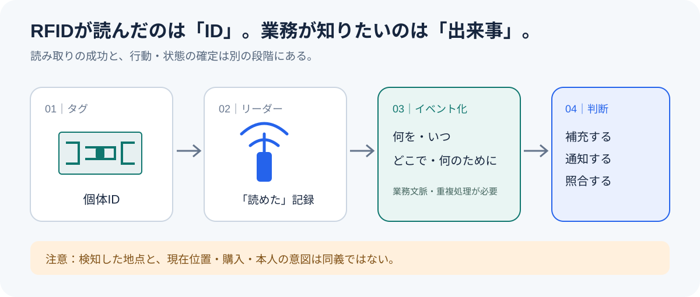
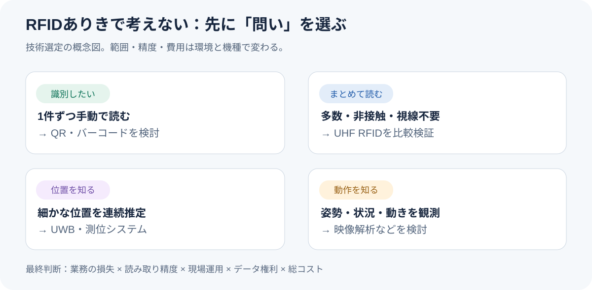

# 電池もない値札が返事をする――RFIDは何を知り、何を知らないのか

*2026年11月5日｜守破離リサーチ／事実・解釈・仮説を区別した技術・事業論考*

服の値札が返事をする。こちらから話しかけた覚えもないのに、棚卸しの機械に向かって「私はこの商品です」と名乗る。しかも、電池が入っていない。値札の労働環境が心配になるが、仕組みを調べると、もっと妙な話だった。**値札は自分から声を出しているわけではない。**

これはRFID（Radio Frequency Identification：電波による個体識別）の話である。製品に付いた小さなICとアンテナが、読み取り機から届いた電波を利用して識別情報を返す。バーコードのように見える位置へ1点ずつ向けなくても、複数の商品を読み取れる場合がある。[GS1：RFIDの仕組み](https://support.gs1.org/support/solutions/articles/43000734380-how-does-an-rfid-system-work-)／[GS1：バーコードとEPCの違い](https://support.gs1.org/support/solutions/articles/43000734209-how-are-gs1-databar-and-epc-the-same-and-how-are-they-different-)

ここで一つ、話をややこしくする。読み取り機が「この商品を見た」と報告したとき、商品が本当にその場所にあると言えるのか。誰かが買った、使った、運んだとまで分かるのか。**RFIDは何を知り、何を知らないのか。** この境界を見極めると、技術の機能一覧よりも事業の見え方が変わってくる。

## 守①｜電池のないタグが返事をするのは、電波を借りて反射するからだ

RFIDは単一の製品名ではなく、電波を使う識別技術の総称である。身近なNFC（近距離無線通信）も広義にはRFIDに含まれる。一方、物流やアパレルの一括読み取りで使われるRAIN RFIDは、主にパッシブUHF帯を用いる。利用する周波数・タグ・リーダーが違えば、読める距離や運用条件も変わる。[GS1標準仕様](https://ref.gs1.org/standards/genspecs/24.0.0/)

パッシブ型のタグには、通常、電池も自力で送信する無線機もない。リーダーの電波から回路を動かすエネルギーを取り出し、アンテナが電波を反射する状態を変える。この反射波通信（バック・スキャッタリング）でIDを返す。人間にたとえれば、自分で叫ぶのではなく、相手が照らした光を鏡で点滅させて返事をするようなものだ。[GS1：パッシブ型とアクティブ型](https://support.gs1.org/support/solutions/articles/43000733398-what-is-the-difference-between-passive-and-active-tags-)

*写真：Boevaya mashina、2019年。デカトロンのTシャツの縫い込みラベルを分解した実物。[元画像と利用条件](https://commons.wikimedia.org/wiki/File:RFID_tag_in_textile_label_disassembled.jpg)（CC BY-SA 4.0、改変なし）。*

この写真では、布の内側に金属のアンテナが収まっている。秘密基地のような大型装置ではなく、商品の一部として縫い込める薄い部品だ。ただし、タグが返すのは識別子であって、商品名、価格、持ち主の人生まで知っているわけではない。そうした情報は、通常、別のデータベースと照合する。[GS1 Japan：EPCとSGTIN](https://www.gs1jp.org/standard/epc/about_epc.html)

したがって、RFIDの第一の役割は、物体に「個体を指し示すための名前」を付けることだ。名前が分かった後、その名前をどの記録へ結び付けるかは別の設計問題になる。

## 守②｜スポーツ用品店とマラソン大会は、同じ仕組みを別の目的で使っている

スポーツ用品小売のデカトロンは、RFIDを商品単位の管理へ広げた代表例だ。同社の公開資料によれば、2008年にフランスで試験を始め、2019年1月までに全商品へRFIDタグを付ける体制を整えた。製造、倉庫、店舗の検品・棚卸し・会計へと、読み取りの場を拡張している。[デカトロン公式：RFIDの導入史](https://www.decathlon-united.media/media/decathlon-united-rfid-en)

*写真：z22、2014年。交通用RFIDリーダー・アンテナの実機。デカトロンの店舗設備ではない。[元画像と利用条件](https://commons.wikimedia.org/wiki/File:TransCore_RFID_reader_and_antenna.jpg)（CC BY-SA 3.0、改変なし）。*

別の現場に移る。マラソン大会では、ゼッケンに付いたタグとコース上の計測マットを組み合わせ、競技者が計測地点を通過した時刻を記録する。MYLAPSはこの方式をパッシブUHFタグを利用するBibTagシステムとして提供し、製品資料では検知率99.8%超を掲げる。ただし、これは提供会社の製品仕様上の数値であり、どの大会・条件でも同率を保証する意味ではない。[MYLAPS公式：ランニング計測](https://mylaps.com/active-sports/sports/running/?noredirect=en-US)

両者に共通するのは「個体IDの読み取り」だが、**商品管理で知りたいのは在庫の状態、レースで知りたいのは通過の時刻**である。同じ電波技術でも、業務が求める出来事は異なる。ここを見落とすと「RFIDがあれば何でも追跡できる」という、ずいぶん元気な誤解が生まれる。

業界規模も確認しておく。RAIN Allianceによると、主要タグ用ICメーカー4社の2025年出荷数は**427億個**。2024年の記録的水準からは減少した。これは売上高でも、稼働中のタグ総数でもない。市場の伸びを語るときは、何を数えているのかを先に確かめる必要がある。[RAIN Alliance：2025年出荷実績（2026年4月公表）](https://therainalliance.org/rain-alliance-reports-42-7-billion-tag-chip-shipments-in-2025/)

## 守③｜読み取り記録は「目撃情報」であって、現在地や本人の意図ではない

例えばスタジアムの倉庫で、RFIDリーダーが無線機AのIDを午前9時に検知したとする。分かったのは、その地点の読み取り条件下でIDが検知されたことだ。午前11時にも同じ場所にあるか、誰が使ったか、持ち出しが適法だったかまでは、その記録だけでは分からない。

GS1が定めるEPCIS（電子商品コード情報サービス）は、現実世界の出来事を共有するための標準である。主な情報は、**何を（What）、いつ（When）、どこで（Where）、どんな業務文脈で（Why）**の4つ。ここでのWhyは人間の「なぜそうしたかったか」という心理ではなく、入荷・出荷などの業務上の意味を指す。[GS1 Japan：EPCISの考え方](https://www.gs1jp.org/standard/epcis/)

*筆者作成。RFIDの読み取り、イベント情報への変換、業務上の判断を区別する概念図。*

読み取りの現場には物理的な例外もある。水分はUHF帯の電波を吸収し、金属は反射やアンテナ特性の変化を起こす。専用タグや配置の工夫で改善できるが、すべての環境で読み漏れが消えるわけではない。[GS1：金属と水の影響](https://support.gs1.org/support/solutions/articles/43000734154-does-rfid-work-around-metal-and-water-)

もう一つ厄介なのは、**読み取れなかったことは、そこに存在しないことの証明ではない**という点だ。これは在庫にも競技者にも効いてくる。RFIDの導入を考えるなら、検知そのものの精度に加え、読み漏れ、重複検知、誤った照合を業務側でどう扱うかまで設計する必要がある。

## 破①｜事業の利益はタグ販売より「読み取り後の面倒」を減らす部分に潜む可能性がある

ここからは実例に基づく解釈と事業仮説であり、市場成立が確認された話ではない。RFIDを売る会社は、タグやリーダーを供給する。だが導入企業の困りごとは、必ずしも「タグが足りない」ことではない。棚卸しに時間がかかる、欠品に気付かない、機材の返却漏れを探している、という業務上の損失である。

仮に競技場の備品管理を考える。従来は担当者が台帳と現物を照合する。RFIDを導入すると、一括読み取りで照合工程を短縮できる可能性がある。ただし、誰かのバッグに残った無線機、金属ケースで読めない機材、IDだけが残った破損タグがあれば、作業は終わらない。つまり商品の「見える化」以上に、**例外を処理する仕組み**が重要になる。

収益性を検討する際は、年間便益を「削減できた照合作業時間の価値＋減らせた紛失・再調達費＋回避できた欠品損失」と分け、タグ・リーダー・システム・保守・運用変更の総費用を引いて考える。項目は検証の枠組みであり、便益を実証した数値ではない。実測前に「効率化率30%」などと置いてしまうと、数字が先に結論を作ってしまう。

これは、技術の販売から「現場の未解決作業を減らすサービス」へ視点を移す提案である。最初に数えるべきなのはタグの個数ではなく、現場で発生している探索・照合・差し戻しの回数だ。

## 破②｜スマートフォンへの搭載は前進しているが、一般普及を既成事実にしてはいけない

RFIDの裾野を変え得る技術として、端末へのリーダー内蔵がある。Qualcommは2025年8月、UHF RFID機能を統合した企業向けモバイルプロセッサ「Dragonwing Q-6690」を発表した。これは業務端末向けの技術発表であり、一般消費者のスマートフォンすべてがUHF RFIDを読めるようになったという意味ではない。[Qualcomm公式発表](https://www.qualcomm.com/news/releases/2025/08/qualcomm-launches-world-s-first-enterprise-mobile-processor-with)

将来、読取端末の入手性が高まれば、専用機器を配る負担が減り、売場・物流・保守の担当者が個体情報を扱いやすくなる可能性がある。一方、RFIDタグの読み取りには無線設計、OS対応、地域ごとの電波規制、認証、情報アクセス権限が関わる。「スマホが読める」から「誰でも自由に商品履歴を読める」までには、いくつもの段差がある。

欧州のデジタル製品パスポート（DPP）は、製品の素材や修理、再利用に関する情報を扱う制度的な流れだ。ただしDPPはRFIDの義務化と同義ではなく、QRコードなども情報への入口になり得る。**製品の情報基盤が必要になることと、RFIDが唯一の勝者になることは別問題**だ。[欧州委員会：Digital Product Passport](https://single-market-economy.ec.europa.eu/single-market/digital-product-passport_en)

## 破③｜マラソンの通過記録と写真を結べば、個人向け映像販売の入口になり得る

ここでは具体的な事業仮説を一つ立てる。大会参加者がゴールした瞬間の写真や映像を探すとき、撮影素材だけから一人を特定するのは簡単ではない。一方、ゼッケンのRFID計測には、どの競技者がどの地点をいつ通過したかというイベント記録がある。両者の時刻を合わせれば、膨大な映像から候補を絞れる可能性がある。

ただし、計測マットを踏んだ時刻と、カメラの前を通った時刻は一致しない場合がある。撮影地点の位置、時計の同期、競技者の速度、映像中の遮蔽、参加者IDの対応関係を扱わなければ、間違った映像を本人へ配信しかねない。**RFIDは顔認識の代用品ではなく、検索範囲を絞る手掛かり**として使うのが自然だろう。

事業仮説としては、参加者向けの写真・動画販売、大会主催者向けの運営分析、計測事業者向けの映像照合機能が考えられる。ただし、顧客が追加料金を払うか、撮影・利用許諾が得られるか、どの精度まで許容されるかは未検証だ。実証では「何人中何人を正しい候補へ絞れたか」と「本人確認を含む人手作業が何分減ったか」を別々に測る必要がある。

## 離①｜RFIDから見えるのは「同じ商品」と「この1個」が違うという思想だ

同じサイズ、同じ色、同じ型番のユニフォームが3枚ある。販売管理では同一商品として扱えても、返品・修理・譲渡の履歴は3枚で違う。GS1のSGTINは、商品種別を表すGTINに個別のシリアル番号を加え、同種の商品を1個ずつ区別できる識別子である。識別子はRFID以外の方法でも扱える。[GS1 Japan：SGTINの説明](https://www.gs1jp.org/standard/epc/about_epc.html)

ここから連想できるのは、モノに「固有の履歴」を付ける発想だ。製造、入庫、販売、修理、回収などの出来事を、同じ個体IDへ接続する。スポーツ用品であれば、交換履歴の確認や中古流通での情報照合などが候補になる。ただし、それらが実際にどこまで記録・共有されるかは制度と企業の設計次第で、RFIDタグ単独では実現しない。

個体の履歴が長く残るほど、別の問題も起きる。商品IDが購入者IDと結び付けば、モノの記録が人の行動記録へ変わる。来場者のリストバンドを追えば便利になる場面もあるが、「便利だから集める」では取得目的の説明にならない。技術によって観測できることと、観測してよいことを分ける必要がある。

## 離②｜「誰がどこにいるか」を知りたいとき、RFIDを使わない判断も正しい

技術比較の軸は、何を観測したいかだ。個別のQRコードでよいなら、安価で導入しやすい可能性がある。多数のモノを視線を合わせず一括で読み取りたいなら、UHF RFIDが候補になる。連続的な高精度測位を狙うならUWB（超広帯域無線）、姿勢や動きの意味を把握したいなら映像解析なども検討対象だ。各技術の精度・費用は環境と構成に依存し、ここに単一の万能ランキングはない。

*筆者作成。用途別の概念比較。実際の導入では読取距離、設置条件、費用、個人情報の扱いを別途検証する。*

意外だが、RFIDのリサーチを進めるほど、RFIDを選ばない理由が明確になる。それは調査の失敗ではない。技術の性能から考え始めると「できること」の一覧になるが、現場の問いから始めると「どこまで必要か」の判断になる。むしろ後者の方が、事業化の議論には役立つ。

## 検証と限界｜再リサーチで、便利な物語を三つ修正した

最初の整理では「RFIDならモノを追跡できる」「市場は右肩上がり」「スマホ対応で一気に普及する」と書きたくなる。しかし一次情報へ戻ると、いずれも条件を加えない限り言い過ぎだった。RFIDの通常の読み取りは観測地点でのイベントであり、無条件の連続位置追跡ではない。2025年のタグ用IC出荷は前年より減った。企業向けプロセッサの発表は、消費者向け端末の普及を証明しない。[GS1](https://support.gs1.org/support/solutions/articles/43000734380-how-does-an-rfid-system-work-)／[RAIN Alliance](https://therainalliance.org/rain-alliance-reports-42-7-billion-tag-chip-shipments-in-2025/)／[Qualcomm](https://www.qualcomm.com/news/releases/2025/08/qualcomm-launches-world-s-first-enterprise-mobile-processor-with)

追加で確認したのは、デカトロンの公式導入史、MYLAPSの製品説明、GS1のイベントデータ標準である。3資料を並べると、実際に導入されている用途は「大量の商品」「通過時刻」「業務イベント」と異なるが、共通しているのはIDを意思決定に必要な出来事へ変換する仕事だと分かる。これは事例を横断した筆者の解釈であり、各社が同じ事業戦略を採っているという主張ではない。

なお、本稿は公開資料の確認に基づく文献調査であり、現場への取材、実機試験、顧客ヒアリングは行っていない。RFIDによる映像販売の利益率や需要、特定会場での読取率を確認したものでもない。読者が活用する際は、技術仕様と顧客課題の両面を独立して検証する必要がある。

## 実務への接続｜まず4週間で「読む価値」を測る

提案する実証実験は、巨大なシステム構築から始めない。**第1週**は対象を一つだけ決める。例えば無線機30台の返却管理や、マラソンの特定通過地点と写真の照合だ。現行手順、担当者、所要時間、紛失や誤照合の頻度を記録する。ここでは「困っている」という感想だけでなく、何回、何分、いくらを確認する。

**第2週**は小規模なタグ・リーダーの配置試験を行い、水・金属・向き・密集による読み漏れと誤検知を測る。**第3週**は読み取りデータを業務イベントへ変換し、例外時の手作業を含む運用を試す。**第4週**に従来方式と比較し、処理時間、照合精度、再処理件数、運用費用、利用者負担を評価する。期間と対象台数は提案上の仮置きであり、必要な試験期間は現場条件で変わる。

合格条件は「RFIDが読めた」ではなく、「現場の損失が、導入・維持費を上回る程度に減った」こととする。費用や精度が合わなければQRコードや既存システムの改善へ切り替える。技術導入そのものを成功基準にしないことが、実証を事業判断へつなげる。

## 再利用プロンプト｜次の技術も同じ深さで調べる

> 対象技術について、①原理と限界を一次資料で確認し、②既存の導入企業・実際の業務・計測可能な成果を分け、③代替技術との比較を行う。次に、事実と未検証の仮説を区別して、スポーツ・エンタメ領域での事業機会を3案作る。各案について顧客の現行業務、未解決の損失、導入条件、必要なデータ、誤検知や権利の例外、検証指標を示す。初回調査でできた主張を疑う再リサーチを行い、間違いがあれば修正する。最後に「その技術を使わない方がよい条件」を必ず明示する。専門用語は初出で説明し、図解と出典リンクを付ける。

このプロンプトの狙いは、奇抜なアイデアを増やすことではない。調べて分かった原理をいったん疑い、別の技術へ乗り換える可能性まで残すことだ。新規事業の調査では、最初の仮説を捨てられる設計も成果になる。

## 結語｜電池のない値札が教えるのは、モノにも「目撃証言」があるということだ

最初の問いに戻る。電池のない値札は、電波を受けて識別子を返す。しかし、それだけでは自分が売れたか、捨てられたか、大切に使われたかを知らない。知っているのは、受け取った電波に対して返した小さな信号だけだ。

人間がその信号へ時刻と場所、業務の意味を付け、履歴として保存すると、モノの「目撃証言」が積み上がる。だからRFIDの本当の競争は、タグがどれだけ遠くから読めるかだけでは終わらない。**その証言から何を判断でき、どこから先は判断してはいけないかを設計する仕事**が残る。値札は無口だった。しゃべりすぎていたのは、むしろこちらの期待の方だった。

## 参考資料・確認用リンク

- [GS1：RFIDの動作原理](https://support.gs1.org/support/solutions/articles/43000734380-how-does-an-rfid-system-work-)
- [GS1 Japan：EPCと商品個体識別](https://www.gs1jp.org/standard/epc/about_epc.html)
- [GS1 Japan：EPCISと業務イベント](https://www.gs1jp.org/standard/epcis/)
- [デカトロン：RFID導入と全商品タグ化](https://www.decathlon-united.media/media/decathlon-united-rfid-en)
- [MYLAPS：ランニング計測とBibTag](https://mylaps.com/active-sports/sports/running/?noredirect=en-US)
- [RAIN Alliance：2025年タグ用IC出荷実績](https://therainalliance.org/rain-alliance-reports-42-7-billion-tag-chip-shipments-in-2025/)
- [Qualcomm：UHF RFID内蔵企業向けプロセッサ](https://www.qualcomm.com/news/releases/2025/08/qualcomm-launches-world-s-first-enterprise-mobile-processor-with)
- [欧州委員会：Digital Product Passport](https://single-market-economy.ec.europa.eu/single-market/digital-product-passport_en)

**Simple English:** An RFID tag can tell a reader its ID. It cannot tell the whole story. The value comes from turning signals into trustworthy decisions.

**日本語：** RFIDタグが返すのは識別情報にすぎない。事業価値は、その情報を信頼できる判断へ変えるところに生まれる。
