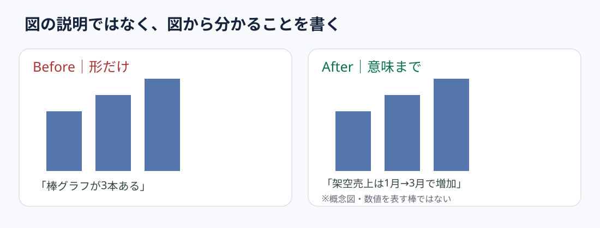

# 代替テキストは図の形より結論を書く

**2026-11-05 06:00 JST｜学習ID 2026-11-05/0600｜基礎技・今日の小さな改善｜3〜5分**

## 今日の結論

**図表の代替テキストには、見た目より「読者が理解すべき結論」を書く。** 説明を言語化できない図は、スライドの主張との関係が曖昧な可能性がある。代替テキストは視覚に頼らない読者のための説明であると同時に、作り手自身の図解チェックにも使える。

## 守｜代替テキストの役割

代替テキスト（alt text）は、スクリーンリーダーなどで図の内容を伝える短い文章。Microsoftは図の内容と目的を簡潔に述べること、グラフでは単に形を説明するのでなく重要な発見を伝えることを勧めている。図が複雑な場合は、本文やデータ表でも詳細を補う。

## Before→After｜架空の売上推移

**Before：**「青い棒が3本並んだ棒グラフ」。これでは何を判断すべきか分からない。**After：**「架空の月次売上は1月から3月にかけて増加している。増加要因はこの図だけでは特定できない」。数値を持たない概念図なので、実際の金額や増加率は述べない。

## 破｜4ステップで直す

1. 図の役割を「比較・推移・構成・手順」から一つ選ぶ。
2. その図から読み取れる事実を一文で書く。因果関係を推測で足さない。
3. Windows版PowerPointで図を右クリックし、［代替テキストの表示］を選んで記入する。表示名は版により異なる場合がある。
4. 説明文だけを読んで、図が伝える要点を理解できるか確認する。必要なら本文にも数値・単位・出典を残す。

## 例外と別解｜飾りは説明しない

背景の罫線など意味を持たない装飾は「装飾としてマーク」できる。一方、詳細な散布図や複雑な表は一文で全情報を代替できない。主要な結論をaltに置き、正確な数値は別の表や本文で提示する。

## 離｜図を言語化すると分析の飛躍が見える

スポーツクラブの来場者数推移で「イベント効果で増加」と書こうとして、単なる前後比較しかないと気づく場合がある。そのとき代替テキストを「イベント後に増加。イベントによる増分かは未検証」と修正できる。アクセシビリティ対応が、事実と解釈の境界を点検する工程になる。

## 失敗例｜結論を盛りすぎる

**失敗：**図にない原因や予測まで書く。**回避：**観測できる変化と仮説を分け、図の裏付けを超える説明は本文の検証課題へ移す。

## 60秒課題｜手元のグラフを一文に

グラフを一つ選び、「何が／いつ・どこと比べて／どう違う」を20〜40字で書く。**合格基準：**「棒グラフ」「円グラフ」という形の説明だけで終わらず、単位・比較対象・主張の整合が取れている。

## 参考資料・Simple English

参考：[Microsoft公式｜効果的な代替テキスト](https://support.microsoft.com/en-gb/accessibility/office-accessibility/everything-you-need-to-know-to-write-effective-alt-text)／[Microsoft公式｜PowerPointのアクセシビリティ](https://support.microsoft.com/en-us/accessibility/powerpoint/make-your-powerpoint-presentations-accessible-to-people-with-disabilities)。

**Simple English: Describe the insight, not just the chart.** ／ **日本語：グラフの形だけでなく、そこから分かることを説明しよう。**
