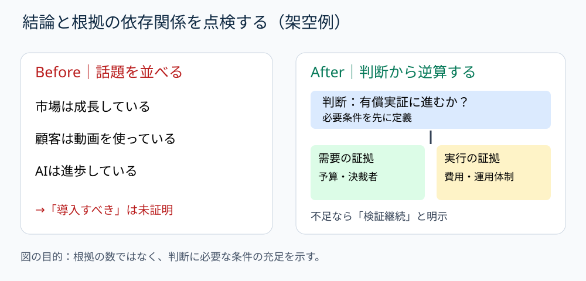

# 結論を支える根拠だけを残す｜判断条件から逆算するスライド設計

**2026-11-05 09:00 JST｜学習ID 2026-11-05/0900｜構想・論理｜3〜5分**

## 今日の結論

**スライドの結論を先に書き、その結論が成立するために必要な根拠を逆算する。** 関連情報を並べるだけの資料から、意思決定に必要な証拠の不足まで分かる資料に変わる。

## 守｜「関連する」と「支える」は違う

資料の遅さは、情報収集が終わらないことだけでなく、集めた情報が結論の成立条件につながっていないことから生じる。**依存関係**とは、ある判断が成立するために、別の条件や事実が必要になる関係。「市場が伸びている」は事業機会の背景にはなるが、「自社が今すぐ投資すべき」の十分な根拠ではない。需要、採算、実行可能性などの確認が別途必要になる。

## Before→After｜スポーツ動画サービスの架空例

**Before：**「市場成長」「AIの進歩」「クラブの動画利用」を横に並べ、タイトルを「新サービスに参入すべき」とする。**After：**タイトルを「有償実証の判断には需要と実行条件の検証が必要」とし、上部に判断、中央に需要の証拠（予算・決裁者）と実行の証拠（費用・運用体制）、下部に不足情報と次の調査を置く。いずれも架空例であり、実際の市場判断ではない。

## 破｜4ステップで根拠を選び直す

1. **判断を動詞で書く。**「市場分析」ではなく「有償実証に進むか」。
2. **成立条件を2〜3個に分解する。**「顧客が払う」「提供できる」「損失を管理できる」。
3. **各条件に対応する証拠を一つずつ指定する。**予算・決裁者、制作原価、実証の停止基準など。未調査は空欄でなく「未検証」と書く。
4. **タイトルの強さを証拠に合わせる。**条件が未確認なら「投資すべき」と断定せず、「検証を先行する」とする。例外として、純粋な状況報告なら意思決定ではなく把握すべき変化を結論にしてよい。

## 離｜資料は情報の倉庫ではなく判断の回路

スポンサー提案では「露出量が多い」から「契約すべき」へ飛ばず、広告主の目的、対象顧客への到達、費用対効果を確認する。採用計画でも「応募が多い」だけで増員を決めず、必要人員、採用単価、定着を確認する。図の矢印は装飾ではなく、主張と根拠の依存関係を表す。

## 失敗例｜すべての箱を矢印でつなぐ

**失敗：**関係の薄い市場データから投資判断へ矢印を引き、因果が証明されたように見せる。**回避：**矢印ごとに「この事実がなければ判断は変わるか」と問い、変わらなければ背景情報へ移す。

## 60秒課題｜一つだけ不足条件を探す

「来場者が増えたので来季の広告費を増やすべき」を点検する。**解答例：**増加と広告施策の因果、追加費用に対する増分利益、他施策との比較が未検証。少なくとも一つを「必要な証拠」として具体化できれば合格。

## 参考資料・Simple English

参考：[Microsoft公式｜アウトライン表示](https://support.microsoft.com/ja-jp/powerpoint/create-and-print-a-presentation-in-outline-view)／[Microsoft公式｜作業に応じた表示モード](https://support.microsoft.com/en-us/powerpoint/training/choose-the-right-view-for-the-task-in-powerpoint)／[SlideLand](https://www.slideland.tech/)（図解発想の参照先。今回の図は独自作成）。

**Simple English: Evidence must support the decision.** ／ **日本語：根拠は、判断を支えるものでなければならない。**

