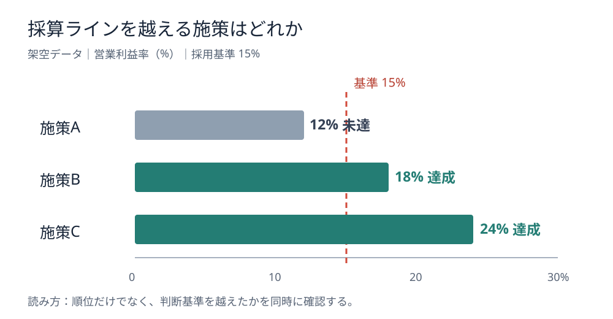

# 順位ではなく採否を見せる｜閾値線付き棒グラフ

**2026-11-05 12:00 JST｜学習ID 2026-11-05/1200｜レイアウト・図解｜3〜5分**

## 今日の結論

**意思決定を促す比較図には、順位だけでなく採否の境界を描く。** 3施策の利益率が12%、18%、24%なら、最大値はCだ。しかし「15%以上なら採用」という条件があれば、Bも採用候補になる。順位の図を判断の図に変えるのが、閾値線（判断基準を示す線）だ。

## 守｜順位と採否は別の問い

棒グラフは量の大小を伝える。閾値線は「必要水準に届いたか」を伝える。両者を重ねると、どれが最も高いかと、どれが条件を満たすかを同時に読める。採用基準は仮説ではなく、事前に決まったルールなのか、今回提案する暫定基準なのかを必ず区別する。

## Before→After｜架空の施策選定

BeforeはA12%、B18%、C24%の棒を高い順に並べるだけ。Afterは**営業利益率15%以上を採用候補とする架空のルール**を赤い縦線で示し、Aは未達、B・Cは達成と直接ラベルを置く。線は棒の長さと同じ数値尺度上に配置する。

*図：順位と採否を一枚で分けて読む。A12%、B18%、C24%、基準15%はすべて説明用の架空値。*

## 破｜4ステップで作る

1. **判断の問いを決める。**「最大はどれか」なら単純な棒、「条件を満たすのはどれか」なら基準線を追加する。
2. **尺度を固定する。** 横軸は0〜30%、棒はゼロ起点にし、単位を明記する。基準線は15%の正確な位置に置く。
3. **基準の性質を書く。**「社内承認済み基準」「検討用の仮置き」など出所を明示する。基準が複数あるなら線を増やしすぎず帯で区分する。
4. **直接ラベルを付ける。** 各棒の末尾に値と達成・未達を表示する。PowerPointでは棒グラフを挿入し、基準線は軸と位置を合わせた図形で重ねる方法がある。データ更新時は線の位置も再確認する。

## 離｜別の図がよい場合

**向く：** 単一の指標と明確な採否基準がある施策・店舗・投資案件。**向かない：** 収益性と実現可能性の二軸で選ぶなら散布図、複数の必須条件を判定するなら合否表、時系列の基準超過を見るなら折れ線と基準線がよい。基準自体に合意がなければ、先に基準の妥当性を議論する資料が必要だ。

## 失敗例｜恣意的な基準を既定事実にする

**失敗：** 作成者が置いた15%を「会社の採用基準」のように見せる。**回避：** 図中に「説明用の仮基準」と明記し、意思決定者が承認した数値だけを正式基準として扱う。

## 60秒課題｜基準線を足すべきか

スポーツイベント3案の想定利益率は8%、14%、19%。社内で承認済みの最低利益率は12%。何をタイトルにし、どれを候補にするか。**解答例：**「3案中2案が最低利益率12%を満たす」。14%と19%の2案を候補とし、利益率だけで最終決定しない。

## 参考資料・Simple English

参考：[SlideLand｜スライドの図解・グラフ事例](https://www.slideland.tech/)／[Microsoft公式｜PowerPointでグラフを作成](https://support.microsoft.com/en-us/accessibility/powerpoint/use-a-screen-reader-to-create-charts-in-powerpoint)。本図は独自制作で、公開作例の転載ではない。

**Simple English: Show the decision threshold, not just the ranking.** ／ **日本語：順位だけでなく、判断の基準線を示そう。**