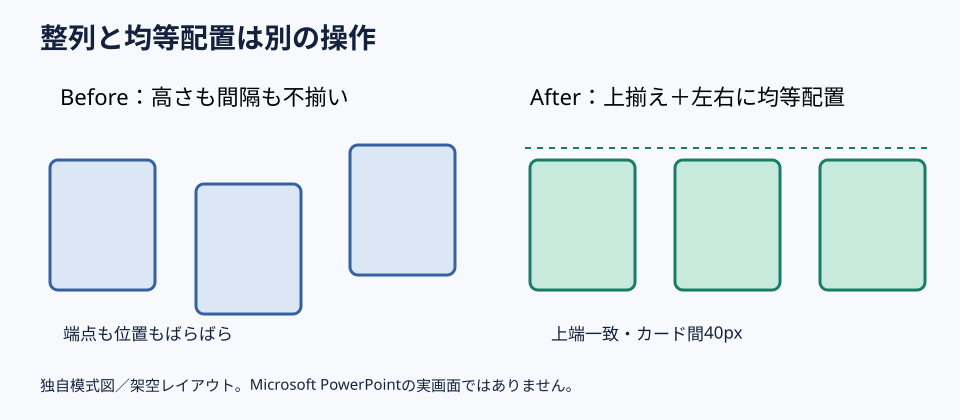

# 3つの図形は上揃えと均等配置を分けて整える

**2026-11-05 15:00 JST｜学習ID 2026-11-05/1500｜PowerPoint実装・時短｜3〜5分**

## 今日の結論

**図形をきれいに並べるには「端をそろえる」と「間隔をそろえる」を別々に実行する。** 見た目で微調整する前に、整列基準を決めるだけで修正回数を減らせる。

## 守｜整列と均等配置の違い

整列は複数図形の左端・上端・中心などを同じ線に置く操作。均等配置は3つ以上の図形の間隔を等しくする操作だ。例えば横並びの比較カードは、まず上端をそろえ、その後で左右の間隔をそろえる。なおカードの幅が違う場合、中心点の距離が等しいことと余白が等しいことは別なので、実際の余白を確認する。

## Before→After｜比較カード3枚

Before：事業A・B・Cのカードを目視で配置し、上端もカード間隔もばらつく。After：カードの高さと幅を統一し、上揃えと左右均等配置を適用する。3案を同格に比較するという意味が、配置から伝わる。

## 図解｜2つの操作を順番に使う

*図：整列は上端、均等配置は隣接する図形間の余白をそろえる。数値は架空のレイアウト例。*

## 破｜Windows版PowerPointで4ステップ

1. **対象を選ぶ。** Ctrlを押しながら3つのカードをクリックして複数選択する。
2. **整列基準を確認。** ［図形の書式］→［配置］→［整列］で、［選択したオブジェクトを揃える］を選ぶ。［スライドに揃える］だと意図せず全体が動く。
3. **上端をそろえる。** ［整列］→［上揃え］を実行する。
4. **左右を均等配置。** 最も左と右のカードの位置を決めてから、3つを選び［整列］→［左右に整列／水平方向に配置］を実行する。メニュー名は製品版で異なる場合があるため、等間隔配置の項目を確認する。

## 離｜見た目の整列は意味の整列でもある

比較対象が同格ならカードの幅・高さ・余白を統一する。一方、主案と補助案を示すなら、あえて主案を大きくする方が意味に忠実な場合もある。**同じ見た目にすべきかを先に決め、操作は後から選ぶ。**

## 失敗例｜スライド全体を基準にしてしまう

失敗：3枚のカードを左揃えしようとして［スライドに揃える］が有効なまま操作し、カードが左端へ集まる。回避：［選択したオブジェクトを揃える］を確認し、端点を固定してから均等配置する。

## 60秒課題｜3枚を30秒で整える

幅が同じ3つの長方形を横に置き、上端をずらす。30秒で上揃え、残り30秒で左右均等配置する。判定は①上端が同一線②左右の余白が等しい③スライド全体の左右余白が不自然でない、の3点。

## 参考資料・Simple English

Microsoft公式：[オブジェクトを整列または配置する](https://support.microsoft.com/ja-jp/office/graphics-visuals/align-or-arrange-objects)。図解研究の入口：[SlideLand](https://www.slideland.tech/)。本稿の図は独自模式図であり、特定作例を再現したものではない。

**Simple English: Align the edges, then distribute the gaps.** ／ **日本語：端をそろえてから、間隔を均等にしよう。**

