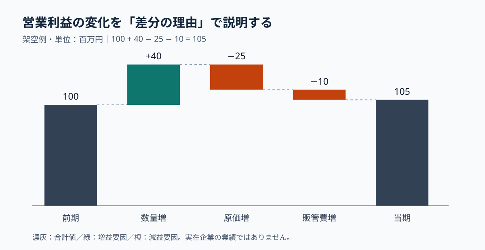

# グッドパッチ掲載事例から学ぶ｜滝グラフは増減の理由をつなぐ

**2026-11-05 18:00 JST｜学習ID 2026-11-05/1800｜名作スライド解剖｜3〜5分**

## 今日の結論

**増えた・減ったという結果だけでなく、その差が何によって生じたかを一枚で伝える。** 滝グラフ（ウォーターフォールグラフ）は、合計値から次の合計値へ至る増減を橋渡しする図。数値の内訳が確定していれば、説明の順序を先に決められ、作図の手戻りも減る。

## 守｜実在する掲載事例をどう読むか

SlideLandのウォーターフォールグラフ分類には、株式会社グッドパッチの「2026年8月期 第2四半期 決算説明資料」が掲載され、「営業利益増減」のタグが付いている。**確認できた事実は資料名・分類・タグまで**であり、原典の特定ページの色、配置、数値や作者はここでは断定しない。以下はその図解分類を手がかりにした独自教材である。

**ページの目的**は「利益の差を要因で説明すること」。**主張**は「どの要因が増減を左右したか」。**構造**は開始値→プラス要因→マイナス要因→終了値。**視覚的工夫**は増減を浮いた棒と接続線で連続的に見せる点にある。ただしこれは図の一般原理であって、掲載ページの詳細描写ではない。

## 図解｜合計と差分を混ぜない

*図：100＋40−25−10＝105。架空データ、単位は百万円。濃灰は合計、緑は増益、橙は減益。何を理解させるか：最終差額5の裏で複数の大きな増減が相殺されている。*

## 破｜再現する4ステップ

1. **比較する合計値を決める。** 前期100、当期105など、同じ定義・期間・単位でそろえる。
2. **差分を漏れなく分解する。** 例：数量増＋40、原価増−25、販管費増−10。合計が＋5になることを検算する。
3. **棒の起点を積み上げる。** 増益要因は直前の累積値から上へ、減益要因は下へ描く。開始・終了の合計棒だけをゼロ基準にする。
4. **タイトルに読み取りを置く。** 「営業利益推移」ではなく「数量増の効果を原価・販管費の増加が相殺」と書く。ただし架空例では実企業の断定と混同させない。

**別解：**要因の大小比較だけなら横棒、時系列の推移なら折れ線が向く。滝グラフは差分の加減算が成立する場合に使う。

## Before→After｜数値列から判断の図へ

**Before：**「前期100、数量＋40、原価−25、販管費−10、当期105」と数字を横一列に並べる。**After：**左端に前期の合計棒、中央に浮いた増減棒、右端に当期の合計棒を配置する。タイトルは「数量増を費用増がほぼ相殺」とし、どの要因を深掘りすべきか読者に伝える。

## 離｜スポーツ事業の意思決定へ

例えばホームゲームの収益差を「前年売上→来場者数の変化→客単価の変化→商品構成の変化→今年売上」で分解したくなる。しかし数量・単価・構成の効果には交互作用が生じ得る。**足して一致する定義を先に決める**ことが図の信頼性を左右する。滝グラフの巧拙は配色より、差分の会計・分析上の整合性にある。

## 失敗例と限界

**失敗：**各増減棒をすべてゼロから描き、あたかも合計値の比較であるように見せる。**回避：**増減棒は累積値から始め、接続線と符号を付ける。要因が重複したり、未説明の残差がある場合は「その他・未説明」を明記し、説明し切ったように見せない。

## 60秒課題

前期売上80、客数増＋18、客単価低下−7、その他＋2なら当期はいくらか。**答え：93。**まず80＋18−7＋2＝93を確認し、合計棒は80と93、差分棒は＋18・−7・＋2の順に置く。判定基準は合計一致・単位一致・増減の起点一致。

## 参考資料・Simple English

原典の掲載分類：[SlideLand｜ウォーターフォールグラフ](https://www.slideland.tech/docs/graph/water-fall)。分類の定義：[SlideLand｜カテゴリ一覧](https://www.slideland.tech/docs/category-list)。PowerPointの操作案内：[Microsoft公式PowerPointサポート](https://support.microsoft.com/ja-jp/powerpoint)。

**Simple English: Explain the bridge, not only the gap.** ／ **日本語：差だけでなく、差が生まれた道筋を説明しよう。**
