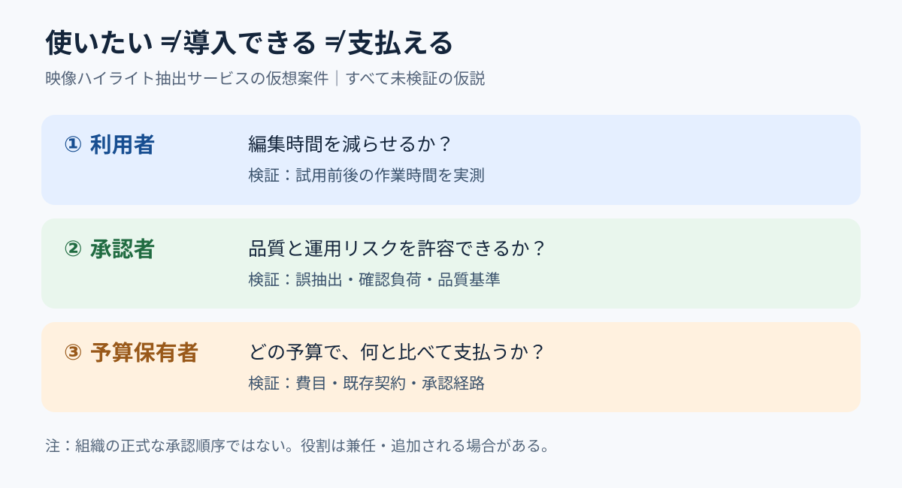

# 利用者・決裁者・予算保有者を分ける｜導入障壁の三者マップ

**2026-11-05 21:00 JST｜学習ID 2026-11-05/2100｜コンサル実務応用｜3〜5分**

## 今日の結論

**使う人が欲しいと言っても、買う人が納得しなければ売れない。** 新規事業の提案スライドは「誰が使うか」だけでなく「誰が導入を承認し、どの予算から支払うか」を分けると、次の検証が明確になる。これは実際の組織で役割が兼任される場合もある分析上の分解である。

## 守｜顧客価値と購買成立は別の問い

価値提案キャンバスは顧客の仕事・困りごと・得たい成果を整理する。一方、法人向けサービスでは**利用価値の検証**と**購買手続きの検証**を分ける必要がある。今回の三者は①利用者（現場で使う人）、②承認者（導入の可否を決める人）、③予算保有者（支出枠を管理する人）。実在企業の役職構成を示すものではない。Strategyzerも顧客課題、提案価値、収益の仮説を段階的に検証する考え方を示している。

**図が示すこと：** 同じ製品でも、現場の有用性、承認の条件、支払いの根拠は異なる。矢印は組織上の正式な承認順序ではなく、検証論点の接続を表す。

## 破｜4手順で「売れる条件」の1枚を組む

1. **対象案件を限定する。** 仮想例は「試合映像からハイライト候補を抽出するサービスをクラブへ提案」。実際の導入実績や顧客要望を示すものではない。
2. **三者の仕事を別々に記す。** 利用者＝編集時間を短縮、承認者＝品質と運用リスクを管理、予算保有者＝費用対効果と予算枠を判断。すべて現段階では［仮説］。
3. **各行に検証可能な問いを置く。** 利用者「候補抽出は編集時間を何分減らすか」、承認者「誤抽出の確認負荷は許容範囲か」、予算保有者「どの費目で何と比較して支払うか」。
4. **右端に次の証拠を置く。** 作業時間の実測、試用後の品質判定、予算・稟議の聞き取りを並べる。役割が同一人物なら行を統合し、複数部署にまたがるなら関係者を増やす。

## Before→After｜映像AIの提案を購買判断へ

**Before：**「AIで映像編集を効率化し、クラブ向けに展開する」。利用者の便益しか見えず、支払う条件が不明。**After：**「編集時間の短縮可能性だけでなく、品質承認と予算適合を検証してから事業化を判断する」。PPTでは上部にこの主張、中央に図の三段、下部に「次のアクション：現場試用・品質基準確認・予算担当ヒアリング」と配置する。成果や費用削減は未実証として断定しない。

## 離｜販売先を増やすより「誰が拒否できるか」を探す

同じ発想は病院の業務ソフト、商業施設の人流分析、スポンサー向け広告効果測定にも転用できる。**導入を止められる人（拒否権を持つ関係者）**が利用者・決裁者・予算保有者以外にいる場合、情報セキュリティや法務も独立した検証行にする。三者マップは組織図ではなく、導入失敗の仮説を洗い出すための道具だ。

## 失敗例｜役職を想像して実在組織に当てはめる

「広報部長が決裁し、マーケティング予算で買う」と事実のように書くのは危険。組織や費目は案件で変わる。**回避：** 役割名は仮置きと明記し、ヒアリングで承認経路、既存契約、費目を確かめる。

## 60秒課題｜誰の「いいね」では足りないか

「映像編集者が便利だと言った」から「クラブが契約する」までに必要な問いを2つ書こう。**解答例：**「誰が品質と運用リスクを承認するか」「どの予算で、何を比較対象として支払うか」。判断基準は、使用感と購買条件が混ざっていないこと。

## 参考資料・Simple English

参照：[Strategyzerの価値提案の検証手順](https://www.strategyzer.com/library/roadmap-to-test-your-value-proposition)／[Strategyzerの顧客区分に関する注意](https://www.strategyzer.com/library/5-common-mistakes-to-avoid-when-using-the-value-proposition-canvas)／[SlideLandの事業計画スライド分類](https://www.slideland.tech/docs/material/business-plan)。図は独自作成であり、案件と役割はすべて仮想。**Simple English: A user is not always the buyer.** ／ **日本語：使う人が、必ずしも購入を決める人とは限らない。**
