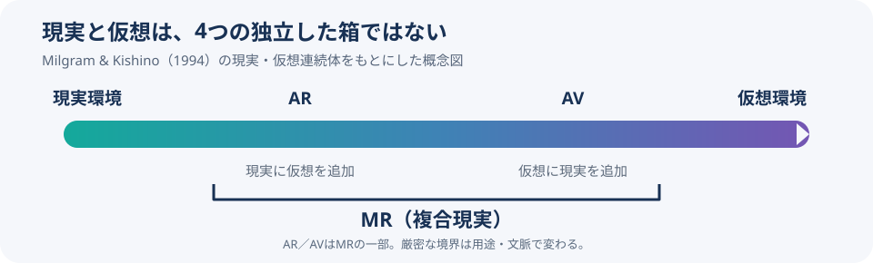
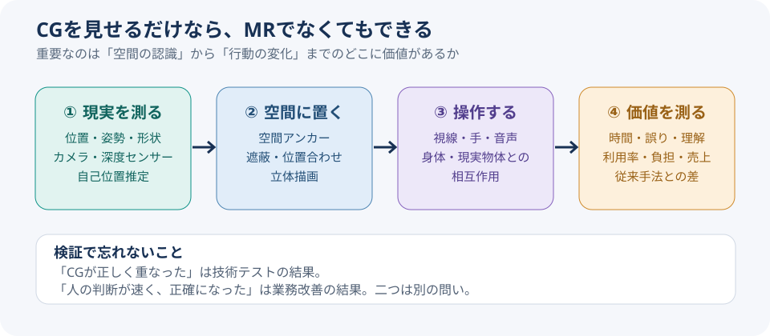

# 机の裏に隠れるCGは、机を知っているのか――MRを「現実の説明書」として考える

*2026年11月6日｜公開された論文・企業公式資料を基に調査。事実・研究結果・筆者の解釈・未検証の事業仮説を区別して記す。実機試用や顧客取材は行っていない。*

部屋にCGの犬を出す。そこまでは分かる。ゲームだって動画だって犬を出せる。では、その犬がソファの後ろに回った瞬間、本当に背もたれに隠れたらどうだろう。犬はデータなのに、ソファの位置を守っている。**犬に生活動線を教えた覚えはない。**

ここに複合現実（MR：Mixed Reality）の面白さがある。現実の上に絵を足すだけでなく、物理的な部屋の形や位置を計算に取り込み、仮想の物体をそこで振る舞わせる。もっとも、「MRなら必ずソファを認識できる」という意味ではない。製品や実装の能力はそれぞれ違う。問題は、映像の合成ではなく、現実がソフトウェアにとって何になるかだ。

## 要旨｜MRは「ARの上位版」ではなく、現実と仮想を結び付ける考え方である

MRは、現実環境と仮想環境を混ぜ合わせた体験や、その仕組みを指す。学術的な原義では、現実へ仮想物体を追加する拡張現実（AR）も、仮想環境へ現実由来の情報を取り込む拡張仮想（AV）もMRに含まれる。現在の製品説明では、空間理解・遮蔽・相互作用を備えた体験を強調する用法も見られる。この二つを分けないと、「ARよりMRが上」という単純な進化図が生まれてしまう。[1994年の原論文](https://globals.ieice.org/en_transactions/information/10.1587/e77-d_12_1321/_p)／[マイクロソフト公式解説](https://learn.microsoft.com/en-us/windows/mixed-reality/discover/mixed-reality)

調査から立てる仮説は一つ。**MRが生む価値の核心は、現実の背景にCGを描くことよりも、現実を位置付きの情報として扱い、人間の判断へ返すことにある。** ただし、だからすべての仕事にMRが必要という結論にはならない。むしろ、不要な場面を見抜く力が事業性を左右する。

## 守①｜1994年の定義では、MRはARを包含していた

用語を整理しよう。仮想現実（VR：Virtual Reality）は、主にコンピューター上に作った環境への没入を指す。拡張現実（AR：Augmented Reality）は、現実の景色や映像へデジタル情報を加える。複合現実（MR）は、現実と仮想が混ざった幅広い状態を表す。

1994年12月25日に発表されたポール・ミルグラム（Paul Milgram）と岸野文郎の論文『A Taxonomy of Mixed Reality Visual Displays』は、現実と仮想の間に「現実・仮想連続体（Reality–Virtuality Continuum）」を置いた。その内部にARとAVを配置する。研究者たちは両者を単純な機器の優劣で区切るのではなく、世界をどの程度認識しているか、表示の再現性、現実感などを含めて分類しようとした。[原論文の書誌・要旨](https://globals.ieice.org/en_transactions/information/10.1587/e77-d_12_1321/_p)

*図1：筆者作成。論文の考え方を簡略化した模式図。ARとAVの境界は厳密な機器ランキングではない。*

その後、メーカーが「MR」をより豊かな空間認識を伴う体験として説明することも増えた。マイクロソフトの開発者向け資料は、スマートフォンのAR体験も複合現実の広い範囲に位置付けつつ、空間の認識、手や視線の入力、立体音響などを挙げている。[マイクロソフトのMR概説](https://learn.microsoft.com/en-us/windows/mixed-reality/discover/mixed-reality)

だから、テレビの買い替えのように「ARからMRへグレードアップ」と考えると、原義とも製品横断の比較ともずれる。まず**何を現実として取り込み、何がその情報に応じて変わるのか**を聞く方が正確だ。

## 守②｜犬をソファの裏へ隠すには、四つの仕事がある

犬のCGがソファの前へ飛び出し、次に背もたれの裏へ回る。これを自然に表示するには、装置が周囲を見て、座標を持ち、前後関係を描画し、利用者の動きへ追随する必要がある。

**第一に、自己位置推定と環境地図作成（SLAM）。** カメラや慣性センサーなどを用いて、装置がどこにいるかと周囲の形を推定する。**第二に、空間マッピング（Spatial Mapping）。** 床・壁・家具の面や立体構造を把握する。**第三に、空間アンカー（Spatial Anchor）。** CGを現実のある位置に固定し、利用者が動いても位置関係を保つ。**第四に、遮蔽処理（Occlusion）。** 実物が手前にあるとき、CGの該当部分を見えなくする。

マイクロソフトは空間マッピングにより実際の表面へ仮想物体を置き、現実物体による遮蔽を再現できると説明する。Metaも、パススルー（外部カメラ映像の表示）、シーン認識、空間アンカー、深度情報による遮蔽を別々の機能として整理している。[マイクロソフト：空間マッピング](https://learn.microsoft.com/en-us/windows/mixed-reality/design/spatial-mapping)／[Meta：MRを構成する機能](https://developers.meta.com/vr/discover/mixed-reality-intro/)

*図2：筆者作成。右端の成果測定は技術の必須機能ではなく、導入判断に必要な評価段階として追加した。*

ここで、小さな思考の転換が起きる。ソファはもう単なる「背景画像」ではない。ソフトウェアが参照する**位置や形を持った環境データ**になる。ただし、認識には誤差があり、暗所、遮蔽物、動く家具などで精度は変わる。犬に家具の位置を教えたのは魔法ではなく、十分には信頼できない測定と計算だ。

## 守③｜MRを映す装置には、透過型とカメラ映像型がある

同じ「現実が見える」でも、見え方は違う。マイクロソフトのHoloLens 2は透過型の光学ディスプレイを使い、実物の景色に表示光を重ねる。一方、Apple Vision ProやMeta QuestのMR体験では、装置のカメラで捉えた景色をディスプレイに表示する「パススルー」が重要になる。[HoloLensの描画方式](https://learn.microsoft.com/en-us/windows/mixed-reality/develop/advanced-concepts/rendering-overview)／[Apple：パススルーと没入度](https://developer.apple.com/design/human-interface-guidelines/immersive-experiences/)

*画像：マイクロソフト公式ブログ（2019年）の製品イメージ。[元記事](https://blogs.microsoft.com/blog/2019/02/24/microsoft-at-mwc-barcelona-introducing-microsoft-hololens-2/)。実地の作業改善効果を検証した写真ではない。*

透過型なら停電しても現実の景色そのものは遮断しにくいが、仮想物体で黒や影を表現するには制約がある。パススルー型は現実映像とCGを柔軟に合成できる反面、映像表示や遅延、装置の稼働状態へ視界が依存する。どちらが常に優秀という話でもない。「何を見せるか」だけでなく、**現場で何を見失ってはいけないか**が装置選びの条件になる。

## 破①｜NBAは、試合を「見る映像」から「置いて眺めるデータ」へ変え始めた

ここで犬からバスケットボールへ移る。Appleは2025年の発表で、Apple Vision Pro向けNBAアプリについて、複数の試合映像や試合データに加え、一部試合で選手の移動を小さな3Dコートに再現するテーブルトップ型の表示を紹介した。2026年5月のApple開発者向け記事でも、NBAの担当者が、複数画面、リアルタイムの統計、3D試合再現、没入型中継という異なる体験を説明している。[Apple日本語公式発表](https://www.apple.com/jp/newsroom/2025/10/spectrum-brings-nba-games-in-apple-immersive-to-apple-vision-pro/)／[2026年のNBA開発者インタビュー](https://developer.apple.com/news/?id=butwix3f)

*画像：Apple Developer掲載、NBAアプリの画面。[掲載元](https://developer.apple.com/news/?id=butwix3f)。3Dコートと通常の試合映像を組み合わせた公式紹介であり、どの試合でも利用できることを保証するものではない。*

面白いのは、180度の没入型試合映像と、3Dのコート再現が**同じものではない**点だ。前者は撮影された場面に身を置く視聴体験。後者は選手の位置情報を立体的な表現へ変換する体験。専用カメラが増えた話と、競技データの使い道が増えた話を一緒にしない方がいい。

この違いはスポーツビジネスにも効く。映像を売るなら撮影・編集・配信・権利の設計が中心になる。動きの3D再現を売るなら、トラッキングデータの品質、遅延、立体再現の正確さ、データ利用権限が重くなる。**MRの企画書に「臨場感」とだけ書くと、必要な調達先さえ決められない。**

## 破②｜職業訓練に効果を示す研究はある。しかし「全部MRの勝利」ではない

事業性を考えるなら、宣伝資料だけでなく研究を見る。2025年に公表された職業教育・訓練の系統的レビューとメタ分析は53研究を扱い、比較対照群に対して、行動面・認知面・情意面の訓練成果に統計的に有意な正の効果を報告した。標準化効果量はそれぞれ d＝0.40、d＝0.84、d＝0.65。ただし研究が扱う「MR」は、VRとARも含む広い区分である。[Böddingほか、2025年、Virtual Reality](https://link.springer.com/article/10.1007/s10055-025-01118-z)

ここで重要なのは、標準化効果量を「作業時間40％短縮」と読まないことだ。d＝0.40は平均の差を統計的に標準化した指標であり、改善率ではない。対象となる訓練内容や対照条件によっても結果は変わる。今回の研究から、特定のMR機器の投資回収や、サッカーの戦術学習の効果まで確定するわけではない。

それでも研究は「効果があり得る」という根拠を与える。つまり次に必要なのは、**誰の、どんな作業に、何と比較して、どれだけの改善が出たか**という条件付きの問いだ。技術導入に必要なのは希望の大きさではなく、比較実験の設計である。

## 破③｜MRの象徴だったHoloLens 2は製造終了した

ここが今回の再調査で最も大きく見方を変えた部分だ。マイクロソフトの公式資料によれば、HoloLensの製造は2024年12月までに終了している。一方、HoloLens 2には2026年10月時点でもセキュリティ更新が配信されており、Windows Holographic 24H1の最終機能更新以降もセキュリティ保守は続いている。製造終了と、既存機器が即座に動かなくなることは別である。[HoloLens公式更新履歴](https://learn.microsoft.com/en-us/hololens/hololens-release-notes)／[販売・在庫に関する公式案内](https://learn.microsoft.com/en-us/hololens/hololens2-purchase)

MRの代表的な装置が製造終了したから、MR全体が終わった、とも言えない。AppleやMetaでは別の設計思想による空間コンピューティングが進んでいる。しかし、製造継続性、保守、入手性、現場装着の負担は、事業実装を左右する。派手なデモが成功しても、翌年に同じ機器を何十台も調達できなければ、運用計画は成立しない。

技術の可能性と、その企業の製品戦略を同じグラフで語らない。これはMRに限らず、新技術を調べるときの大事な区別だ。

## 離①｜思考実験：CGの矢印が必要な仕事と、ただ邪魔な仕事を分ける

ここからは実機実験ではなく、**導入適否を考えるための思考実験**を行う。スタジアムで作業するスタッフを想定し、三つの課題を同じMR機器で解こうとしてみる。

- **A：試合開始時刻を確認する。** 壁に大きな時刻表示を出せる。でもスマートフォンや時計で足りる。MR化の必要性は低い。
- **B：複雑な機器のどの端子を抜くか確認する。** 実物の端子の位置へ矢印を固定できれば、説明書と実機を往復する手間を減らせる可能性がある。ただし位置合わせの誤りは重大な事故につながり得るため、確認工程は省けない。
- **C：試合中、特定選手の立ち位置を実寸のピッチ上に再現する。** 空間の距離感が重要ならMRの意味がある。ただしコーチング上の効果は未検証で、現場利用の安全性や集中への影響も考慮が必要だ。

三例を比べると、共通する境界線が見える。**その情報が「そこ」に表示される必要はあるか。** 必要なければ、スマホ、紙、普通の映像でよい。必要なら、空間を認識し続けるコストを払う理由が生まれる。

## 離②｜競争の場所はゴーグルの中から、空間データの整備へ移るかもしれない

MRでスポーツの試合を再現するとしよう。3Dの選手モデルを描く前に、どの選手がいつどこにいたか、コートやピッチをどの座標で扱うか、時間を映像とどう同期させるかを決めなければならない。映像に映っている情報と、実際に計測した座標は同じではない。

ここから、次の三つの事業仮説が考えられる。**①空間データ整備**：競技や施設のデータを、複数の表示装置で使える形式へ変換する。**②現場支援**：作業員の視界へ位置付きの手順や警告を出す。**③体験制作**：選手の動きや建築物の完成形を実寸・立体で見せる。いずれも実在市場の規模、支払意思、採算はこの調査では確認していない。

別の分野へ飛ぶと、デジタルツイン（現実の状態をデジタル上で表現し、更新する考え方）との接点もある。デジタルツインが状態を表し、MRがその状態を現場の位置へ返し、AIが予測や操作案を支援する。しかし三つをつなぐだけで価値が出るわけではない。データ精度、更新頻度、権限、誤案内への対処がそろって初めて業務になる。

この段階で、MRを「ヘッドセット販売」とだけ分類するのは狭すぎる。逆に、何でも空間データ事業に含めれば市場を大きく見積もりすぎる。**誰がどのデータにアクセスでき、どんな意思決定を改善できるか**まで市場を切って考える必要がある。

## 実務への接続｜まず「空間が必要か」を検証する

提案として、MR事業の初期検討を四段階に分けたい。

1. **現行業務の観察。** 対象作業を一つ選び、迷い・確認・手戻りに費やす時間と誤りの種類を記録する。
2. **2Dの代替案を作る。** 紙、スマートフォン、通常の動画・大型モニターで同じ課題をどこまで解けるかを確認する。
3. **空間表示の限定実証。** 同じ内容を現実の物体や位置に結び付けて提示する。位置ずれ、視界の妨げ、疲労、安全面も測る。
4. **費用対効果を判断。** 作業時間、修正回数、理解度、利用負担と、機器・制作・保守・コンテンツ更新の総費用を比較する。

判断軸を「MRで作れたか」ではなく、「同じ課題を2Dより適切に解けたか」に変える。スポーツのファン体験であれば、滞在時間や満足だけでなく、体験に追加料金を払う人がいるか、運営者が継続費用を負担できるかも別に検証すべきだ。

## 再リサーチ｜三つの便利すぎる説明を修正した

第一に、「ARは重ねるだけ、MRは相互作用する上位版」という説明を修正した。1994年の原義ではARはMRの一部であり、現代のマーケティング上の区分と同一ではない。[原論文](https://globals.ieice.org/en_transactions/information/10.1587/e77-d_12_1321/_p)

第二に、「3Dで見られるスポーツ＝全部MR」とする説明を避けた。NBAの180度没入型映像と、プレーを3Dコートに再現する機能は異なる。後者が現実空間へ配置されると空間型の体験になるが、どちらも必ず同じ技術・データで実現されるわけではない。[Apple Developer](https://developer.apple.com/news/?id=butwix3f)

第三に、「有望技術なら専用機器の普及も進む」という推測を弱めた。HoloLens 2は製造終了しており、機器の供給と技術の広がりは別々に追う必要がある。[マイクロソフト](https://learn.microsoft.com/en-us/hololens/hololens-release-notes)

なお、上記の検証は公開文献に基づく。市場規模、スポーツ向けの実際の契約単価、投資回収期間は算定していない。研究の効果量を企業収益へ直接換算することもしない。

## 再利用プロンプト｜MR・空間技術の事業性を調べる

> あなたは技術調査者、サービスデザイナー、事業開発担当者を兼ねる。対象とするMR・AR・VR・空間コンピューティング技術について、まず学術的定義とメーカーの用語法を分け、一次資料をリンク付きで確認する。次に、センサー・自己位置推定・空間マッピング・アンカー・遮蔽・操作入力・コンテンツ・権利処理のうち、各事例に実際に必要な要素を特定する。導入事例は「実装された機能」「提供企業の主張」「第三者が検証した成果」を混同しない。用途を3件選び、必ず紙・スマホ・通常映像との比較を行う。想定顧客、現在の作業、未解決の損失、必要なデータ、機器供給・保守、プライバシー、安全性、成果指標、撤退条件を整理する。予測は仮説と明記し、初回調査に反する証拠を追加探索する。最後に、ひとつの妙な具体例から始まり、技術→実例→比較→新しい問いへ進む文章を日本語で書く。見出しは結論型にし、誇張を避け、図解と出典を付ける。

## 結語｜ソファの後ろへ隠れた犬は、「位置」に価値があると教えてくれた

最初の犬に戻る。あれはCGだからソファの裏に隠れたのではない。ソファの位置が計算され、犬の位置と比較され、前後関係が描き直されたから隠れた。見た目には小さな出来事だが、「現実のものがソフトウェアの判断材料になる」という変化が起きている。

ただ、その変化をすべての場所で起こす必要はない。時刻を知りたいだけなら時計でいい。知らない端子を一本抜くなら、実物の真上に矢印があることには意味がある。技術を調べる前は、MRとは「すごいものが見えること」だと思っていた。今は、**「その情報は、なぜその場所になければいけないのか」と問い返す技術**に見える。

犬はソファの位置を守った。次は、我々が現場の事情を守れるかどうかだ。

## 参考資料・一次情報

- [Milgram & Kishino（1994）：MRの分類と現実・仮想連続体](https://globals.ieice.org/en_transactions/information/10.1587/e77-d_12_1321/_p)
- [Microsoft：What is mixed reality?](https://learn.microsoft.com/en-us/windows/mixed-reality/discover/mixed-reality)
- [Microsoft：Spatial Mapping](https://learn.microsoft.com/en-us/windows/mixed-reality/design/spatial-mapping)
- [Meta：Mixed Realityの構成技術](https://developers.meta.com/vr/discover/mixed-reality-intro/)
- [Apple：visionOSの没入体験とパススルー](https://developer.apple.com/design/human-interface-guidelines/immersive-experiences/)
- [Apple：NBAの空間コンピューティング事例（2026年5月）](https://developer.apple.com/news/?id=butwix3f)
- [Apple：NBA映像・3Dコート紹介（日本語）](https://www.apple.com/jp/newsroom/2025/10/spectrum-brings-nba-games-in-apple-immersive-to-apple-vision-pro/)
- [Böddingほか（2025）：職業訓練へのMR活用のメタ分析](https://link.springer.com/article/10.1007/s10055-025-01118-z)
- [Microsoft：HoloLens 2の更新・製造終了に関する注記](https://learn.microsoft.com/en-us/hololens/hololens-release-notes)

**Simple English:** Mixed reality matters when digital information needs a real place to make sense. The question is not whether a hologram looks impressive, but whether it helps someone act better.

**日本語：** MRを使う理由は、映像の派手さではなく、現実の特定の場所に情報があることで判断や行動が変わるかどうかにある。
