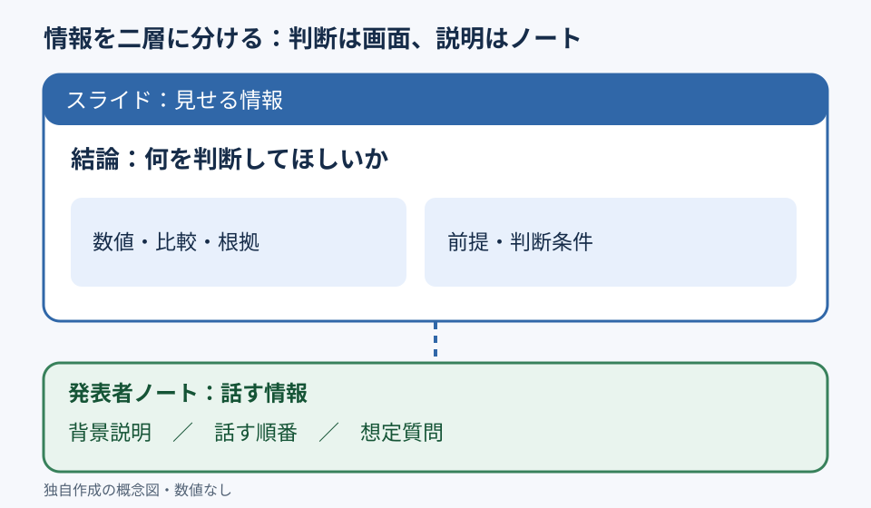

# 説明をノートへ逃がし、スライドは判断に集中させる

**2026-11-06 06:00 JST｜学習ID 2026-11-06/0600｜基礎技・今日の小さな改善｜3〜5分**
## 今日の結論

**スライドは判断に必要な情報、発表者ノートは理解を補う説明に分ける。** 文字を単純に削るのではなく、受け手がその場で比較・判断するために必要な数値や条件は画面に残す。発表者だけが使う補足や話す順番をノートへ移すと、資料の読みやすさと修正のしやすさを両立しやすい。

## 守｜情報を二層に分ける

発表者ノートとは、スライドの下部に入力する発表者向けのメモ。Microsoftの公式案内では、［表示］→［ノート］でノート領域を開ける。画面に置くべきものは結論、比較対象、重要な数値、判断条件。ノートに向くものは導入の話し方、補足説明、質問への備え。ただし、資料を単独配布するなら重要な定義や出典をノートだけに隠さない。

## Before→After｜架空の来場者調査

**Before：**「調査は来場者200人に実施し、対象は土日の来場者で、初回来場者の再来場意向は…」と調査条件も説明文も本文に詰める。**After：**画面には「初回来場者の再来場意向は検証余地がある」という暫定的な論点と、確認すべき数値欄・調査対象欄を配置。ノートには調査設計の補足と話す順番を記す。ここでの200人は架空の例であり、再来場意向の実測値は設定していない。

## 図解｜画面とノートの役割

この図は、情報を削除するのではなく、**判断に必要な情報を画面へ、発話を助ける情報をノートへ**振り分けることを示す。

## 破｜4ステップで分ける

1. まずスライドの結論を一文で書き、読者に求める判断を決める。
2. 数値、比較軸、定義、出典など、判断に不可欠な要素を画面へ残す。
3. 説明の順番、背景のエピソード、想定質問への回答をノートへ移す。
4. Windows版PowerPointの［表示］→［ノート］で入力し、スライドだけを見ても結論を誤解しないか点検する。

## 例外と別解｜配布資料は自己完結させる

発表を伴わない経営会議の事前配布資料では、ノートにしかない重要情報は読まれない可能性がある。その場合は本文に短い注釈を残し、詳細な調査方法を付録へ分離する。ノートは「情報を隠す場所」ではなく、口頭説明を設計する場所と捉える。

## 離｜質疑応答の準備も設計できる

スポーツ事業の市場規模推計では、画面に算式・前提・推計値を置き、ノートには「なぜこの採用率か」「感度分析はしたか」という想定質問を置ける。話す情報を分ける作業が、単なる装飾ではなく、論証の弱点を探すレビューにもなる。

## 失敗例｜重要な前提までノートに移す

**失敗：**採用率や対象市場の定義をノートだけに置き、画面上では市場規模だけが大きく見える。**回避：**結論を左右する前提は画面に残し、口頭補足がなくても誤読しない構造にする。

## 60秒課題｜文章を二層に仕分ける

「新サービスは導入率10%を仮定し、対象施設500件、年間単価100万円として市場規模を試算。仮定の妥当性は要検証」を、画面とノートに分けよう。**判断基準：**画面に「500件×10%×100万円＝5,000万円（仮定）」と未検証の注記を残し、ノートに検証方法や説明順を置ければ合格。数値はすべて架空。

## 参考資料・Simple English

参考：[Microsoft公式｜PowerPointの基本操作](https://support.microsoft.com/en-us/powerpoint/basic-tasks-for-creating-a-powerpoint-presentation)／[Microsoft公式｜発表者ノートとコメント](https://support.microsoft.com/en-us/accessibility/powerpoint/use-a-screen-reader-to-read-or-add-speaker-notes-and-comments-in-powerpoint)／[SlideLand｜図解・資料の公開事例](https://www.slideland.tech/)。

**Simple English: Show the decision, keep the explanation in notes.** ／ **日本語：判断材料は見せ、説明はノートに置こう。**
