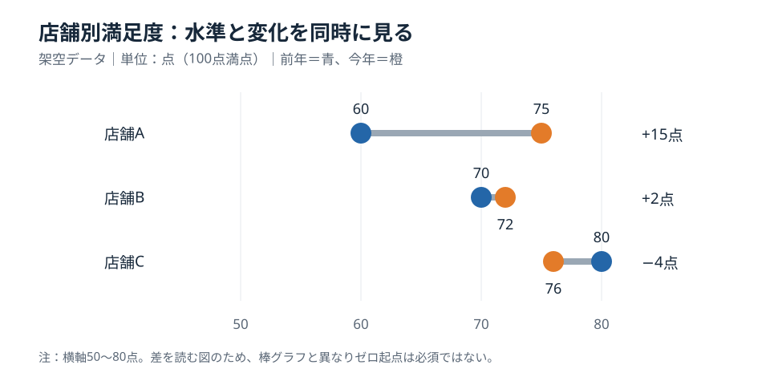

# 2時点の差はダンベル図で見せる｜水準と変化の同時比較

**2026-11-06 12:00 JST｜学習ID 2026-11-06/1200｜レイアウト・図解｜3〜5分**

## 今日の結論

**2時点の「到達水準」と「変化幅」を同時に読ませるなら、ダンベル図が有効だ。** 同じ横軸上の2点を線で結ぶだけで、前年より改善したか、どの店舗が今高いかを一緒に比較できる。2本ずつの棒を並べるより、差の方向が読み取りやすい場面がある。

## 守｜ダンベル図は何を比較するか

ダンベル図とは、同じ対象の2つの測定値を点で示し、その間を線で結ぶ図だ。線の長さは変化幅、左右の位置は絶対水準を表す。これは因果関係の図ではない。施策導入前後の差があっても、施策が原因とは限らない。複数店舗の前年・今年、男女別の指標、計画と実績など、同じ尺度で2つの値を比べる用途に向く。

## Before→After｜架空の店舗満足度

Beforeは「A：前年60・今年75、B：70・72、C：80・76」という表だけ。Afterは共通の横軸で前年を青、今年を橙にして結ぶ。**Aは+15点で最大改善、Cは−4点だが今年76点で最高水準**という、改善幅と水準の違いを1枚で伝える。

*図：2時点の位置と変化幅を同時に読む。値はすべて説明用の架空データ。横軸は50〜80点で、点の位置と差分は同じ尺度で描いた。*

## 破｜4ステップで作る

1. **問いを二つに分ける。**「今年どこが高いか」と「どこが伸びたか」。片方しか問わないなら棒グラフや差分棒の方が単純だ。
2. **対象ごとに2値を整える。** 店舗A60→75、B70→72、C80→76。単位・期間・調査方法が一致するか確認する。標本数が大きく違えば注記する。
3. **共通の尺度に配置する。** 横軸50〜80点、各店舗を1行にする。各行の点を線で結び、前年・今年の色を統一する。PowerPointでは散布図のデータ点と線、または編集可能な円・線図形で作れる。
4. **差分を直接記す。** 右側に+15、+2、−4点。重なる点のラベルは上下にずらす。複数枚で比較するなら軸範囲を統一する。

## 離｜使わない方がよい場面

**向く：** 2時点・同じ単位・複数対象の比較。**向かない：** 3時点以上の推移なら折れ線、構成比の増減なら100%積み上げ棒、ゼロからの量の比較なら棒グラフ、変化の要因分解ならウォーターフォール図が適切だ。差が小さく測定誤差が大きい場合は、点だけで結論を出さず信頼区間などを添える。

## 失敗例｜切り取った軸で変化を誇張する

横軸を70〜80点に狭めると、わずか2点の変化も大きく見える。**回避：** 軸の範囲を明記し、変化幅の数値を併記する。異なるページで軸を変えたら比較不能になるため、同じ目的の図は尺度をそろえる。

## 60秒課題｜どの図を選ぶか

架空の会員継続率が、店舗Xで80%→82%、Yで65%→77%、Zで75%→74%だった。**問い：** 最も改善した店舗と、今年最も高い店舗は同じか。**解答：** 改善幅最大はYの+12ポイント、今年最高はXの82%。2つの結論が異なるので、ダンベル図が有効だ。

## 参考資料・Simple English

参考：[SlideLand｜公開スライド事例](https://www.slideland.tech/)／[Microsoft公式｜PowerPointのグラフ作成](https://support.microsoft.com/en-us/powerpoint/training/use-charts-and-graphs-in-your-presentation)／[Microsoft公式｜データラベルの追加](https://support.microsoft.com/en-us/office/add-or-remove-data-labels-in-a-chart)。図は独自制作であり、公開作例の転載ではない。

**Simple English: Show both the level and the change.** ／ **日本語：水準と変化の両方を示そう。**