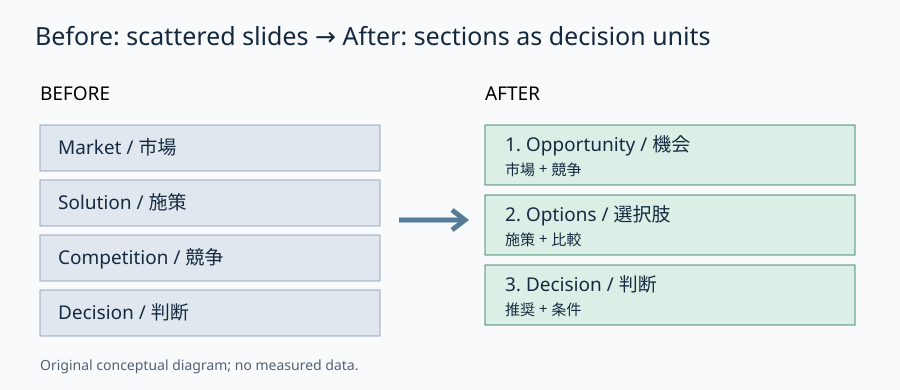

# セクションで資料を組み替える｜1枚ずつ動かさず論点ごとに修正

**2026-11-06 15:00 JST｜学習ID 2026-11-06/1500｜PowerPoint実装・時短｜3〜5分**

## 今日の結論

**スライドの順番を1枚ずつ直す前に、PowerPointの「セクション」で論点単位に束ねる。** まとまりを動かすと、全体ストーリーの修正が速くなり、担当分担も明確になる。

## 守｜セクションはスライドのフォルダー

セクションとは、複数のスライドをひとまとまりとして管理する機能だ。スライドの内容やデザインを自動で改善するものではない。構想段階では「市場」「競争」「提案」のような名詞より、「機会はあるか」「勝てるか」「何を決めるか」のような問いで区切ると、レビュー時に欠けた論点を見つけやすい。

## Before→After｜順番より先にまとまりを直す

Before：市場→施策→競争→判断の順に個別スライドが並び、施策を先に見せる理由が曖昧。After：①機会（市場・競争）→②選択肢（施策・比較）→③判断（推奨・条件）と3つのセクションに分ける。これは構成例であり、唯一の正解ではない。

## 図解｜個別スライドを意思決定単位へ

*図：スライド単位の並べ替えではなく、論点単位で束ね直すと構成を検討しやすい。独自制作の概念図であり実測データではない。*

## 破｜Windows版PowerPointで4ステップ

1. **区切りを決める。** スライド一覧で、次のまとまりの先頭となるスライドを選ぶ。
2. **セクションを追加する。**［ホーム］→［セクション］→［セクションの追加］。またはスライド間を右クリックして追加する。
3. **問いで命名する。** 例：「市場に参入余地はあるか」。セクション名横の三角形で折りたたみ、枚数と全体像を確認する。
4. **まとまりごと並べ替える。**［表示］→［スライド一覧］でセクション見出しをドラッグする。最後に各セクションの冒頭と末尾がつながるか読む。共同編集時は担当区間をセクションで分けてもよい。

例外：短い3枚の報告なら区切る手間が勝つ。単純な1枚の位置変更ならサムネイルを直接動かす方が速い。

## 離｜セクション名をレビューのチェックリストにする

セクションは整理棚にとどまらない。「市場は伸びるか」「顧客は払うか」「自社が勝てるか」の問いを見出しにすれば、各ブロックが答えを持っているか確認できる。これは資料制作だけでなく、会議のアジェンダや調査設計にも転用できる。ただしセクションは発表画面に自動表示されないので、聴衆向けの章扉が必要なら別に作る。

## 失敗例｜セクションだけきれいで結論がない

「市場分析」「競合分析」と名付けるだけでは、資料の論理は改善しない。回避策は、セクションを閉じた状態で見出しを読み、**意思決定に必要な問いの順番になっているか**確認すること。

## 60秒課題｜4枚を束ね直す

「市場規模」「推奨案」「顧客課題」「競合」の4枚がある。2〜3つの問い型セクションにまとめ、順番を変えよう。判断基準は、推奨案の前にその根拠が読めること。解答例：「需要はあるか（顧客課題・市場規模）」→「勝ち筋はあるか（競合）」→「何を選ぶか（推奨案）」。

## 参考資料・Simple English

参考：[Microsoft公式｜スライドをセクションに整理](https://support.microsoft.com/en-au/powerpoint/training/organize-your-powerpoint-slides-into-sections)／[Microsoft公式｜スクリーンリーダーでスライドを操作](https://support.microsoft.com/en-us/accessibility/powerpoint/use-a-screen-reader-to-work-with-slides-in-powerpoint)／[SlideLand｜スライド事例](https://www.slideland.tech/)。操作はMicrosoft公式のWindows向け記述に基づく。SlideLandは追加の構成参考先であり、本図の出典ではない。

**Simple English: Move the story, not just the slides.** ／ **日本語：スライドだけでなく、話の流れを動かそう。**

