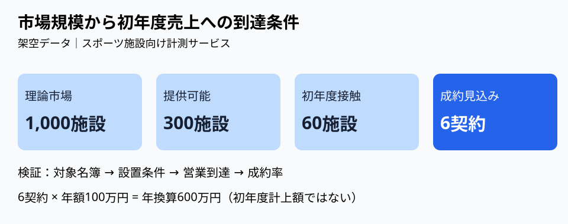

# 市場規模から初年度売上へ飛ばない｜到達可能性の三段ブリッジ

**2026-11-06 21:00 JST｜学習ID 2026-11-06/2100｜コンサル実務応用｜3〜5分**

## 今日の結論

**市場が大きいことと、初年度に売れることは別の命題だ。** TAM（理論上の総市場）から売上目標へ直行せず、「対象顧客→接触可能顧客→成約可能顧客」の順に検証する。市場推計を営業計画と混同する手戻りを減らせる。

## 守｜TAMは売上予測ではない

TAM（Total Addressable Market、総潜在市場）は、定義した製品・価格・顧客範囲における理論的な市場機会。SAM（Serviceable Available Market、提供可能市場）は事業の提供条件に合う範囲、SOM（Serviceable Obtainable Market、獲得可能市場）は競争や営業能力を踏まえた獲得見込みを指す。定義は分析目的によって揺れるため、資料では各段階の計算条件を明記する。**獲得可能市場と初年度の売上計画も同じではない。**

## 破｜4手順で市場から営業の橋を架ける

1. **単位を決める。** 仮想のスポーツ施設向け計測サービスを「施設数×年間単価」で計算する。施設と契約法人の重複を確認する。
2. **対象を絞る。** 仮に全国1,000施設のうち、技術・設置条件を満たす300施設を対象にする。これは実測値ではない。
3. **営業到達率を置く。** 300施設のうち初年度に接触できる60施設と仮置きする。到達経路、担当人数、商談期間を別途検証する。
4. **成約率を感度分析する。** 成約率10%なら6契約、年額100万円なら年換算600万円。5%なら300万円、20%なら1,200万円。実際の初年度計上額は導入時期や収益認識で変わる。

## Before→After｜市場の大きさを意思決定につなぐ

**Before：**「対象市場は1,000施設×年100万円＝10億円。初年度売上1億円を目指す」。顧客到達や契約率が抜けている。**After：**「理論市場10億円に対し、初年度の接触可能60施設を起点に成約率を検証する。仮置き10%なら年換算売上600万円」。PPTは上部に判断文、中央に絞り込み図、下部に「次の検証：施設リスト／接触率／試用後成約率」と置く。

## 図解｜三段ブリッジを同じ単位で描く

**図が示すこと：** 市場規模と営業能力の間には複数の条件がある。各数値は説明用の架空データ。面積や長さは規模を厳密に表すものではない。

## 離｜市場調査より先に営業の制約を調べる

同じ構造はスポンサー営業、自治体向けSaaS、学校写真販売にも使える。例えば販売パートナーが100社あっても、提案できる担当者や決裁期が限られれば初年度の契約数は増えない。**市場の上限を調べるだけでなく、最初の10件が成立する経路を描く**と、必要な調査が変わる。

## 失敗例｜率を掛ければ精度が上がると思う

根拠のない「到達率20%・成約率10%」を掛けるだけでは予測が精緻になったように見えるだけ。回避策は、各率に［仮説］を付け、顧客名簿、商談実績、導入期間のどの証拠で更新するかを併記すること。

## 60秒課題｜最初の6件を逆算する

年額100万円のサービスで初年度に6契約を狙う。成約率を10%と仮置きした場合、必要な商談母数は何件か。**答え：60件。** ただし商談化率が別に必要なら、さらに上流の接触件数を逆算する。判断基準は「施設数」「商談数」「契約数」を混ぜないこと。

## 参考資料・Simple English

参照：[SlideLandの事業計画スライド分類](https://www.slideland.tech/docs/material/business-plan)／[Microsoft公式：図形の整列](https://support.microsoft.com/en-us/office/graphics-visuals/align-or-arrange-objects)。図は独自作成。**Simple English: A big market is not a sales forecast.** ／ **日本語：大きな市場が、そのまま売上予測になるわけではない。**
