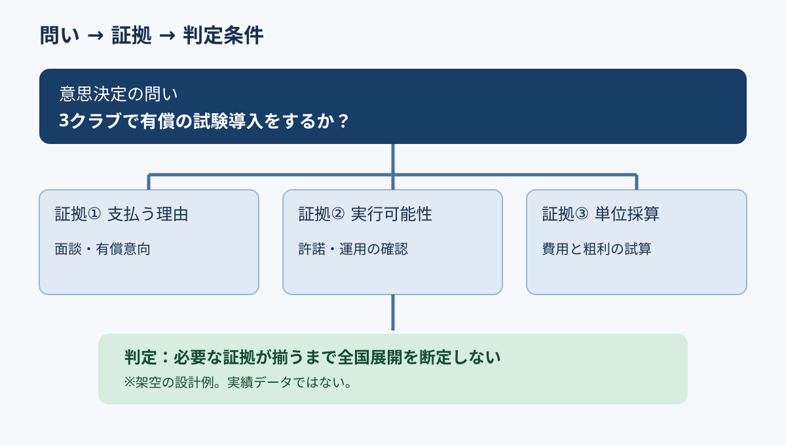

# 問いと証拠を先に契約する｜検証設計から始めるスライド構想

**2026-11-07 09:00 JST｜学習ID 2026-11-07/0900｜構想・論理｜3〜5分**

## 今日の結論

**スライドを作る前に「何を決めるか」と「何が分かれば決められるか」を対で書く。** 情報収集の迷走と、資料完成後の「それで何を判断するの？」を減らせる。

## 守｜問いと証拠の契約

「問いと証拠の契約」は、この教材で用いる作業上の呼び名。問い（意思決定の対象）と、証拠（その判断を支える観測事実）、判定条件（どの結果なら進めるか）を最初に合意する。一般的な論点ツリーは問題を分解する道具だが、分解した項目がすべて重要とは限らない。重要度は「その答えによって意思決定が変わるか」で決める。

## Before→After｜架空のスポーツ映像サービス

**Before：**「市場規模／競合／技術／収益モデル」の4枚を何となく作る。**After：**「地方クラブ向け映像分析を3クラブで試験導入するか？」を問いとし、①顧客が支払う理由、②許諾・運用の実行可能性、③1クラブ当たりの貢献利益、の3証拠を配置する。どれかが不足すれば全国展開の結論には進まない。数値を伴わない架空の設計例である。

## 破｜4ステップで作る

1. **決定動詞を入れる。**「調べる」ではなく「試験導入するか／見送るか」と書く。
2. **反転条件を考える。**どの事実が出れば推奨が変わるかを1〜3個挙げる。
3. **観測方法を指定する。**顧客面談、試用継続率、許諾確認、原価試算など、証拠の取得先を添える。
4. **スライドの見出しを仮置きする。**「顧客課題が有料導入につながるか」「許諾と運用は再現できるか」「単位採算は成立するか」。まだ答えがなければ疑問形のままにする。例外：危機対応など即断が必要なら、取得できない証拠を明示し、暫定判断と見直し時点を置く。

## 離｜証拠を選ぶことは、調べないことを決めること

採用計画なら「人員増が本当にボトルネックを解消するか」、地域イベントなら「来場者の増分価値が運営負荷を上回るか」が契約になる。市場規模が大きくても、導入許諾が得られなければ試験導入は止まる。資料の順番は情報の網羅性ではなく、意思決定への影響で決める。

## 失敗例｜調べやすい情報を証拠と取り違える

**失敗：**公開統計だけで市場の大きさを説明し、実際に支払う顧客がいるかを確かめない。**回避：**各証拠の横に「これが否定されたら結論は変わるか？」と書き、変わらない項目は補足へ移す。

## 60秒課題｜一枚目を描く前に

「スポーツ施設向け新サービスを発売する」というテーマを、決定動詞を含む問いに書き換え、判断を変える証拠を二つ挙げる。**解答例：**「まず2施設で有償実証するか？」／証拠＝施設の支払意思と、運営負荷を含む採算。**判断基準：**証拠が否定されたとき、実施・延期・中止の選択が変わること。

## 参考資料・Simple English

参考：[McKinsey｜問題を分解する論点ツリー](https://www.mckinsey.com/careers/life-at-mckinsey/our-culture-and-communities/mckinsey-women-blog/problem-solving-is-for-everyday-life-too)／[SlideLand｜図解と構成の3層](https://www.slideland.tech/docs/books/01)／[SlideLand｜資料のページ分類](https://www.slideland.tech/docs/category-list)。これらは考え方の参考であり、「問いと証拠の契約」という名称の出典ではない。

**Simple English: Decide what evidence would change your mind.** ／ **日本語：考えを変える証拠を先に決めよう。**
