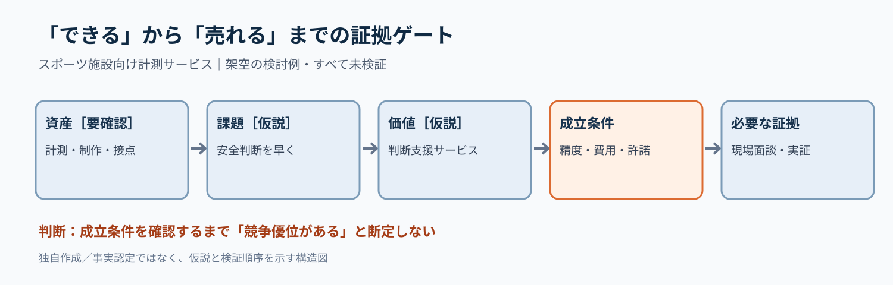

# 新規事業の『強み』を検証可能な参入条件へ変える｜ボトルネック証拠ゲート

**2026-11-07 21:00 JST｜学習ID 2026-11-07/2100｜コンサル実務応用｜3〜5分**

## 今日の結論

**保有資産の列挙は、競争優位の証明ではない。** スポーツ向け新規事業を提案するときは「資産→顧客課題→提供価値→成立条件→証拠」の順に並べる。強みを言い切る前に、投資判断を左右する未検証の条件を見つけられる。

## 守｜能力と優位を分ける

ケイパビリティ（capability）は組織が実行できる能力、競争優位は顧客に選ばれ、競合より有利に価値を届けられる状態を指す。撮影技術、計測技術、スポーツ団体との接点が存在しても、顧客が追加料金を払うかは別問題。今回の企業・事業の組み合わせは**検討用の仮説**であり、実際の保有資産や優位性を認定するものではない。

## 破｜5手順で証拠ゲートを作る

1. **意思決定を固定する。** 問いを「スポーツ施設向け計測サービスの実証に進むか」と書く。
2. **資産を事実と仮説に仕分ける。** 技術保有、顧客接点、運用能力について確認済み資料がないものは［要確認］にする。
3. **顧客の仕事を置く。** 例：施設運営者が「安全管理の判断を早くしたい」。ヒアリング前は［課題仮説］と明示する。
4. **成立条件を絞る。** 精度、設置費、導入許諾、支払意思のうち、崩れると事業が成立しない条件を選ぶ。
5. **証拠と次の行動を結ぶ。** 実証計画には「誰に・何を・何件確かめるか」を置き、通過基準を事前合意する。

## Before→After｜資産紹介を投資判断に変える

**Before：**「計測技術×映像制作×スポーツ団体との接点を生かし、新規事業を展開」。顧客課題も競合との差も未確認。**After：**「施設の安全判断を支援するサービスは、現場課題・精度・支払意思の3条件が確認できれば実証候補となる［仮説］」。スライド上部にこの判断文、中央に5列の因果連鎖、下部に最優先の検証事項を置く。

## 図解｜強みから証拠までを一方向につなぐ

**図が示すこと：** 「できること」と「売れること」の間には複数の検証が必要。すべて架空の検討例であり、実在企業の実績や性能を示さない。

## 離｜最も弱い条件から調査を始める

技術の優秀さを説明するほど、顧客の支払意思や導入権限が後回しになりやすい。医療機器、教育SaaS、スポンサー商品でも、強い資産を足し算する前に**一つ欠けるだけで止まる条件**を探す。これは制約条件から設計する考え方で、調査順序そのものを変える。

## 失敗例｜証拠のない優位を色で確定させる

「競合が追随できない」を緑の確定ラベルで表示すると、視覚が根拠以上の確信を生む。回避策は［事実］［仮説］［未検証］のラベルを付け、競合比較・顧客ヒアリング・実証結果を別々に記録すること。

## 60秒課題｜最初の検証を一つ選ぶ

仮想案件で「技術精度は高いが、施設が予算を持つか不明」と聞いた。次に作るべき資料は技術紹介か、予算保有者の確認表か。**答え：予算保有者の確認表。** 判断基準は「その不確実性が残ると、次の投資判断を誤るか」。精度も未検証なら並行して確認する。

## 参考資料・Simple English

参照：[SlideLand：市場環境スライドの分類](https://www.slideland.tech/docs/page/market)／[Strategyzer：ビジネスモデル・キャンバス](https://www.strategyzer.com/library/the-business-model-canvas)／[Strategyzer：顧客価値の設計](https://www.strategyzer.com/library/the-value-proposition-canvas)。**Simple English: An asset is not proof of advantage.** ／ **日本語：資産があるだけでは、優位性の証拠にならない。**
