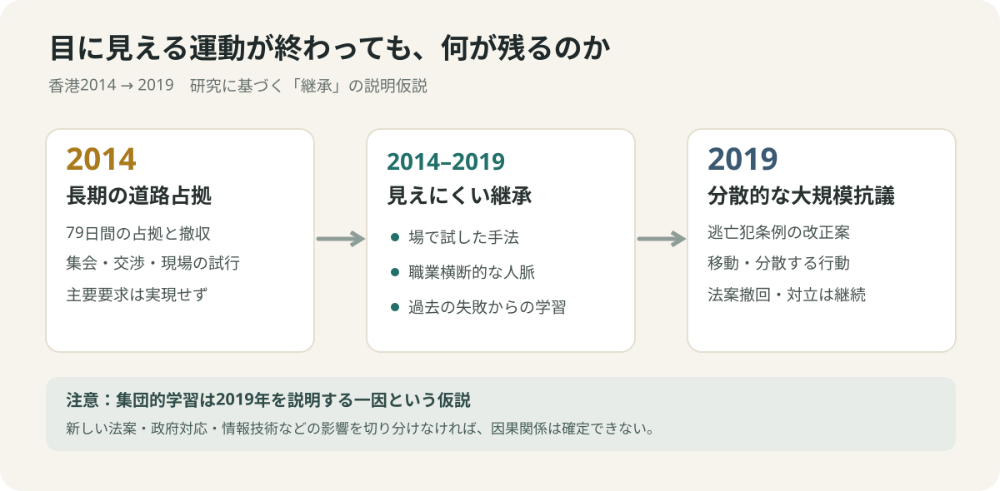

# 街を占拠した79日間は、どこに保存されたのか

*香港の2014年雨傘運動と2019年デモから考える、解散後も残る集団の記憶*

デモが終わったら、デモはどこに保存されるのだろう。集会なら解散する。道路に立てたテントは撤去できる。横断幕は丸められる。しかし、参加した人が覚えた道順、知らない相手と協力した感覚、警察に遭遇したときの判断まで、ゴミ収集車に積み込めるわけではない。2014年の香港では、民主的な選挙制度を求める抗議者たちが79日間にわたって幹線道路などを占拠し、主要な要求を実現しないまま撤収した。5年後の2019年、香港では別の法案をきっかけに、さらに大規模で、動き方の違う抗議活動が起きた。そこで気になった。**政治的には実現できなかった運動が、組織として何かを残すことはあるのか。** これは勝利を後付けする話ではない。終わった出来事のうち、次の出来事に持ち越されるものを見分ける話である。

## 守｜2014年の争点は、投票する権利だけではなかった

背景には、1997年に英国から中国へ返還された香港の「一国二制度」がある。香港は中国の特別行政区だが、基本法によって独自の制度と高度な自治を認められた。基本法45条は、行政長官を、民主的手続きに従う指名委員会の候補者指名を経た普通選挙で選ぶことを最終目標に掲げている。争われたのは、**有権者が投票できても、候補者の選び方を誰が決めるのか**という問題だった。[香港基本法第45条](https://www.basiclaw.gov.hk/en/basiclaw/chapter4.html/1000)。

2014年8月31日、中国の全国人民代表大会常務委員会は、2017年の行政長官選挙について、候補者を2、3人に限定し、それぞれが指名委員会の過半数の支持を得る仕組みを決めた。中国側は普通選挙への前進と説明し、民主派は候補者が事前に絞り込まれる選挙では実質的な選択ができないと反発した。この違いを無視して、どちらかが「選挙に反対した」と書くのは不正確だ。[香港政府による2014年決定の説明](https://www.cmab.gov.hk/en/press/press_3481.htm)／[米議会調査局による制度の整理](https://www.everycrsreport.com/reports/R44031.html)。

9月28日には警察の催涙ガスや唐辛子成分を含む噴霧剤から身を守るため、人々が傘を使った。傘が運動の名前になったのは、まず具体的な用途があったからだ。「雨傘運動」は同年12月15日まで79日間続いた。傘は宣伝会社が企画したロゴではなく、現場で使われた生活用品だった。[米議会調査局・2014年11月の現地情勢](https://www.everycrsreport.com/reports/IF10005.html)／[政治学者ヴィクトリア・ホイによる分析](https://www.journalofdemocracy.org/articles/hong-kongs-umbrella-movement-the-protests-and-beyond/)。

*写真：2014年11月14日、金鐘（アドミラルティ）の占拠現場。撮影：あばさー。写真の権利者がパブリックドメインとして公開。[原画像・利用条件](https://commons.wikimedia.org/wiki/File:Umbrella_Movement_at_Admiralty_on_14_November_2014_04.JPG)。*

この写真をよく見ると、写っているのは「抗議する人々」だけではない。テント、掲示、通路、物の置き方まで含めた、長く滞在するための場所である。大勢で何日も同じ場所にいるとは、演説を繰り返すだけでなく、日常の手順をつくることでもある。ただし、写真一枚でその手順が2019年へ継承されたと証明することはできない。

## 守｜2019年には、別の法律から同じ社会の不信が噴き出した

2019年の発端は選挙制度ではない。台湾で起きた殺人事件を背景に、香港政府は犯罪人を引き渡す制度の抜け穴を埋めるとして、逃亡犯条例などの改正を提案した。政府の説明では、協定のない地域とも個別に引き渡しを行えるようにする必要があった。一方、提案の対象には中国本土も含まれ得たため、反対派は香港の司法制度と自由が脅かされると懸念した。[香港保安局・2019年2月の説明](https://www.sb.gov.hk/eng/articles/articles_2019_02_28.html)。

6月には大規模なデモが続き、警察との衝突や、抗議者による破壊行為も起きた。6月16日の参加者数は主催者と警察で大きく異なり、数値を一つに決めて記すのは適切ではない。政府は6月15日に法案の審議を停止し、9月4日に撤回方針を表明、10月23日に正式撤回した。ところが抗議は終息しなかった。法案だけでなく、警察対応の検証や政治制度の改革などが要求に加わっていたからだ。[香港政府による撤回表明](https://www.info.gov.hk/gia/general/201909/04/P2019090400704.htm)／[撤回日を確認できる政府声明](https://www.info.gov.hk/gia/general/201910/31/P2019103100909.htm)。

*写真：2019年6月16日の抗議活動。撮影：ボイス・オブ・アメリカ（Voice of America）。米国のパブリックドメイン作品として公開。[原画像・利用条件](https://commons.wikimedia.org/wiki/File:Voa_hong_kong_protest_16june2019.jpg)。*

2014年の主な方法は、特定の場所を長く占拠することだった。2019年には、場所を移しながら行動する方法や、特定の指導者に決定を集中させない方法が目立った。もちろん2014年も2019年も内部は一枚岩ではなく、2019年の参加者全員が同じ戦術に賛成したわけでもない。[台湾大学・何明修による比較研究](https://www.harvard-yenching.org/research/how-protesters-evolve-hong-kongs-anti-extradition-movement-learned-the-lesson-of-the-umbrella-movement/)。

## 破｜本部が消えたあとも、運動の手順は残り得る

ここで調べすぎるくらい調べたいのは、2014年と2019年の「違い」だけでなく、その間の5年間で何が保存されていたかだ。公表された研究を突き合わせると、少なくとも三つの保存先が仮説として浮かぶ。第一に、**場の記憶**。2014年の占拠地では、人が集まり、試し、衝突し、調整する経験が蓄積された。第二に、**人のつながり**。占拠が終わっても、その後に生まれた団体や職業を横断する関係が消えたとは限らない。第三に、**失敗についての判断**。固定した拠点や目立つ指導者に依存しすぎないほうがよい、という学習があったかもしれない。

実際に、社会学者の何明修（ホー・ミンショー）は2020年の研究で、2014年の占拠地が戦術を試す場となり、その後の団体が職業横断的なつながりを維持し、分散的な意思決定へ向かう学習が生じたと論じている。さらに2022年の香港浸会大学などの研究は、2014年以降に表立たなくなった市民社会の関係が、2019年の危機の際に動員の基盤として再び機能し、デジタルでの連絡や相互扶助と結びついたと分析した。[何明修・2020年](https://www.harvard-yenching.org/research/how-protesters-evolve-hong-kongs-anti-extradition-movement-learned-the-lesson-of-the-umbrella-movement/)／[鄭煒ら・2022年](https://scholars.hkbu.edu.hk/en/publications/total-mobilization-from-below-hong-kongs-freedom-summer/)。

*独自作図：2014年から2019年への「つながり」を検討するための整理。2014年の経験が2019年の発生原因を単独で説明する、という図ではない。*

少し妙なのは、目に見える「組織」がなくなることと、集団を動かす「能力」がなくなることは同じではない点だ。組織図に名前のない人どうしでも、どこで連絡すればよいか、どんな行動には賛成しないか、危険をどう判断するかといった知識は持ち得る。**解散とは、関係がゼロになることではなく、関係の見え方が変わることなのかもしれない。**

## 破｜もっともらしい説明に、わざと別の説明をぶつける

観測された出来事を説明する仮説を立てる推論を、アブダクション（最も筋の通る説明を探す仮説的推論）という。仮説を発見することと、その正しさを検証することは違う。[スタンフォード哲学百科事典・アブダクション](https://plato.stanford.edu/entries/abduction/)。ただし、ここで「2014年の敗北が2019年の大規模化を生んだ」と書くと、因果関係を急ぎすぎる。2019年には新しい引き渡し法案があり、警察と抗議者の衝突があり、デジタル通信環境も2014年とは異なっていた。研究が示す集団的学習は有力な説明だが、唯一の原因とまでは言えない。政府側も抗議の一部で発生した暴力と公共施設の損壊を問題視した一方、抗議者側には警察対応を問題視する声があった。どちらの言い分も、個々の出来事の検証を省く免罪符にはならない。[香港政府・2019年の声明](https://www.info.gov.hk/gia/general/201910/31/P2019103100909.htm)／[2019年の抗議戦術を検討した学術研究](https://www.cambridge.org/core/journals/china-quarterly/article/evolution-of-protest-repertoires-in-hong-kong-violent-tactics-in-the-antiextradition-bill-protests-in-2019/E59AC952FD5D818DB65F8043D4824A5F)。

そこで、記事の推論を「空・雨・傘」で監査してみる。**空は観測された事実**。2014年に79日間の占拠があり、2019年に別の争点から大規模抗議が起き、研究者が両者の間の学習と関係の継続を分析した。**雨は、その事実を説明する仮説**。参加経験の蓄積は2019年の組織形態を説明する一因かもしれない。ただし新たな政治的脅威、技術、現場の衝突でも説明できる部分がある。**傘は、次に取る検証行動**。当時の行動記録、2014年以降の団体活動、匿名化された参加者調査、2019年の行動選択に関する証言を、時系列で突き合わせる。追跡が当事者の安全を損ね得る以上、個人を特定する調査を安易に提案すべきではない。

この枠組みで一次資料と研究要旨を実際に照合すると、面白いずれが出る。政府資料で確かめやすいのは、候補者指名制度や法案撤回日といった制度上の出来事だ。一方、2014年の経験が2019年にどの程度役立ったかは、個々の人の経験や関係を調べなければ測れない。**公文書に「終わり」と書けるものと、人々の中で終わっていないものは、そもそも観測方法が違う。** これは検証可能性の違いであって、後者を無条件に美化する理由ではない。

## 離｜会議が解散したあと、組織は何を覚えているか

この問題を、政治と無関係に見える会社の会議へ持ち込んでみる。新サービスの提案が却下され、会議が終わる。議事録には「見送り」と残る。それを一年後に読むと、何も進まなかったように見える。しかし、その場にいた人が、誰なら数字の違和感を見抜けるか、どんな実験なら協力を得られるか、何を話すと対立が深まるかを覚えていれば、次の提案を組み立てる条件は変わる。これは香港デモに関する実証結果ではなく、組織の記憶を考えるための**思考実験**である。

さらに厄介なのは、過去の経験が役立つだけとは限らないことだ。一度うまくいかなかった手法を過剰に忌避したり、以前の対立に引きずられて新しい選択肢を狭めたりする可能性もある。2019年の戦術には柔軟さがあった一方、意思決定の統一や過激化の抑制が難しくなる面も論じられている。[抗議戦術の変化に関する研究](https://www.cambridge.org/core/journals/china-quarterly/article/evolution-of-protest-repertoires-in-hong-kong-violent-tactics-in-the-antiextradition-bill-protests-in-2019/E59AC952FD5D818DB65F8043D4824A5F)。記憶が残ることは、望ましい判断が保証されることではない。

ここから抽出できる原理は、**組織の存続と、組織が生んだ知識の存続は別々に測らなければならない**ということだ。会議数、会員数、活動日数を数えるだけでは、実際に残った判断の仕方が見えない。業務で確かめるなら、前回失敗した理由の記録だけでなく、次回に何を変えたか、誰と協力できるようになったか、過去の学びが誤りだった場合にどう修正するかまで追う必要がある。

## 離｜その記憶を「勝利」と呼ばないために

ここには倫理的な境界がある。2014年の運動が2019年の行動の一部を支えたとしても、それをもって2014年が「実は成功だった」と言い換えてはいけない。2019年も法案撤回という変化はあったが、参加者の要求がすべて実現したわけではない。衝突や逮捕、社会の分断を、後から語りやすい成長物語の材料にしてはならない。2020年には香港国家安全維持法が施行され、2024年3月には基本法23条に基づく香港国家安全条例が施行された。香港政府は社会の安定と国家安全保障の観点から必要性を説明している。現在の政治環境を、2019年当時と同じものとして語ることもできない。[香港保安局・国家安全条例の解説](https://www.sb.gov.hk/eng/bl23/faq.html)。

研究が言えるのは、2014年の運動の後に何も残らなかったわけではない、という限定されたことだ。誰にとって、どの変化が望ましかったかという評価は別に必要になる。とくに香港人の意見や経験を一つにまとめないことは大切だ。参加者、反対者、傍観者、家族の中で異なる意見を持った人、それぞれに異なる記憶がある。ここに一つの代表的な感情を捏造することはできない。

## 解散した街を、もう一度見る

冒頭の疑問に戻ろう。デモが終わったら、どこに保存されるのか。テントを片付ければ、道路は元の用途に戻る。しかし、参加者がその場所で経験した選択と関係を、同じ速度で撤去することはできない。その経験が次の運動にどれほど影響したかは、慎重に調べなければならない。それでも2014年と2019年の香港を続けて見ると、街の使われ方と、そこで蓄積される知識を切り離して考えにくくなる。

翌朝の交差点は、いつもどおり人が信号を待ち、車が流れているだろう。何も起こっていないように見える。その景色の中に、誰かが覚えた連絡先、警戒心、助けられた経験、以前は思いつかなかった手順が残っているかもしれない。**都市に記憶装置があるとすれば、それは必ずしも記念碑や記録館ではない。人が次にどう動くかという、まだ目に見えない選択肢の中にもある。**

## 調査と出典｜確認できたこと、まだ言えないこと

**確認した事実**：香港基本法45条、2014年の候補者指名制度、79日間の雨傘運動、2019年の法案提案と正式撤回、2024年の国家安全条例。**研究に基づく解釈**：2014年の占拠地での試行、占拠後の人脈、失敗からの学習が2019年の動員の一部を支えたという説明。**独自の推論**：集団の記憶を「場・関係・判断」に分け、会議の解散後にも残る知識へ接続した点。**未実施の検証**：個人の追跡調査、当事者への独自取材、2014年の経験が2019年に与えた寄与の定量的推定。**注記**：比較図は研究の要点を編集上再構成したもので、歴史を単一の因果で示すものではない。

主な資料：[香港基本法45条](https://www.basiclaw.gov.hk/en/basiclaw/chapter4.html/1000)／[香港政府・2014年の決定](https://www.cmab.gov.hk/en/press/press_3481.htm)／[米議会調査局・2014年雨傘運動](https://www.everycrsreport.com/reports/IF10005.html)／[香港保安局・2019年改正案](https://www.sb.gov.hk/eng/articles/articles_2019_02_28.html)／[香港政府・2019年撤回発表](https://www.info.gov.hk/gia/general/201909/04/P2019090400704.htm)／[何明修・2020年比較研究](https://www.harvard-yenching.org/research/how-protesters-evolve-hong-kongs-anti-extradition-movement-learned-the-lesson-of-the-umbrella-movement/)／[鄭煒ら・2022年動員研究](https://scholars.hkbu.edu.hk/en/publications/total-mobilization-from-below-hong-kongs-freedom-summer/)／[ケンブリッジ大学出版局・抗議戦術の研究](https://www.cambridge.org/core/journals/china-quarterly/article/evolution-of-protest-repertoires-in-hong-kong-violent-tactics-in-the-antiextradition-bill-protests-in-2019/E59AC952FD5D818DB65F8043D4824A5F)。
