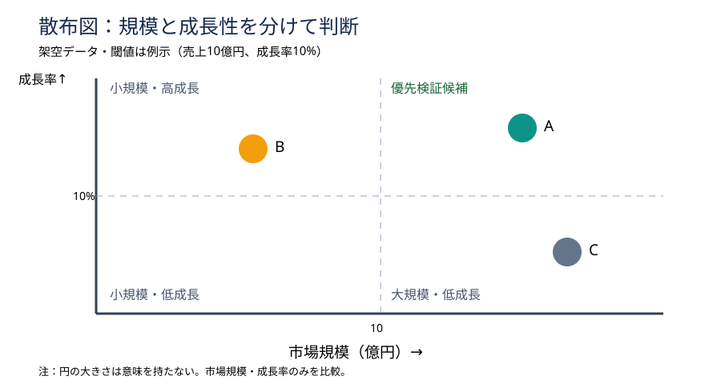

# 散布図の閾値を先に決め、投資候補を誤読させない

## 今日の結論

散布図は「二つの数値の関係」を一画面で比較する図。重要なのは点の配置だけでなく、縦横の軸と判断の閾値を先に定義することだ。市場規模と成長率を混ぜたランキングより、優先検証すべき市場と追加調査が必要な市場を区別しやすい。

## 守：原理と使いどころ

散布図は各対象を二つの連続量の座標に置く。四象限とは、縦横の基準線で領域を四つに分けたもの。ただし四象限の境界は自然法則ではない。経営判断では「平均値」「採算ライン」「戦略上の最低条件」のどれを基準にしたかを明記する。二つの指標が独立した意味を持ち、複数対象を同時に比べるときに向く。時系列の推移には折れ線、厳密な順位比較には棒グラフが適する。

## 破：制作手順と別解

1. 最初に意思決定を書く。「次に深掘りする市場はどれか」。
2. 横軸を市場規模（億円）、縦軸を市場成長率（%）に設定し、調査年と定義をそろえる。
3. 閾値の理由を決める。今回は説明用に規模10億円、成長率10%とする。実案件では投資条件などから再設定する。
4. 点を置き、対象名を直接表示する。重なればラベル位置を調整し、凡例だけに頼らない。
5. 右上を「優先検証候補」として強調する。ただし収益性・参入障壁・自社適合性は別途検証する。閾値が恣意的なら四象限を外し、散布図だけで分布を見せる。

## 図解：架空市場の優先検証

この図は、規模と成長性を混同せずに候補を比較するための配置例。A・B・Cの数値と閾値はすべて架空であり、点の大きさに意味はない。

## Before→After

Before：「市場Aは成長性が高い。Bも有望。Cは規模が大きい」と文章で列挙する。これでは比較軸が曖昧で、なぜAを選ぶのか説明しづらい。

After：タイトルを「規模と成長性の両面からAを優先検証する」とし、中央に散布図、右下に「次の検証：利益率・顧客獲得費用・参入障壁」を置く。現時点では投資決定ではなく調査優先順位の仮説と明示する。

## 離：異分野への転用

スポンサー候補なら横軸を契約単価、縦軸を継続率に変える。営業活動なら案件金額と受注確度。ただし受注確度は主観推定になりやすく、根拠の品質を点の色や注記で区別する発想が重要。三つ目の変数を円の面積に割り当てるバブル図は便利だが、面積の知覚誤差が増えるため必要な場合だけ使う。

## 失敗例と回避

失敗は「中央値で切っただけなのに、右上を絶対的な勝者と呼ぶ」こと。中央値は対象集団が変われば動く。閾値の出所と意思決定上の意味を脚注に残し、結論は「優先検証候補」と限定する。

## 60秒課題

候補X：規模20億円・成長率3%、候補Y：規模8億円・成長率18%。どちらを優先するか。答えは目的次第。短期売上を重視するならX、高成長市場の探索ならYが候補。ただし利益率・競争状況・自社適合性がないため投資判断は保留する。

## 参考資料

Slidelandの散布図カテゴリ：https://www.slideland.tech/docs/graph/scatter

Slidelandの図解分類：https://www.slideland.tech/docs/category-list

## Simple English

**Choose the axes before the layout.**／レイアウトを決める前に、比較軸を決めよう。
