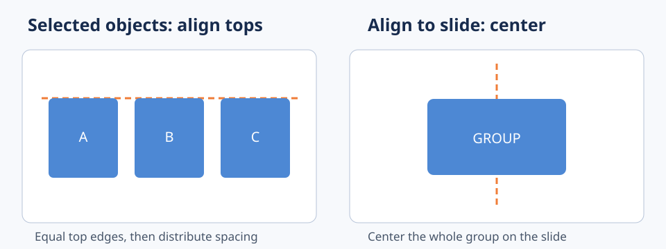

# 整列の基準を切り替え、図形の位置ずれを一括修正する

**2026-11-08 15:00 JST｜学習ID 2026-11-08/1500｜PowerPoint実装・時短｜3〜5分**

## 今日の結論

PowerPointで図形を整列するとき、**選択した図形同士をそろえるのか、スライド全体に対してそろえるのか**を先に決める。基準の取り違えによる手戻りを防ぎ、3つ以上のカードを一括で配置できる。

## 守｜整列には2種類の基準がある

［選択したオブジェクトに合わせる］は選択範囲内で位置をそろえる。［スライドに合わせる］はスライド全体の位置を基準にする。前者は比較カード同士の整列、後者は表題や図全体の中央配置に向く。Microsoft公式は［図形の書式］→［配置］→［整列］から基準と方向を選ぶ方法を案内している。

## Before→After｜3つの施策カード

Before：施策A・B・Cの上端がずれ、手で1枚ずつドラッグして調整。After：3枚を選択し、［選択したオブジェクトに合わせる］→［上揃え］を実行。カードの上端を一括で統一する。さらに［左右に整列］で間隔を均等化する。

## 図解｜基準を間違えると何が起きるか

*図：左はカード間の上端揃え、右はスライド全体を基準とする中央揃え。操作画面ではなく概念図。*

## 破｜4ステップで実装

1. **目的を決める。** カード同士の位置調整か、スライド中央への配置かを分ける。
2. **複数選択する。** Windows版PowerPointでShiftを押しながら対象図形を選択する。
3. **整列基準を指定する。** ［図形の書式］→［配置］→［整列］で［選択したオブジェクトに合わせる］を選び、［上揃え］を実行する。全体中央なら［スライドに合わせる］→［左右中央揃え］を選ぶ。
4. **間隔を確認する。** 3枚以上なら［左右に整列］を使う。左右端の図形が意図した位置にあることを先に確かめる。

## 離｜整列はデザインより情報の比較可能性

営業施策3案を比較する場合、カードの上端・幅・間隔がそろうと、読者は位置の違いではなく内容の違いに集中できる。ただし重要案だけ大きく見せる意図があるなら、機械的な均等化は逆効果。整列は意味の等価性を確認してから使う。

## 失敗例｜全カードがスライド中央に重なる

3枚のカードを個別に中央へ寄せたいわけではないのに、［スライドに合わせる］で左右中央揃えを使うと、横方向の位置が同じになって重なる。**回避：複数のカードを並べたいときは、まず選択範囲基準を確認する。**

## 60秒課題｜比較カードの整列

横に並んだ3つの四角形を少し上下にずらし、3つを選択して上端をそろえる。次に間隔を均等にする。**合格基準：上端が一直線、左右の端点が保持され、3枚が重ならない。**

## 参考資料・Simple English

参考：[Microsoft公式｜図形の整列](https://support.microsoft.com/en-us/office/graphics-visuals/align-or-arrange-objects)／[Microsoft公式｜ガイドと整列](https://support.microsoft.com/en-us/powerpoint/training/guides-for-arranging-things-on-a-slide)／[SlideLand](https://www.slideland.tech/)。本図は独自制作。

**Simple English: Choose the reference before you align.** ／ **日本語：整列する前に、何を基準にするか決めよう。**
